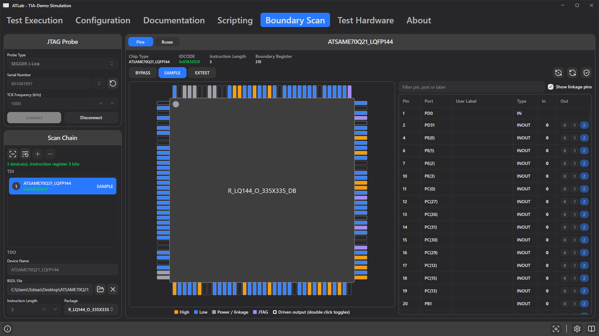

# ATLab - Automated Testing Framework


ATLab is a cross‑platform automated testing framework for interfacing with hardware through the [Test Interface Adapter](https://github.com/TobiasNetzer/TestInterfaceAdapter) and controlling external test instruments through remote control interfaces.
Built with **Avalonia UI** and **.NET**, it offers a modern environment for developing and running automated test sequences.

An example project developed with ATLab can be found [here](https://github.com/TobiasNetzer/ATLab-Examples).

## 📖 User Guide

A complete user guide covering installation, project setup, scripting, building and running test sequences, reports and troubleshooting is available in English and German:

- **English:** [docs/user-guide/en](docs/user-guide/en/README.md)
- **Deutsch:** [docs/user-guide/de](docs/user-guide/de/README.md)

The guide is also shipped as a PDF with every release package (in the `docs` folder next to the program) and can be opened from within ATLab with the book button in the status bar or `F1`.

## Features

**Test sequences** · [Building Test Sequences](docs/user-guide/en/08-building-test-sequences.md)

-   Organize a sequence into **modules** (e.g. power supply, programming, LED test) that can be enabled individually or run on their own.
-   Each step routes the relay matrix and stimulation channels, waits for an optional delay and acquires a value that is checked against **limits with units and SI prefixes**.
-   **Pass/Fail actions**: continue, repeat the step, jump to another step, end the test or show a message to the operator.
-   **Variables and expressions**: runtime and system variables (serial number, user, date…), encoding blocks for binary data and arithmetic expressions in commands and limits.
-   **Response processing**: cut values out of text or binary answers with skip/length, match rules and numeric extraction.

Where a step's value comes from ([Evaluation Sources](docs/user-guide/en/09-evaluation-sources.md)):

| Source | Value |
|--------|-------|
| **Script** / **Device Command** | Answer of an external instrument or DUT |
| **Interface Command** | Data read from the DUT through the adapter's I²C or UART interface |
| **External Program** | Exit code or output of a local program |
| **User Confirmation** / **User Input** | The operator's pass/fail judgement or an entered value |
| **Expression** | A calculation from runtime variables |
| **File** | A number read from a file |
| **Boundary Scan** / **Boundary Scan Bus** | Pin levels, or I²C/SPI data accessed through boundary scan pins |

**Instruments and scripting** · [Configuration](docs/user-guide/en/06-configuration.md) · [Scripting](docs/user-guide/en/07-scripting.md)

-   Remote-control instruments and DUTs over **Serial Port (VCOM/RS232)**, **TCP/IP (raw socket)** and **VISA** (NI-VISA, Windows only).
-   **Device Manager** for all instruments of a project; their identification can be listed in the test report.
-   **Scripts**: reusable multi-command scripts with variables (e.g. `{Range}`), stored in a script folder shared across projects.
-   **Response checks**: every command of a script can check its answer with its own mask and limits, e.g. that an instrument reports no error.
-   **Script Runner**: run a script directly on an instrument and see every response and check result while writing it.

**Test Interface Adapter** · [Test Hardware](docs/user-guide/en/04-test-hardware.md)

-   Relay matrix to route signals to instruments, stimulation and external stimulation channels, and isolated I²C/UART interfaces to the DUT.
-   Built-in relay matrix self-test and an external probe to find the matrix channel of a net.

**Boundary scan** · [Boundary Scan Tab](docs/user-guide/en/12-boundary-scan.md)

-   Read and drive pins of JTAG chips through a **SEGGER J-Link** or **FTDI MPSSE** probe, based on the chips' BSDL files.
-   Detect the scan chain, view pins on a package drawing, and talk to I²C/SPI devices or pin groups through boundary scan pins.

**Running tests** · [Running Tests](docs/user-guide/en/14-running-tests.md)

-   Run the full sequence, continuously, from a selected step, a single module or a single step; **debug mode** steps through a run.
-   **Development mode** for editing and an operator view for production, optionally protected by a password.
-   **Serial number entry** with validation rules (barcode scanners supported), operator dialogs with images, and an optional USB **control module** with start/stop buttons.
-   **Simulator**: build and try sequences without the test hardware.

**Results and documentation** · [Test Results & Reports](docs/user-guide/en/15-results-and-reports.md) · [Documentation Tab](docs/user-guide/en/13-documentation-tab.md)

-   Automatic **CSV** data files, **PDF** test reports and **JSON** result files with run metadata, including the used test equipment.
-   Project documentation with notes, images, attachments and information about the device under test.

**Application**

-   Runs on **Windows and Linux**.
-   Projects and scripts are plain **JSON** files, well suited for version control.
-   **English and German**, **light and dark theme**, set in the settings dialog.
-   The user guide is built in: press `F1` to open it.


## Installation

Download the latest version from the [releases page](https://github.com/TobiasNetzer/ATLab/releases):

| Asset | Platform | Notes |
|-------|----------|-------|
| `ATLab-setup-<version>.exe` | Windows (64-bit) | Installer with Start-menu entry and `.atlab` file association |
| `ATLab-win-<version>.zip` | Windows | Portable build, no installation |
| `ATLab-linux-<version>.tar.gz` | Linux | Portable build |

*Optional:* NI-VISA runtime for VISA-based instruments (**currently Windows only**).

See the [Installation chapter](docs/user-guide/en/02-installation.md) for details, including Linux serial port permissions.

## Building from Source

Prerequisite: **.NET 10.0 SDK** (or newer).

```bash
git clone https://github.com/TobiasNetzer/ATLab.git
cd ATLab
dotnet restore
dotnet build -c Release
dotnet run --project ATLab.csproj
```

Alternatively, open `ATLab.sln` in **JetBrains Rider**, **Visual Studio 2022**, or **VS Code** (with C# Dev Kit).

To build the user guide PDFs yourself:

```bash
pip install -r scripts/requirements-docs.txt
python -m playwright install chromium
python scripts/build_user_guide_pdf.py --lang en   # or --lang de
```

## Overview

### Configuration
Add and configure external test instruments (Serial, TCP/IP, VISA), project settings, custom channel names and runtime variables.
→ [Configuration Tab](docs/user-guide/en/06-configuration.md)


### Scripting
Create reusable multi-command instrument scripts with variables (e.g. `{Range}`), stored in a script folder shared across projects. Commands can check their responses with their own mask and limits, and the Script Runner next to the editor runs a script on an instrument to test it.
→ [Scripting Tab](docs/user-guide/en/07-scripting.md)


### Test Execution
Build the test sequence, configure limits, evaluation sources, response processing and relay routing per step, then run, single-step or debug it.
→ [Building Test Sequences](docs/user-guide/en/08-building-test-sequences.md) · [Running Tests](docs/user-guide/en/14-running-tests.md)


Depending on the project settings, a test report and a data file are generated automatically when the test completes:
- Example Prototype-001_2026-10-18_18-50-00: [PDF report](docs/Prototype-001_2026-10-18_18-50-00.pdf) · [CSV data](docs/Prototype-001_2026-10-18_18-50-00.csv)
- Example Prototype-002_2026-10-18_18-50-52: [PDF report](docs/Prototype-002_2026-10-18_18-50-52.pdf) · [CSV data](docs/Prototype-002_2026-10-18_18-50-52.csv)

### Documentation
Keep notes, images, attachments and DUT information directly within the project.
→ [Documentation Tab](docs/user-guide/en/13-documentation-tab.md)


### Boundary Scan
Connect a SEGGER J-Link or FTDI JTAG probe, detect the scan chain, import BSDL files, watch and drive the pins of the chips on the board, and set up I²C, SPI and pin group buses for test steps.
→ [Boundary Scan Tab](docs/user-guide/en/12-boundary-scan.md)



### Test Hardware
View information about the attached Test Interface Adapter, its channels and interfaces, and run the relay matrix self-test.
→ [Test Hardware Tab](docs/user-guide/en/04-test-hardware.md)


## License

ATLab is licensed under the [GNU GPL v3](LICENSE).
