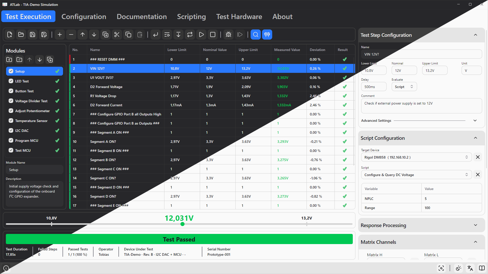
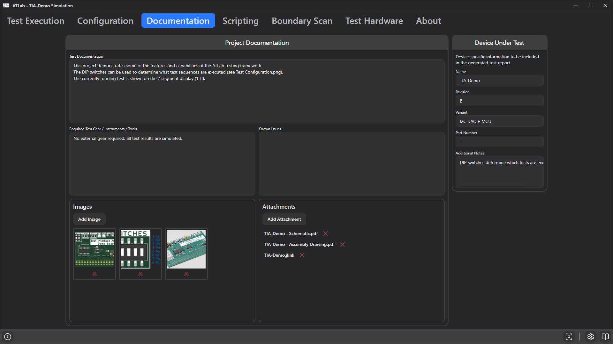
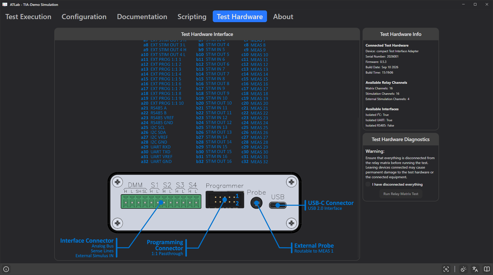

# ATLab - Automated Testing Framework


ATLab is a cross‑platform automated testing framework for interfacing with hardware through the [Test Interface Adapter](https://github.com/TobiasNetzer/TestInterfaceAdapter) and controlling external test instruments through remote control interfaces.
Built with **Avalonia UI** and **.NET**, it offers a modern environment for developing and running automated test sequences.

An example project developed with ATLab can be found [here](https://github.com/TobiasNetzer/ATLab-Examples).

## 📖 User Guide

A complete user guide covering installation, project setup, scripting, building and running test sequences, reports and troubleshooting is available in English and German:

- **English:** [docs/user-guide/en](docs/user-guide/en/README.md)
- **Deutsch:** [docs/user-guide/de](docs/user-guide/de/README.md)

The guide is also shipped as a PDF with every release package (in the `docs` folder next to the program) and can be opened from within ATLab with the book button in the status bar or `F1`.

## Features

-   **Custom Test Sequence Creation**: Test steps can be configured to perform various actions:
    -   **Test Instrument Remote Control**: Send custom commands or predefined scripts to remotely control external instruments (multimeter, oscilloscope, etc.).
    -   **Response Validation**: Use custom response processing to verify incoming data.
    -   **Shell Commands**: Execute local system commands or scripts.
    -   **Evaluate Runtime Variables**:
        -   **Dynamic Test Configurations**: Define and use custom variables within test scripts for dynamic test configurations.
        -   **Expression Evaluation**: Support for evaluating custom expressions to generate dynamic or calculated values.
    -   **User Confirmation**: Let the operator judge a step as passed or failed.
    -   **User Input**: Let the operator enter a measured value that is checked against the limits.
    -   **File Content**: Read and validate file contents from the local file system.
    -   **Relay Control**: Configure the Relay Matrix and Relay Groups, using the Test Interface Adapter, to route and switch signals to external devices.
    -   **Interface Communication**: Use the Test Interface Adapters onboard interfaces (I2C/UART) to communicate with the DUT.
    -   **Define Pass/Fail Criteria**:
        -   **Test Step Evaluation**: Define pass/fail criteria based on step results and conditions.
        -   **Conditional Test Execution**: Repeat a step, jump to another step, or end the test depending on the result.
-   **Test Instrument Interfacing**: Support for **Serial Port (VCOM/RS232)**, **TCP/IP (raw socket)** and **VISA (Virtual Instrument Software Architecture)** interfaces.
-   **Device Management**: Configure and manage multiple devices (Test Instruments or DUTs) with custom settings.
-   **Test Modules**: Organize test sequences into modules (e.g. power supply, programming, LED test) that can be enabled individually or run on their own.
-   **Scripting Engine**: Create test sequences with predefined multicommand scripts.
-   **Debugging & Simulation**: Step through sequences in development mode, or work without hardware using the built-in simulator.
-   **Test Result Exporting**: Export test results to CSV files for analysis and logging.
-   **Test Report Generation**: Automatically generate PDF test reports with detailed test results for documentation and sharing.
-   **Test Documentation**: Ability to add documentation, images, and other assets to the project.
-   **JSON File Format**: All project and script files use a standard JSON file format, perfect for tracking changes through version control.
-   **Cross-Platform Support**: Runs on Windows & Linux.
-   **Themes**: Light and Dark theme available.
-   **Languages**: Currently supports English and German.



## Installation

Download the latest version from the [releases page](https://github.com/TobiasNetzer/ATLab/releases):

| Asset | Platform | Notes |
|-------|----------|-------|
| `ATLab-setup-<version>.exe` | Windows (64-bit) | Installer with Start-menu entry and `.atlab` file association |
| `ATLab-win-<version>.zip` | Windows | Portable build, no installation |
| `ATLab-linux-<version>.tar.gz` | Linux | Portable build |

*Optional:* NI-VISA runtime for VISA-based instruments (**currently Windows only**).

See the [Installation chapter](docs/user-guide/en/02-installation.md) for details, including Linux serial port permissions.

## Building from Source

Prerequisite: **.NET 10.0 SDK** (or newer).

```bash
git clone https://github.com/TobiasNetzer/ATLab.git
cd ATLab
dotnet restore
dotnet build -c Release
dotnet run --project ATLab.csproj
```

Alternatively, open `ATLab.sln` in **JetBrains Rider**, **Visual Studio 2022**, or **VS Code** (with C# Dev Kit).

To build the user guide PDFs yourself:

```bash
pip install -r scripts/requirements-docs.txt
python -m playwright install chromium
python scripts/build_user_guide_pdf.py --lang en   # or --lang de
```

## Overview

### Configuration
Add and configure external test instruments (Serial, TCP/IP, VISA), project settings, custom channel names and runtime variables.
→ [Configuration Tab](docs/user-guide/en/05-configuration.md)


### Scripting
Create reusable multi-command instrument scripts with variables (e.g. `{Range}`), stored in a script folder shared across projects.
→ [Scripting Tab](docs/user-guide/en/06-scripting.md)


### Test Execution
Build the test sequence, configure limits, evaluation sources, response processing and relay routing per step, then run, single-step or debug it.
→ [Building Test Sequences](docs/user-guide/en/07-building-test-sequences.md) · [Running Tests](docs/user-guide/en/11-running-tests.md)


Depending on the project settings, a test report and a data file are generated automatically when the test completes:
- Example Prototype-001_2026-10-18_18-50-00: [PDF report](docs/Prototype-001_2026-10-18_18-50-00.pdf) · [CSV data](docs/Prototype-001_2026-10-18_18-50-00.csv)
- Example Prototype-002_2026-10-18_18-50-52: [PDF report](docs/Prototype-002_2026-10-18_18-50-52.pdf) · [CSV data](docs/Prototype-002_2026-10-18_18-50-52.csv)

### Documentation
Keep notes, images, attachments and DUT information directly within the project.
→ [Documentation Tab](docs/user-guide/en/13-documentation-tab.md)



### Test Hardware
View information about the attached Test Interface Adapter, its channels and interfaces, and run the relay matrix self-test.
→ [Test Hardware Tab](docs/user-guide/en/14-test-hardware.md)



## License

ATLab is licensed under the [GNU GPL v3](LICENSE).
