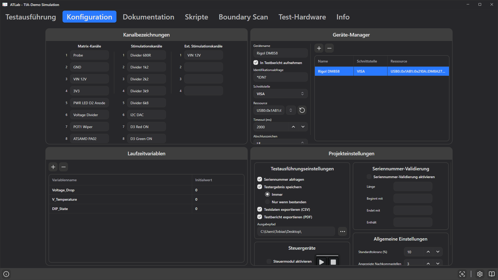

# 6. Registerkarte Konfiguration

Die Registerkarte **Konfiguration** enthält die projektweiten Einstellungen. Alles hier wird in der Projektdatei gespeichert.

Sie besteht aus vier Bereichen:

- [Kanalbezeichnungen](#kanalbezeichnungen)
- [Geräte-Manager](#geräte-manager)
- [Laufzeitvariablen](#laufzeitvariablen)
- [Projekteinstellungen](#projekteinstellungen)

---

## Kanalbezeichnungen

Geben Sie den Relaiskanälen des Adapters sprechende Namen wie `GND`, `VIN 12V` oder `TP12 3V3`. Es gibt drei Spalten:

| Spalte | Kanäle |
|--------|--------|
| **Matrix-Kanäle** | Messmatrix-Kanäle, in jedem Schritt als Matrix H / Matrix L wählbar |
| **Stimulationskanäle** | Stimulationsrelais |
| **Ext. Stimulationskanäle** | Externe Stimulationsrelais |

Die Zeilenanzahl entspricht dem angeschlossenen Adapter (bzw. dem Simulator). Die Namen erscheinen in den Relaisauswahlen der Schrittkonfiguration (als `<Nummer> <Name>`) und machen Sequenzen deutlich leichter lesbar und prüfbar. Lassen Sie ungenutzte Kanäle leer.

> **Tipp:** In der Matrix-Auswahl können Sie die Kanalnummer über die Tastatur eingeben, um direkt dorthin zu springen.

---

## Geräte-Manager

Der Geräte-Manager listet die externen Geräte, mit denen Schritte kommunizieren können: Messgeräte wie Multimeter und Netzteile oder ein Prüfling mit eigener serieller/TCP-Schnittstelle.

- **+** (**Neues Gerät hinzufügen**) legt ein Gerät `New Device` mit Schnittstelle *Serial Port* an.
- **−** (**Gerät entfernen**) löscht das ausgewählte Gerät.
- Wählen Sie rechts in der Tabelle ein Gerät aus, um es links zu bearbeiten. Eine lange Ressourcenangabe endet in der Tabelle mit „…“; beim Überfahren mit der Maus wird sie vollständig angezeigt.

Schritte verweisen über eine interne ID auf Geräte; Umbenennen eines Geräts stört daher keine Schritte. Löschen dagegen schon: Solche Schritte schlagen dann mit *„Target Device ID … not found.“* fehl.

### Gemeinsame Felder

| Feld | Beschreibung |
|------|--------------|
| **Gerätename** | Name in den Schritt-Editoren und im Testbericht. |
| **In Testbericht aufnehmen** | Führt das Gerät im PDF-Bericht unter *Verwendete Prüfmittel* auf. |
| **Identifikationsabfrage** | Befehl, der beim Erzeugen eines Berichts gesendet wird, z. B. `*IDN?`. Die Antwort (Hersteller, Modell, Seriennummer, Firmware) erscheint im Bericht. Nur wirksam, wenn *In Testbericht aufnehmen* aktiv ist. |
| **Schnittstelle** | `Serial Port`, `TCP/IP` oder `VISA`. Die übrigen Felder hängen davon ab. |

### Serial Port (serielle Schnittstelle)

| Feld | Standard | Beschreibung |
|------|----------|--------------|
| **Port** | – | COM-Port (Windows) oder `/dev/tty…` (Linux). Mit der Aktualisieren-Schaltfläche neu suchen. |
| **Baudrate** | 115200 | |
| **Datenbits** | 8 | |
| **Parität** | None | |
| **Stoppbits** | One | |
| **Handshake** | None | |
| **Abschlusszeichen** | NONE | Wird an jeden gesendeten Befehl angehängt: `NONE`, `LF`, `CR` oder `CRLF`. |
| **Framing-Modus** | Chunk | Wie das Ende einer Antwort erkannt wird (siehe unten). |
| **Timeout (ms)** | 100 | Nur bei *Timeout Based*: die Pause, die eine Antwort beendet. |

**Framing-Modi**

| Modus | Eine Antwort ist vollständig, wenn … |
|-------|--------------------------------------|
| **Chunk** | … überhaupt Daten empfangen wurden (der erste Block ist die Antwort). Schnell, lange Antworten können aber abgeschnitten werden. |
| **LF Terminated** | … ein Zeilenvorschub (`\n`) eintrifft. Am besten für SCPI-Geräte über seriell. |
| **CRLF Terminated** | … die Folge `\r\n` eintrifft. |
| **Timeout Based** | … für die eingestellte *Timeout (ms)* kein weiteres Byte eingetroffen ist. Gut für binäre Protokolle ohne Abschlusszeichen. |

### TCP/IP (Raw-Socket)

| Feld | Standard | Beschreibung |
|------|----------|--------------|
| **IP-Adresse** | – | z. B. `192.168.20.2` |
| **Port** | 5025 | 5025 ist der übliche SCPI-RAW-Port. |
| **Timeout (ms)** | 2000 | Verbindungs-Timeout. |
| **Abschlusszeichen** | LF | Wird an jeden Befehl angehängt. |

### VISA (Windows, erfordert NI-VISA)

| Feld | Standard | Beschreibung |
|------|----------|--------------|
| **Ressource** | – | VISA-Ressourcenstring, z. B. `USB0::0x1AB1::0x0588::DM3R123456::INSTR` oder `TCPIP0::192.168.1.10::inst0::INSTR`. Die Aktualisieren-Schaltfläche listet alle von NI-VISA gefundenen USB-, GPIB-, seriellen (ASRL) und TCPIP-Ressourcen. |
| **Timeout (ms)** | 2000 | VISA-I/O-Timeout. |
| **Abschlusszeichen** | LF | Abschlusszeichen beim *Lesen* von Antworten. |

> **Hinweis:** Bei VISA gilt das Abschlusszeichen für das Lesen. Befehle werden exakt wie eingegeben geschrieben. Benötigt Ihr Gerät ein Abschlusszeichen an jedem Befehl (typisch bei `::SOCKET`-Ressourcen), hängen Sie es explizit an, z. B. `MEAS:VOLT?{hex:0A}`. Siehe [Befehle, Variablen & Ausdrücke](10-commands-variables-expressions.md#kodierungsblöcke).

### Verbindungsverwaltung

ATLab öffnet die Verbindung zu einem Gerät, sobald ein Schritt sie erstmals benötigt, und hält sie offen, solange aufeinanderfolgende Schritte mit demselben Gerät arbeiten. Spricht ein Schritt ein anderes Gerät an oder wurde die Gerätekonfiguration geändert, wird neu verbunden. Am Ende jedes Testlaufs wird das Gerät freigegeben.

---

## Laufzeitvariablen

Laufzeitvariablen sind benannte Werte, die für die Dauer einer Sitzung bestehen. Verwenden Sie sie, um

- Befehle und Grenzwerte zu parametrieren (z. B. `{V_Supply}`),
- einen Messwert aus einem Schritt zu speichern und später wiederzuverwenden,
- abgeleitete Ergebnisse mit einem **Ausdruck**-Schritt zu berechnen.

| Spalte | Beschreibung |
|--------|--------------|
| **Variablenname** | Nur Buchstaben, Ziffern und `_`. Leerzeichen werden automatisch zu `_`, andere Zeichen werden entfernt. |
| **Initialwert** | Startwert der Variable. |

Variablen mit **+**/**−** oder über das Kontextmenü hinzufügen und entfernen.

**Lebensdauer der Werte**

- Beim Öffnen eines Projekts oder beim Bearbeiten der Tabelle Laufzeitvariablen werden alle Variablen auf ihre Initialwerte zurückgesetzt.
- Ein Schritt mit **Ergebnis einer Variable zuweisen** überschreibt den Wert während eines Laufs (siehe [Prüfsequenzen erstellen](08-building-test-sequences.md#erweiterte-einstellungen)).
- Während eines Laufs geschriebene Werte **bleiben für den nächsten Lauf erhalten**, bis das Projekt erneut geöffnet oder die Tabelle bearbeitet wird. Muss eine Variable bei jedem Lauf mit ihrem Initialwert beginnen, setzen Sie sie in einem frühen Schritt explizit (z. B. mit einem Ausdruck-Schritt, der eine Konstante zuweist).

Wie Variablen referenziert werden, erklärt [Befehle, Variablen & Ausdrücke](10-commands-variables-expressions.md).

---

## Projekteinstellungen

### Testausführungseinstellungen

| Einstellung | Beschreibung |
|-------------|--------------|
| **Seriennummer abfragen** | Vor **Testausführung starten** und **Dauertest starten** muss der Bediener eine Seriennummer eingeben. |
| **Testergebnis speichern** | Exportiert die Ergebnisse automatisch nach jedem abgeschlossenen Lauf. Nur verfügbar, wenn *Seriennummer abfragen* aktiv ist, da die Seriennummer Teil des Dateinamens ist. |
| **Immer / Nur wenn bestanden** | Nach jedem Lauf exportieren oder nur nach bestandenen Läufen. |
| **Testdaten exportieren (CSV)** | Schreibt eine tabulatorgetrennte Datendatei. |
| **Ergebnisdatei für Auswertung exportieren (JSON)** | Schreibt die Ergebnisse zusammen mit Metadaten zu Lauf, Projekt, Prüfling und Prüfmitteln für Auswerteprogramme (siehe [JSON-Ergebnisdatei](15-results-and-reports.md#json-ergebnisdatei)). |
| **Testbericht exportieren (PDF)** | Schreibt einen formatierten Testbericht. |
| **In Unterordner Pass / Fail sortieren** | Schreibt die Dateien bestandener Läufe in den Unterordner `Pass` und fehlgeschlagener Läufe in `Fail` im Ausgabepfad (siehe [Ordner](15-results-and-reports.md#ordner)). |
| **Ausgabepfad** | Ordner für exportierte Dateien. Mit **…** auswählen. Wird bei Bedarf angelegt. |

Details zu den exportierten Dateien: [Testergebnisse & Berichte](15-results-and-reports.md).

### Steuergeräte

| Einstellung | Beschreibung |
|-------------|--------------|
| **Steuermodul aktivieren** | Verbindet das USB-Steuermodul (Start-/Stopp-Tasten mit Status-LEDs). Siehe [Tests ausführen](14-running-tests.md#steuermodul). |

### Seriennummer-Validierung

Ist **Seriennummer-Validierung aktivieren** eingeschaltet, ist die Schaltfläche **Starten** im Seriennummer-Dialog nur aktiv, wenn die Eingabe alle nicht leeren Regeln erfüllt:

| Regel | Beispiel | Passt auf |
|-------|----------|-----------|
| **Länge** | `10` | genau 10 Zeichen (`0` oder leer = beliebig) |
| **Beginnt mit** | `PB-` | `PB-2026001` |
| **Endet mit** | `-A` | `…-A` |
| **Enthält** | `2026` | alles, was `2026` enthält |

Groß-/Kleinschreibung wird beachtet.

### Allgemeine Einstellungen

| Einstellung | Standard | Beschreibung |
|-------------|----------|--------------|
| **Standardtoleranz (%)** | 10 | Beim Eingeben eines Sollwerts werden Unter- und Obergrenze auf Sollwert −/+ diesen Prozentsatz gesetzt. |
| **Angezeigte Nachkommastellen** | 3 | Anzahl der angezeigten Nachkommastellen bei Messwerten. Nachgestellte Nullen entfallen. |
| **Protokolliergrad** | Info | Mindestschwere für Pop-up-Benachrichtigungen und für die Protokolldatei `events.log`: `Info`, `Warning`, `Error`. Erfolgsmeldungen werden immer als Pop-up angezeigt, zählen für die Protokolldatei aber als `Info`. Das Ereignisprotokoll im Fenster zeigt immer alle Meldungen der Sitzung. |
