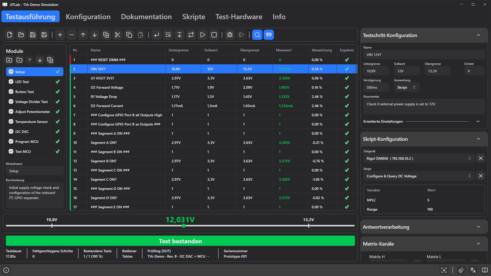

# 7. Prüfsequenzen erstellen

Prüfsequenzen werden auf der Registerkarte **Testausführung** mit aktiviertem **Entwicklungsmodus** erstellt (Baustellen-Schaltfläche am rechten Ende der Werkzeugleiste). Im Entwicklungsmodus erscheinen rechts neben der Schrittliste die Konfigurationsbereiche.

## Module

Ein Projekt ist in **Module** gegliedert, z. B. *Spannungsversorgung*, *Programmierung* oder *LED-Test*. Jedes Modul hat eine eigene Liste von Testschritten. Der Bereich **Module** links neben der Schrittliste zeigt alle Module des Projekts; ein Klick auf ein Modul zeigt dessen Schritte.

| Element | Bedeutung |
|---------|-----------|
| Kontrollkästchen | Bezieht das Modul in die Testausführung ein. Deaktivierte Module werden abgeblendet dargestellt und vollständig übersprungen. |
| Ladesymbol / ✔ / ✘ | Ein drehendes Symbol, während das Modul ausgeführt wird, sonst das Ergebnis des Moduls nach einem Durchlauf (✘, wenn ein ausgeführter Schritt fehlgeschlagen ist). |

Im Entwicklungsmodus bietet der Bereich Schaltflächen zum **Hinzufügen**, **Entfernen**, **Nach oben / unten verschieben** und **Duplizieren** von Modulen sowie Felder für **Name** und **Beschreibung** des ausgewählten Moduls (die Beschreibung erscheint als Tooltip in der Liste). Ein Projekt enthält immer mindestens ein Modul. Module können nur im Entwicklungsmodus aktiviert oder deaktiviert werden.

Module werden in der Reihenfolge der Liste ausgeführt; die Schritte aller aktivierten Module bilden eine durchgehende Sequenz. Die Schrittnummerierung beginnt in jedem Modul bei 1.

Um Schritte in ein anderes Modul zu verschieben, schneiden Sie sie aus, wählen das Zielmodul und fügen sie ein.

## Die Schrittliste

| Spalte | Inhalt |
|--------|--------|
| **Nr.** | Schrittnummer. Der farbige Streifen links zeigt die *Akzentfarbe* des Schritts. |
| **Name** | Name des Schritts. |
| **Untergrenze / Sollwert / Obergrenze** | Grenzwerte, formatiert mit Einheit und SI-Präfix (z. B. `10,8V`, `1,3mA`). |
| **Messwert** | Ergebnis des letzten Laufs; grün bei bestanden, rot bei fehlgeschlagen. Kann auch `Timeout` oder `Overflow` zeigen. |
| **Abweichung** | Abweichung vom Sollwert in Prozent. |
| **Ergebnis** | ✔ oder ✘, nachdem der Schritt ausgeführt wurde. |

Ignorierte Schritte werden abgeblendet dargestellt. Spaltenbreite und -reihenfolge sind veränderbar; sortieren lässt sich die Liste nicht. Passen die Spalten nicht in die Breite, z. B. auf kleinen Bildschirmen, lässt sich die Liste horizontal scrollen. Während eines Tests ist die Bearbeitung gesperrt.

### Mehrere Schritte auswählen

Mit `Strg`+Klick und `Umschalt`+Klick wählen Sie mehrere Schritte aus. Der Konfigurationsbereich zeigt den zuletzt angeklickten Schritt. **Jede Änderung dort wird auf alle ausgewählten Schritte übertragen** – ein schneller Weg, dieselbe Einheit, Verzögerung, dasselbe Gerät oder denselben Relaiszustand für einen ganzen Block von Schritten einzustellen.

## Bearbeitungsbefehle

| Werkzeugleiste | Kontextmenü | Kürzel | Aktion |
|----------------|-------------|--------|--------|
| **Neuen Testschritt hinzufügen** (`+`) | Hinzufügen | `Einfg` | Fügt einen neuen Schritt nach der Auswahl (oder am Ende) ein. |
| **Ausgewählte Testschritte entfernen** (`−`) | Entfernen | `Entf` | Löscht die ausgewählten Schritte. |
| **Ausgewählten Testschritt nach oben / unten verschieben** (↑ / ↓) | Nach oben / Nach unten | | Verschiebt den ausgewählten Schritt innerhalb seines Moduls um eine Position. Gesperrt, wenn der Schritt bereits der erste (nach oben) oder letzte (nach unten) ist. |
| **Ausgewählte Testschritte duplizieren** | Duplizieren | `Strg+D` | Fügt Kopien direkt nach der Auswahl ein. |
| **Ausgewählte Testschritte ausschneiden** | Ausschneiden | `Strg+X` | Entfernt die Schritte und hält sie zum Einfügen bereit. |
| **Ausgewählte Testschritte kopieren** | Kopieren | `Strg+C` | Kopiert die Schritte. |
| **Testschritte einfügen** | Einfügen | `Strg+V` | Fügt die kopierten/ausgeschnittenen Schritte nach der Auswahl ein. |

Schritte werden innerhalb ihres Moduls automatisch neu nummeriert. Kopien erhalten neue interne IDs; *Springe zu*-Ziele in kopierten Schritten zeigen daher weiterhin auf die Originalschritte. Wird ein ganzes Modul dupliziert, werden Sprünge zwischen Schritten innerhalb dieses Moduls auf die kopierten Schritte umgelenkt.

---

## Testschritt-Konfiguration

Der obere Bereich rechts bearbeitet die Grundeigenschaften des ausgewählten Schritts. Ist kein Schritt ausgewählt, z. B. in einem leeren Modul, sind alle Bereiche gesperrt und zeigen Standardwerte. Bereiche lassen sich über den Pfeil in ihrer Kopfzeile einklappen; ATLab merkt sich, welche geöffnet sind.

### Name, Grenzwerte und Einheit

| Feld | Beschreibung |
|------|--------------|
| **Name** | Freitext, erscheint in der Liste und in Berichten. |
| **Untergrenze** | Kleinster Wert, der besteht. |
| **Sollwert** | Erwarteter Wert; Grundlage der Abweichung. |
| **Obergrenze** | Größter Wert, der besteht. |
| **Einheit** | Einheitenzeichen wie `V`, `A`, `Ohm`, `Hz`. Wird für die Anzeige und beim Einlesen eingegebener Werte verwendet. |

Ein Schritt **besteht**, wenn `Untergrenze ≤ Messwert ≤ Obergrenze`. Die **Abweichung** beträgt `(Messwert − Sollwert) / Sollwert × 100 %`; ist der Sollwert 0, wird stattdessen die absolute Differenz angezeigt.

**Werte eingeben**

- SI-Präfixe werden verstanden: `p` (10⁻¹²), `n` (10⁻⁹), `u` (10⁻⁶), `m` (10⁻³), `k` (10³), `M` (10⁶). Beispiele mit Einheit `V`: `3.3`, `3,3V`, `500mV`, `0.5`.
- Sowohl `.` als auch `,` werden als Dezimaltrennzeichen akzeptiert.
- Wenn Sie einen **Sollwert** eingeben, werden Unter- und Obergrenze aus der **Standardtoleranz** des Projekts neu berechnet (z. B. Sollwert `12` bei 10 % → `10.8` … `13.2`). Geben Sie zuerst den Sollwert ein und passen Sie danach die Grenzwerte an.
- Eine feste Untergrenze kann nicht größer als der Sollwert sein, eine feste Obergrenze nicht kleiner; ATLab korrigiert solche Eingaben.
- Um auf einen exakten Wert zu prüfen, setzen Sie alle drei auf dieselbe Zahl (z. B. `1` für eine Benutzereingabe oder eine Übereinstimmung).

**Anzeige von Einheiten**

Werte werden mit automatischem SI-Präfix angezeigt (`0.0013 A` → `1,3mA`). Setzen Sie die Einheit in geschweifte Klammern, z. B. `{°C}` oder `{rpm}`, wird die Präfixskalierung abgeschaltet und der Wert unverändert mit dem Einheitentext angezeigt.

**Variablen in Grenzwerten**

Grenzwerte, Sollwert und Verzögerung können Laufzeitvariablen enthalten, z. B. `{V_Ref}` oder einen Ausdruck wie `{expr:{V_Ref}*1.05}`. Sie werden bei jeder Ausführung des Schritts aufgelöst. Die automatische Toleranzberechnung entfällt, sobald einer der drei Werte eine Variable enthält. Siehe [Kapitel 9](09-commands-variables-expressions.md).

### Verzögerung

Wartezeit zwischen dem Schalten der Relais und dem Erfassen des Werts, zum Einschwingen. Der Wert ist in **Sekunden**, sofern kein Präfix angegeben wird: `0.5`, `500ms`, `2`, `2s`. Verzögerungen über einer Sekunde zeigen einen Fortschrittsbalken mit *Warten...*.

### Auswertung

Wählt die [Auswertungsquelle](08-evaluation-sources.md): **Keine**, **Skript**, **Gerätebefehl**, **Schnittstellenbefehl**, **Shell-Befehl**, **Benutzereingabe**, **Ausdruck** oder **Datei**. Darunter erscheint der passende Editorbereich.

### Kommentar

Text für den Bediener. Er wird in einem Dialog angezeigt, wenn *Kommentar anzeigen* aktiv ist, wenn die Bestanden-/Fehlgeschlagen-Aktion *Kommentar anzeigen* ist, und als Frage bei *Benutzereingabe*-Schritten. Der Kommentar darf `{Variable}`-Verweise enthalten, die durch den aktuellen Wert ersetzt werden.

---

## Erweiterte Einstellungen

Zum Aufklappen auf **Erweiterte Einstellungen** klicken.

| Einstellung | Beschreibung |
|-------------|--------------|
| **Schritt ignorieren** | Der Schritt wird bei der Ausführung übersprungen und nicht exportiert. Nützlich zum vorübergehenden Deaktivieren. |
| **Vom Export ausschließen** | Der Schritt läuft und zählt für das Gesamtergebnis, wird aber nicht in CSV oder PDF geschrieben (z. B. Einrichtungsschritte). |
| **Akzentfarbe** | Farbe des Streifens neben der Schrittnummer. Zum optischen Gruppieren von Schritten. |
| **Kommentar anzeigen** | Vor der Ausführung des Schritts wird der Kommentar in einem Dialog mit **Weiter** / **Abbrechen** angezeigt. Abbrechen bricht den Test ab. Über die Bild-Schaltfläche daneben (**Bild zu Meldungsfenster hinzufügen**) fügen Sie dem Dialog ein Bild hinzu (PNG, JPG, BMP, GIF, WEBP) – z. B. ein Foto, wo eine Prüfspitze anzusetzen ist. |
| **Ergebnis einer Variable zuweisen** | Nach der Ausführung wird der Messwert in die gewählte Laufzeitvariable geschrieben. `Timeout` und `Overflow` werden als Text geschrieben. |

### Bestanden-Aktion und Fehlgeschlagen-Aktion

Nach der Bewertung wendet ATLab die **Bestanden-Aktion** an, wenn der Wert innerhalb der Grenzen liegt, andernfalls die **Fehlgeschlagen-Aktion**. Jede Aktion bietet:

| Option | Wirkung |
|--------|---------|
| **Fortfahren** | Mit dem nächsten Schritt weitermachen (Standard). |
| **Wiederholen** | Denselben Schritt erneut ausführen. Nützlich für „Warten bis“-Schleifen, z. B. bei Fehlschlag wiederholen, bis sich eine Spannung eingestellt hat. |
| **Test beenden** | Die Sequenz nach diesem Schritt beenden. Der Lauf wird normal bewertet. |
| **Springe zu** | Mit dem in der Auswahlliste gewählten Schritt weitermachen (vorwärts oder rückwärts). Das Ziel kann in einem beliebigen Modul liegen; die Auswahlliste zeigt Schritte als *Modul / Nr.: Name*; der vollständige Text erscheint beim Darüberfahren mit der Maus. |
| **Kommentar anzeigen** | Den Kommentar in einem Dialog anzeigen, dann mit dem nächsten Schritt weitermachen. Mit **Ergebnis einbinden** zeigt der Dialog zusätzlich den Messwert und dessen Bewertung. **Abbrechen** bricht den Test ab. |
| **Ergebnis invertieren** | Kehrt die Bewertung des Schritts um, *nachdem* die Aktion gewählt wurde. In der Fehlgeschlagen-Aktion bedeutet das „ein Wert außerhalb der Grenzen gilt als bestanden“, in der Bestanden-Aktion „ein Wert innerhalb der Grenzen gilt als fehlgeschlagen“. |

Hinweise:

- Ein sich wiederholender Schritt kann mit der Schaltfläche **Testausführung fortsetzen** in der Werkzeugleiste (oder `Enter`) manuell beendet werden. Die Sequenz fährt dann mit dem nächsten Schritt fort.
- Ohne Verzögerung laufen wiederholte Schritte so schnell wie möglich (mit einer minimalen Pause, damit die Oberfläche reagiert). Eine Verzögerung begrenzt die Abfragerate.
- Ein Sprung zu einem gelöschten oder ignorierten Schritt oder zu einem Schritt in einem deaktivierten Modul protokolliert einen Fehler, markiert den Schritt als fehlgeschlagen und beendet den Test.
- Jede Wiederholung überschreibt das vorherige Ergebnis; nur das letzte zählt.

**Beispiel – warten, bis eine Versorgung hochgefahren ist:**

| Schritt | Auswertung | Grenzwerte | Verzögerung | Fehlgeschlagen-Aktion |
|---------|------------|------------|-------------|-----------------------|
| 5 *Warten auf 3V3* | Skript *Query DC Voltage* | 3,2 … 3,4 V | 0,5 s | Wiederholen |

Kombinieren Sie dies mit einer Zählervariable und einem Sprung, wenn Sie ein festes Zeitlimit benötigen.

---

## Relais-Routing

Die unteren drei Bereiche stellen die Relais des Test Interface Adapters **für den ausgewählten Schritt** ein. Beim Start des Schritts wird genau diese Konfiguration angewendet; am Testende (oder beim Stoppen) werden alle Relais zurückgesetzt.

### Matrix-Kanäle

| Element | Beschreibung |
|---------|--------------|
| **Matrix H** | Kanal, der mit der High-Seite des Messbusses verbunden wird. |
| **Matrix L** | Kanal, der mit der Low-Seite verbunden wird. |
| Tauschen-Schaltfläche | **Kanäle tauschen** – vertauscht H und L. |
| Prüfspitzen-Schaltfläche | **Externe Prüfspitze aktivieren** – schaltet die externe Prüfspitze statt eines Matrix-Kanals auf. |

Wählen Sie **Off**, um eine Seite unverbunden zu lassen. Die Liste zeigt Kanalnummern mit ihren benutzerdefinierten Namen. Verweist ein Schritt auf einen Kanal, den der angeschlossene Adapter nicht hat, schlägt der Schritt mit *„Matrix Channel is not available.“* fehl.

### Stimulationskanäle / Externe Stimulationskanäle

Ein Kontrollkästchen pro Relais. Haken Sie die Relais an, die während dieses Schritts geschlossen sein sollen. Kanalnamen aus der Registerkarte Konfiguration stehen neben den Nummern.

> **Tipp:** Um einen Stimulus (z. B. die Versorgungsspannung) über viele Schritte aktiv zu halten, wählen Sie alle diese Schritte aus und aktivieren das Relais einmal – die Änderung gilt für die gesamte Auswahl.
