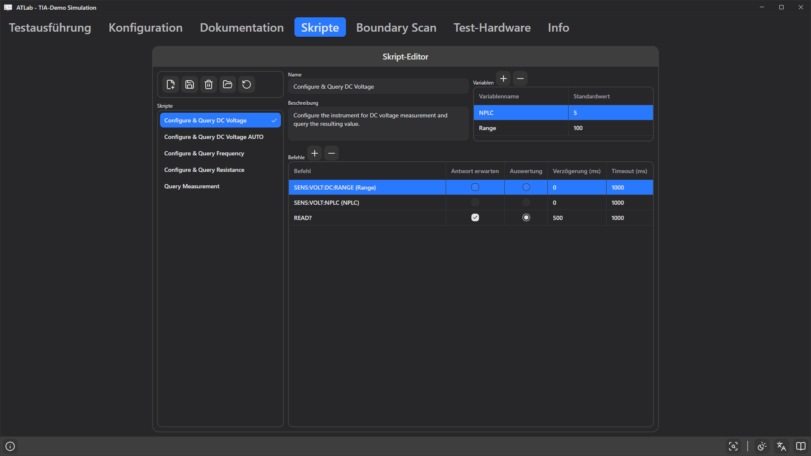

# 7. Registerkarte Skripte

Ein **Skript** ist eine benannte, wiederverwendbare Folge von Gerätebefehlen, z. B. *„Configure & Query DC Voltage“*. Statt dieselben SCPI-Befehle in viele Schritte zu tippen, schreiben Sie sie einmal als Skript und wählen das Skript in jedem Schritt aus. Mit Variablen kann ein Skript viele Schritte mit unterschiedlichen Einstellungen bedienen.

## Der Skriptordner

Skripte werden als einzelne JSON-Dateien (`<id>.json`) in einem **Skriptordner** gespeichert, unabhängig von einem Projekt. Mehrere Projekte können einen Skriptordner gemeinsam nutzen.

- Der Pfad des Skriptordners wird im Projekt gespeichert. Liegt er im Projektordner, wird er relativ gespeichert.
- Ein neues Projekt verwendet den Standard-Skriptordner:
  - Windows: `%LOCALAPPDATA%\ATLab\Scripts`
  - Linux: `~/.local/share/ATLab/Scripts`
- Existiert der konfigurierte Ordner nicht, versucht ATLab, ihn anzulegen; gelingt das nicht, wird der Standardordner verwendet und eine Meldung protokolliert.

## Werkzeugleiste

| Schaltfläche | Funktion |
|--------------|----------|
| **Neues Skript** | Legt ein neues, leeres Skript an und speichert es sofort im Skriptordner. |
| **Skript speichern** | Speichert das ausgewählte Skript. |
| **Skript löschen** | Löscht die Datei des ausgewählten Skripts nach Rückfrage dauerhaft. |
| **Skriptordner ändern** | Wählt einen anderen Ordner als Skriptordner und lädt die Liste neu. |
| **Skriptordner neu laden** | Liest alle Skripte erneut vom Datenträger, z. B. nach dem Abrufen von Änderungen aus der Versionsverwaltung. |

Skripte mit ungespeicherten Änderungen sind in der Liste mit `*` markiert, und die Registerkarte heißt **Skripte\***, solange ein Skript ungespeichert ist. Skriptänderungen werden **nicht** mit dem Projekt gespeichert – verwenden Sie **Skript speichern**.

## Ein Skript bearbeiten

Wählen Sie ein Skript in der Liste **Skripte**. Rechts können Sie bearbeiten:

- **Name** – erscheint in der Skriptauswahl des Schritts.
- **Beschreibung** – erscheint als Tooltip in der Skriptauswahl.
- **Variablen** – Platzhalter mit Standardwerten.
- **Befehle** – die Befehlsliste.

### Variablen

| Spalte | Beschreibung |
|--------|--------------|
| **Variablenname** | Nur Buchstaben, Ziffern und `_`. |
| **Standardwert** | Wert, mit dem ein Schritt beginnt, wenn das Skript erstmals ausgewählt wird. |

Verwenden Sie eine Variable in einem Befehl, indem Sie ihren Namen in geschweifte Klammern setzen, z. B. `SENS:VOLT:DC:RANGE {Range}`. Jeder Testschritt, der das Skript verwendet, erhält eine eigene Kopie der Variablen und kann die Werte überschreiben (siehe [Auswertung Skript](09-evaluation-sources.md#skript)).

### Befehle

| Spalte | Beschreibung |
|--------|--------------|
| **Befehl** | An das Gerät gesendeter Text. Kann Skriptvariablen, Laufzeitvariablen, Kodierungsblöcke und Ausdrücke enthalten ([Kapitel 10](10-commands-variables-expressions.md)). Leere Befehle werden übersprungen. |
| **Antwort erwarten** | Befehl senden und auf eine Antwort warten (Abfrage). Ist die Option aus, wird nur geschrieben. |
| **Auswertung** | Die Antwort dieses Befehls als Messwert des Schritts verwenden. Nur **ein** Befehl pro Skript kann markiert sein; das Markieren eines anderen hebt die vorherige Markierung auf. Erfordert, dass auch **Antwort erwarten** aktiv ist. |
| **Prüfen** | Die Antwort dieses Befehls mit eigener Maske und eigenen Grenzwerten prüfen, siehe [Antwortprüfungen](#antwortprüfungen). Nur für Befehle mit **Antwort erwarten**, die nicht mit **Auswertung** markiert sind. |
| **Verzögerung (ms)** | Wartezeit **vor** dem Senden des Befehls. |
| **Timeout (ms)** | Wie lange auf die Antwort gewartet wird (Standard 1000 ms). Bei Überschreitung endet der Schritt mit dem Ergebnis `Timeout`. |

Befehle werden von oben nach unten ausgeführt. Mit **+**/**−** oder über das Kontextmenü hinzufügen oder entfernen; ein neuer Befehl wird unter dem ausgewählten eingefügt.

### Antwortprüfungen

Der mit **Auswertung** markierte Befehl liefert den Messwert des Schritts, den der Schritt mit seinen Grenzwerten vergleicht. Oft zählen auch andere Antworten – ein Konfigurationsbefehl muss mit `OK` antworten, oder die Fehlerwarteschlange muss leer sein, damit die Messung gilt. Dafür kann jeder andere Befehl mit **Antwort erwarten** seine eigene Antwort prüfen.

Wählen Sie den Befehl in der Liste aus. Der Bereich **Antwortprüfung** unter der Liste zeigt seine Einstellungen:

| Feld | Beschreibung |
|------|--------------|
| **Antwort dieses Befehls prüfen** | Schaltet die Prüfung ein (wie die Spalte **Prüfen**). |
| **Maske**, **Überspringen**, **Länge** | Verarbeitung der Antwort, genau wie bei der [Antwortverarbeitung](11-response-processing.md). Eine leere Maske liest die Antwort als Zahl. |
| **Untergrenze**, **Obergrenze** | Das verarbeitete Ergebnis muss innerhalb dieser Grenzen liegen (einschließlich). |

Prüfungen gehören zum Skript, also führt jeder Schritt, der das Skript verwendet, sie aus. Bei der Ausführung gilt:

- Alle Befehle werden gesendet, auch nach einer fehlgeschlagenen Prüfung.
- Schlägt eine Prüfung fehl – Ergebnis außerhalb der Grenzen oder Antwort nicht verarbeitbar (z. B. zu kurz, keine Zahl) –, ist der Schritt **fehlgeschlagen**, auch wenn sein Messwert innerhalb der Grenzwerte des Schritts liegt. Der Messwert wird trotzdem angezeigt, und die **Fehlgeschlagen-Aktion** des Schritts greift.
- Beim Überfahren des Ergebnisses mit der Maus wird angezeigt, welche Prüfung fehlgeschlagen ist und was empfangen wurde, z. B. `Command 2 'SYST:ERR?': received '-113,"Undefined header"', result 0 not within 1 … 1.` Derselbe Text wird nach Abschluss des Schritts als Warnung ins Ereignisprotokoll geschrieben.
- Ein Timeout bei einem geprüften Befehl beendet den Schritt mit `Timeout`, wie bei jedem anderen Befehl.

Typische Masken: `"OK"` mit Grenzen `1 … 1` (Antwort muss `OK` enthalten), `{dec}` mit Grenzen `0 … 0` (ein reiner Statuswert wie `+0` muss 0 sein) oder eine leere Maske mit Grenzen `4.9 … 5.1` (ein zurückgelesener Wert muss im Bereich liegen).

Der mit **Auswertung** markierte Befehl selbst hat keine Prüfung im Skript; seine Antwort wird mit dem Bereich **Antwortverarbeitung** des Schritts verarbeitet und mit den Grenzwerten des Schritts verglichen.

## Skriptausführung

Der Bereich **Skriptausführung** rechts neben dem Skripteditor führt das ausgewählte Skript ohne Testschritt auf einem Gerät aus – praktisch beim Schreiben eines Skripts oder beim Entwerfen seiner Antwortprüfungen.

1. **Zielgerät** wählen (aus dem Gerätemanager).
2. **Ausführen** (▶) klicken. **Stoppen** (■) bricht die Ausführung ab.

Das Skript läuft **im aktuellen Bearbeitungsstand**, einschließlich ungespeicherter Änderungen, mit den **Standardwerten** seiner Variablen. Laufzeitvariablen in Befehlen verwenden ihre Anfangswerte aus dem Projekt.

Nach der Ausführung zeigen eine Zusammenfassung und eine Tabelle, was passiert ist:

| Spalte | Inhalt |
|--------|--------|
| **#** | Position des Befehls im Skript. |
| **Befehl** | Befehlstext mit ersetzten Skriptvariablen. |
| **Antwort** | Die empfangene Antwort. Zeilenenden werden als `\r` / `\n` angezeigt, da sie oft entscheiden, ob eine Maske passt. Für binäre Antworten **Anzeigemodus** auf `HEX` stellen. |
| **Prüfwert** | Ergebnis der Verarbeitung der Antwortprüfung, z. B. `1` für gefundenen Text oder die extrahierte Zahl. |
| **Status** | **Bestanden** / **Fehlgeschlagen** für geprüfte Befehle, **Auswertung** für den ausgewerteten Befehl, **Keine Antwort** für den Befehl, bei dem ein Timeout oder Fehler die Ausführung beendet hat. |
| **Meldung** | Warum eine Prüfung fehlgeschlagen ist – derselbe Text, den ein Testschritt anzeigt. |

Die Antwort des ausgewerteten Befehls wird unverarbeitet angezeigt; sie wird erst bei der Testausführung mit der Antwortverarbeitung des Schritts verarbeitet.

Die Verbindung zum Gerät wird nach jeder Ausführung geschlossen, damit das Gerät für andere Werkzeuge frei bleibt. Während ein Test läuft, ist **Ausführen** gesperrt.

## Beispiel: Gleichspannungsmessung

**Variablen**

| Variablenname | Standardwert |
|---------------|--------------|
| `Range` | `100` |
| `NPLC` | `5` |

**Befehle**

| Befehl | Antwort erwarten | Auswertung | Verzögerung (ms) | Timeout (ms) |
|--------|:---:|:---:|---:|---:|
| `SENS:VOLT:DC:RANGE {Range}` | | | 0 | 1000 |
| `SENS:VOLT:NPLC {NPLC}` | | | 0 | 1000 |
| `READ?` | ✔ | ✔ | 500 | 1000 |

Ein Schritt mit diesem Skript sendet die beiden Konfigurationsbefehle, wartet 500 ms, fragt `READ?` ab und verwendet die Antwort des Geräts (z. B. `+1.2001555E+01`) als Messwert.

Um sicherzustellen, dass das Gerät die Konfiguration angenommen hat, fügen Sie als letzten Befehl `SYST:ERR?` mit **Antwort erwarten** und **Prüfen** hinzu, Maske `"No error"`, Grenzen `1 … 1`. Das Gerät antwortet `+0,"No error"`, wenn alles angenommen wurde; jede andere Antwort lässt den Schritt fehlschlagen. (Eine Zahlenextraktion wie `{dec}` funktioniert hier nicht: Ohne vorangestelltes Kennzeichen muss sie die ganze Antwort als Zahl lesen, und `+0,"No error"` ist keine.)

## Bewährte Vorgehensweisen

- Halten Sie Skripte klein und allgemein; verlagern Sie schrittspezifische Werte in Variablen.
- Legen Sie den Skriptordner neben Ihre Projekte und unter Versionsverwaltung.
- Liefert ein Skript mehr als eine reine Zahl, verwenden Sie im Schritt die [Antwortverarbeitung](11-response-processing.md), um den Wert zu extrahieren.
- Ist kein Befehl mit **Auswertung** markiert, ist der Messwert des Schritts `0`.
