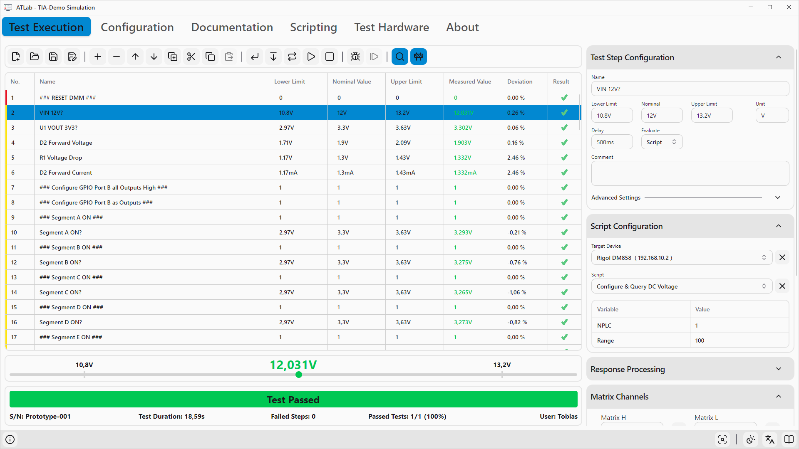

# 11. Tests ausführen

Tests werden auf der Registerkarte **Testausführung** gestartet. Bediener arbeiten normalerweise mit ausgeschaltetem Entwicklungsmodus und sehen nur Werkzeugleiste, Schrittliste und Ergebnisleiste.

## Steuerung der Ausführung

| Schaltfläche | Kürzel | Aktion |
|--------------|--------|--------|
| **Einzelschritt ausführen** | `F3` | Führt nur den ausgewählten Schritt aus (siehe unten). |
| **Testausführung ab ausgewähltem Schritt starten** | | Führt die Sequenz ab dem ausgewählten Schritt aus. |
| **Dauertest starten** | | Führt die ganze Sequenz in einer Endlosschleife aus, bis sie gestoppt wird. |
| **Testausführung starten** (▶) | `F5` | Führt die ganze Sequenz einmal aus. |
| **Testausführung fortsetzen** | `Enter` | Während eines Laufs sichtbar. Beendet einen sich wiederholenden Schritt (Aktion *Wiederholen*) und fährt mit dem nächsten Schritt fort. |
| **Testausführung stoppen** (■) | `Esc` | Bricht den laufenden Test ab. |

Während ein Test läuft, sind Bearbeitungs- und Dateibefehle gesperrt, und die Schrittliste folgt dem aktuellen Schritt.

### Unterschiede zwischen den Startarten

| | Test starten | Dauertest | Ab Auswahl | Einzelschritt |
|---|:---:|:---:|:---:|:---:|
| Fragt Seriennummer ab (falls aktiv) | ✔ | ✔ (einmal) | – | – |
| Automatischer Ergebnisexport (falls aktiv) | ✔ | ✔ (jeder Lauf) | – | – |
| Setzt Relais vorher und nachher zurück | ✔ | ✔ | ✔ | – |
| Befolgt Bestanden-/Fehlgeschlagen-Aktionen | ✔ | ✔ | ✔ | – |
| Zeigt *Kommentar anzeigen*-Dialog vor dem Schritt | ✔ | ✔ | ✔ | – |
| Aktualisiert die Laufzähler | ✔ | ✔ | ✔ | – |

**Einzelschritt ausführen** ist für die Entwicklung gedacht: Es schaltet die Relais des Schritts, wartet, erfasst und bewertet den Wert und zeigt das Ergebnis – sonst nichts. Die Relais **bleiben danach im Zustand des Schritts**. Verwenden Sie es zum Abstimmen von Masken, Grenzwerten und Verzögerungen. Ignorierte Schritte werden nicht ausgeführt.

## Eingabe der Seriennummer

Ist **Seriennummer abfragen** in den Projekteinstellungen aktiv, erscheint beim Klick auf *Testausführung starten* oder *Dauertest starten* der Dialog **Seriennummer eingeben**. Ein Barcodescanner im Tastaturmodus kann verwendet werden.

- **Starten** beginnt den Test. Die Schaltfläche ist nur aktiv, wenn die Eingabe nicht leer ist und – bei aktivierter Validierung – die Validierungsregeln erfüllt.
- **Abbrechen** bricht den Start ab.

Die Seriennummer erscheint in der Ergebnisleiste (**S/N**), in den Dateinamen exportierter Ergebnisse und im PDF-Bericht.

## Bedienerdialoge

Während eines Laufs kann ATLab Dialoge anzeigen:

| Dialog | Titel | Schaltflächen | Wirkung |
|--------|-------|---------------|---------|
| Kommentar anzeigen (vor dem Schritt) | *Benutzerinformation* | **Weiter** / **Abbrechen** | Abbrechen stoppt den Test. |
| Aktion *Kommentar anzeigen* | *Benutzerinformation* | **Weiter** / **Abbrechen** | Zeigt optional den Messwert. Abbrechen stoppt den Test. |
| Schritt mit Benutzereingabe | *Warten auf Benutzereingabe* | **Bestanden** / **Fehlgeschlagen** | Ergebnis `1` oder `0`. |

Dialoge können ein Bild enthalten. Wird ein Dialog ohne Wahl einer Schaltfläche geschlossen, zählt das als **Abbrechen** (bzw. **Fehlgeschlagen** bei einer Benutzereingabe).

## Die Ergebnisleiste

Unterhalb der Schrittliste:

| Element | Beschreibung |
|---------|--------------|
| Statusbanner | **Test läuft** mit Fortschrittsbalken, danach **Test bestanden** (grün), **Test fehlgeschlagen** (rot), **Test abgebrochen** oder **Testausführung fehlgeschlagen**. |
| **S/N** | Seriennummer des aktuellen Laufs oder `-`. |
| **Testdauer** | Verstrichene Zeit des Laufs. |
| **Fehlgeschlagene Schritte** | Anzahl fehlgeschlagener Schritte in diesem Lauf. |
| **Bestandene Tests** | Bestandene Läufe / alle Läufe seit dem Öffnen des Projekts, mit Prozentangabe. Nützlich bei Dauertests. |
| **Benutzer** | Benutzername des Betriebssystems; erscheint im Bericht als *Bediener*. |

### Gesamtergebnis

| Status | Wann |
|--------|------|
| **Test bestanden** | Der Lauf wurde beendet und kein Schritt ist fehlgeschlagen. |
| **Test fehlgeschlagen** | Der Lauf wurde beendet und mindestens ein Schritt ist fehlgeschlagen (einschließlich Timeouts und Überläufen). |
| **Test abgebrochen** | Der Lauf wurde vom Bediener gestoppt (Stopp-Schaltfläche, `Esc`, Steuermodul oder *Abbrechen* in einem Dialog). |
| **Testausführung fehlgeschlagen** | Ein Schritt konnte gar nicht ausgeführt werden (z. B. Gerät nicht erreichbar, Antwort nicht lesbar). Der Lauf wird abgebrochen. |

Ergebnisse werden nur bei **bestandenen** und **fehlgeschlagenen** Läufen exportiert.

## Messfenster

Die Lupen-Schaltfläche (**Messfenster anzeigen**) blendet zwischen Schrittliste und Ergebnisleiste eine große Anzeige ein. Sie zeigt Untergrenze, Messwert und Obergrenze des ausgewählten Schritts auf einer Skala – aus der Entfernung lesbar und praktisch, um mit einem sich wiederholenden Schritt ein Potentiometer abzugleichen.

## Debug-Modus

Im Entwicklungsmodus erscheinen zwei zusätzliche Schaltflächen:

| Schaltfläche | Kürzel | Funktion |
|--------------|--------|----------|
| **Debug-Modus aktivieren** (Käfer-Symbol) | | Wenn aktiv, hält jeder gestartete Lauf **vor jedem Schritt** an. |
| **Einzelschritt weiterschalten** | `F10` | Führt den Schritt aus, an dem der Lauf wartet, und hält vor dem nächsten erneut an. |

Mit dem Debug-Modus gehen Sie eine Sequenz Schritt für Schritt durch – mit allen Aktionen, Dialogen und Relaisänderungen – und können dazwischen Ergebnisse und Relaiszustände prüfen. Mit `Esc` stoppen Sie den Lauf jederzeit. Der Debug-Modus lässt sich nur umschalten, während kein Test läuft.

## Steuermodul

Das Steuermodul ist ein USB-HID-Gerät mit zwei beleuchteten Tasten. Aktivieren Sie es in den Projekteinstellungen (**Steuermodul aktivieren**).

| Situation | Linke (grüne) Taste | Rechte (rote) Taste |
|-----------|---------------------|---------------------|
| Ruhezustand | Test starten (wie `F5`) | Test stoppen |
| Während eines sich wiederholenden Schritts | Fortsetzen (wie `Enter`) | Test stoppen |
| Seriennummer-Dialog | Starten (bei gültiger Eingabe) | Abbrechen |
| Benutzereingabe-Dialog | **Bestanden** | **Fehlgeschlagen** |
| Kommentar-Dialog | **Weiter** | **Abbrechen** |

Die Status-LEDs des Moduls zeigen den Testzustand: Ruhe, läuft, bestanden, fehlgeschlagen und abgebrochen. Wird das Modul beim Aktivieren der Einstellung nicht gefunden, wird die Meldung *„No control module connected.“* protokolliert.

## Einen Test sicher beenden

Wenn ein Test endet – regulär, durch Fehler oder durch Stoppen –, setzt ATLab alle Relais des Test Interface Adapters zurück und schließt die Verbindungen zu den Messgeräten. Bei **Einzelschritt ausführen** bleiben die Relais so, wie der Schritt sie gesetzt hat; führen Sie einen vollständigen Test aus oder einen Schritt ohne Relais, um sie zurückzusetzen.
