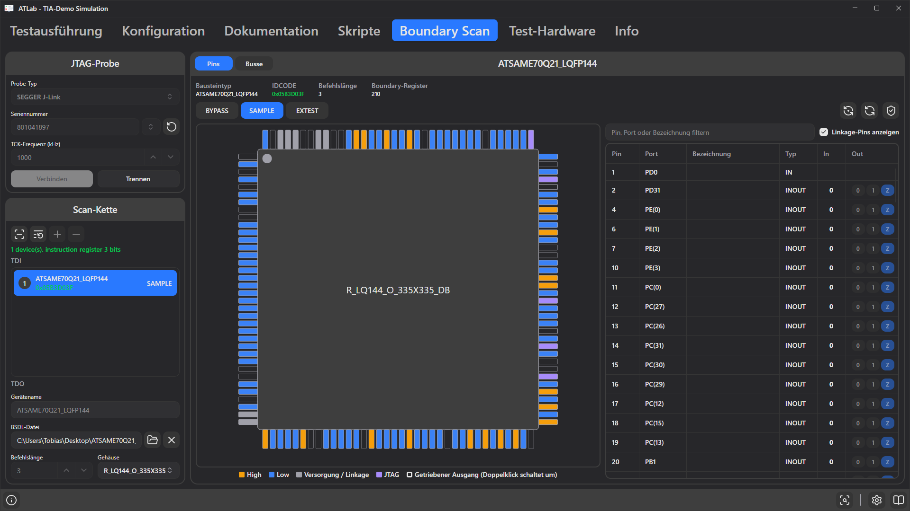

# 12. Registerkarte Boundary Scan

**Boundary Scan** (IEEE 1149.1, auch JTAG genannt) ermöglicht den Zugriff auf die Pins von Bausteinen einer Baugruppe, ohne sie mit einer Prüfspitze zu berühren. Jeder Pin eines Boundary-Scan-fähigen Bausteins hat eine Zelle im *Boundary-Register* des Bausteins. Über eine JTAG-Probe kann ATLab die Pegel dieser Pins lesen und die Pins treiben, während die interne Logik des Bausteins von ihnen getrennt ist. Typische Anwendungen:

- Verbindungen zwischen Bausteinen (Interconnect-Test) und zu Steckverbindern, LEDs, Tastern oder Jumpern prüfen,
- Bestückungsoptionen oder DIP-Schalter auslesen,
- mit I²C- oder SPI-Bausteinen (EEPROMs, Sensoren, Flash-Speicher) kommunizieren, deren Busleitungen an einem Boundary-Scan-Baustein hängen,
- eine Baugruppe untersuchen, die nicht startet.

Auf der Registerkarte **Boundary Scan** wird die Scan-Kette eingerichtet und manuell mit den Pins gearbeitet. Testschritte nutzen diese Einrichtung über die Auswertungsquellen [Boundary Scan](09-evaluation-sources.md#boundary-scan) und [Boundary-Scan-Bus](09-evaluation-sources.md#boundary-scan-bus).

Boundary Scan verwendet nicht den Test Interface Adapter, sondern eine eigene JTAG-Probe am JTAG-Anschluss der Baugruppe.

## Voraussetzungen

### Unterstützte Probes

| Probe | Treiber / Bibliothek | Hinweise |
|-------|----------------------|----------|
| **SEGGER J-Link** | *J-Link Software and Documentation Pack* von SEGGER (`JLink_x64.dll` unter Windows, `libjlinkarm.so` unter Linux) | Alle J-Link-Modelle mit JTAG-Unterstützung. |
| **FTDI MPSSE** (FT2232H, FT232H, FT4232H) | FTDI-*D2XX*-Treiber (`ftd2xx.dll` unter Windows, `libftd2xx.so` unter Linux) | Belegung an Kanal A: ADBUS0 = TCK, ADBUS1 = TDI, ADBUS2 = TDO, ADBUS3 = TMS. |

ATLab sucht die Bibliothek der Probe in dieser Reihenfolge:

1. im **Programmordner von ATLab**,
2. im Suchpfad des Betriebssystems (`PATH`, `System32`, Bibliothekscache),
3. in den Standard-Installationsordnern des Herstellers, z. B. `C:\Program Files\SEGGER\JLink…` (neueste Version zuerst).

Wird die Bibliothek nicht automatisch gefunden, kopieren Sie sie in den Programmordner von ATLab. Beim nächsten Versuch wird erneut gesucht, ATLab muss also nicht neu gestartet werden.

### BSDL-Dateien

Zum Lesen und Treiben von Pins benötigt ATLab die **BSDL-Datei** (Boundary Scan Description Language, `.bsd` oder `.bsdl`) jedes Bausteins. Sie beschreibt das Befehlsregister, die Zellen des Boundary-Registers und die Pinbelegung des Gehäuses. BSDL-Dateien stellt der Hersteller des Bausteins bereit, meist auf der Produktseite oder im Supportbereich seiner Website. Achten Sie darauf, dass die Datei genau zum Baustein und Gehäuse passt.

## Überblick

Die Registerkarte ist in drei Bereiche gegliedert:

- **JTAG-Probe** (links oben) – Auswahl und Verbindung der Probe,
- **Scan-Kette** (links unten) – die Bausteine der Kette und ihre Einstellungen,
- der rechte Bereich zeigt die **Pins** des ausgewählten Bausteins, die **Busse** oder den **Verbindungstest**. Umgeschaltet wird mit den Schaltflächen in seiner Kopfzeile.

Solange ein Testlauf die Kette steuert, ist die Registerkarte gesperrt und ein blauer Hinweis wird angezeigt (siehe [Boundary Scan während der Testausführung](#boundary-scan-während-der-testausführung)).

## Probe verbinden

| Feld | Beschreibung |
|------|--------------|
| **Probe-Typ** | `SEGGER J-Link` oder `FTDI MPSSE (FT2232H / FT232H / FT4232H)`. |
| **Seriennummer** | Seriennummer der zu verwendenden Probe. Leer lassen, um die erste verfügbare Probe zu verwenden. Die Suchen-Schaltfläche listet die angeschlossenen Probes auf; ein Eintrag aus der Auswahlliste neben dem Feld übernimmt die Seriennummer. FTDI-Kanäle erscheinen einzeln, z. B. `…A` und `…B`; JTAG verwendet normalerweise Kanal A. |
| **TCK-Frequenz (kHz)** | JTAG-Taktfrequenz, Standard 1000 kHz. Verringern, wenn die Kettenerkennung bei langen Kabeln oder langsamen Bausteinen fehlschlägt. |
| **ADBUS-Wert (hex)** / **ADBUS-Richtung (hex)** | Nur FTDI. Startpegel und Richtung von ADBUS0–7. TCK, TDI, TDO und TMS sind fest vorgegeben; mit den übrigen Pins lassen sich Treiber oder Pegelwandler des Adapters freigeben. Standard `08` / `0B`. |
| **Verbinden** / **Trennen** | Öffnet oder schließt die Probe. Nach dem Verbinden wird die Kette automatisch gescannt und mit der eingerichteten Kette verglichen (siehe [Scan-Kette](#scan-kette)). |

Die Einstellungen der Probe werden im Projekt gespeichert. **Trennen** versetzt alle Bausteine in den Normalbetrieb (Test-Logic-Reset), bevor die Probe geschlossen wird; dasselbe geschieht beim Beenden von ATLab.

## Scan-Kette

Die Liste zeigt die Bausteine in der Reihenfolge der Kette, von **TDI** (oben) nach **TDO** (unten). Jeder Eintrag zeigt:

- die Position in der Kette und den Namen (aus **Gerätename** oder, wenn kein Name vergeben ist, den Bausteintyp),
- den aus dem Baustein gelesenen IDCODE, grün wenn er zur BSDL-Datei passt, rot wenn nicht,
- den aktuell geladenen Befehl (`BYPASS`, `SAMPLE`, `EXTEST`), solange eine Verbindung besteht,
- *Keine BSDL*, solange noch keine BSDL-Datei zugeordnet ist.

| Schaltfläche | Funktion |
|--------------|----------|
| **Bausteine in der Scan-Kette erkennen** | Scannt die Kette erneut: Anzahl der Bausteine, Gesamtlänge der Befehlsregister und IDCODEs, und vergleicht sie mit der eingerichteten Kette. |
| **Erkannte Kette übernehmen** | Ersetzt die eingerichtete Kette nach einer Rückfrage durch die auf der Baugruppe gefundenen Bausteine. Wiedererkannte Bausteine behalten ihre Einstellungen; alle anderen werden mit BSDL-Datei, Gehäuse und Bezeichnungen entfernt. |
| **Baustein hinzufügen** / **Ausgewählten Baustein entfernen** | Bearbeitet die Kette von Hand, z. B. um ein Projekt ohne Hardware vorzubereiten. Nur ohne Verbindung möglich. |

Das Scannen **verändert eine eingerichtete Kette nie**. Ist eine andere Baugruppe angeschlossen, fehlt ein Baustein oder ist die Kette unterbrochen, bleibt Ihre Einrichtung mit BSDL-Dateien und Bezeichnungen erhalten. Nur eine leere Konfiguration übernimmt die erkannte Kette automatisch, was das Einrichten eines neuen Projekts erleichtert. Um eine bestehende Konfiguration aus der Baugruppe neu aufzubauen, verwenden Sie **Erkannte Kette übernehmen**.

Ein Baustein gilt als wiedererkannt, wenn sein IDCODE zu seiner BSDL-Datei passt. Die BSDL-Datei maskiert in der Regel die Versionsbits, sodass auch andere Silizium-Revisionen desselben Bausteins passen. Bausteine ohne BSDL-Datei müssen den gespeicherten IDCODE haben.

Bei bestehender Verbindung zeigt die Kettenliste die von der Baugruppe gelesenen IDCODEs. Die Statuszeile über der Liste zeigt `<n> device(s), instruction register <bits> bits`, wenn die Baugruppe zur Konfiguration passt, sonst jede Abweichung, z. B. *Found 2 device(s), the project expects 3.*, *Device 2 (U3): IDCODE 0x… does not match the BSDL file of …* oder *Device 1 (U1): instruction length unknown*. Befehle können erst geladen werden, wenn der Status grün ist.

### Baustein-Einstellungen

| Feld | Beschreibung |
|------|--------------|
| **Gerätename** | Bestückungsbezeichnung oder Name, z. B. `U3`. Wird in der Kettenliste, in Testschritten und in Ergebnismeldungen verwendet. |
| **BSDL-Datei** | Ordner-Schaltfläche: BSDL-Datei importieren. ×-Schaltfläche: entfernen. Die Datei wird sofort eingelesen; Warnungen (z. B. fehlende Befehle) erscheinen im Ereignisprotokoll. BSDL-Dateien im Projektordner werden mit relativem Pfad gespeichert. |
| **Befehlslänge** | Wird aus der BSDL-Datei übernommen. Für Bausteine ohne BSDL-Datei muss sie von Hand eingetragen werden. Ist nur bei einem Baustein der Kette die Länge unbekannt, berechnet ATLab sie aus der Gesamtlänge. |
| **Gehäuse** | Gehäusevariante aus der BSDL-Datei (z. B. `TQFP144`, `BGA256`). Bestimmt die Pinnamen und die Gehäusedarstellung. |
| **Footprint auf der Platine** | Referenz des Bausteins auf der KiCad-Platine des Projekts, z. B. `U3`. Damit umrandet die [Platinenansicht](14-running-tests.md#platinenansicht) den Baustein bei Boundary-Scan-Schritten und hebt die verwendeten Pins mit ihren Netzen hervor: Der Gehäusepin jedes Ports ist die Pad-Nummer des Footprints. |

Bausteine ohne BSDL-Datei können in der Kette bleiben; sie bleiben immer in BYPASS.

## Ansicht Pins

Die Ansicht **Pins** zeigt den ausgewählten Baustein: **Bausteintyp** (der Entity-Name aus der BSDL-Datei, z. B. `STM32F407_LQFP100`), **IDCODE**, **Befehlslänge** und **Boundary-Register** (Anzahl der Zellen).

### Befehle

| Schaltfläche | Wirkung |
|--------------|---------|
| **BYPASS** | Der Baustein wird überbrückt; seine Pins arbeiten normal. |
| **SAMPLE** | Die Pinpegel werden gelesen, ohne den Baustein zu beeinflussen. Geeignet, um Signale im normalen Betrieb der Baugruppe zu beobachten. |
| **EXTEST** | Die Pins werden vom Boundary-Register übernommen: Ausgänge werden aus ihm getrieben, Eingänge gelesen. Der Baustein verlässt den Normalbetrieb. |

Bevor EXTEST aktiv wird, lädt ATLab zuerst die gewünschten Ausgangswerte (PRELOAD), sodass die Ausgänge nie mit zufälligen Pegeln starten. Nach dem Laden einer BSDL-Datei stehen alle Zellen auf den **sicheren Werten** der BSDL-Datei; in der Regel sind damit alle Ausgänge abgeschaltet.

> **Vorsicht:** In EXTEST treiben die Ausgänge gegen alles, was sonst noch an dem Netz hängt. Stellen Sie vor dem Treiben eines Pins sicher, dass kein anderer Treiber auf der Baugruppe dagegen arbeitet, sonst können Bausteine beschädigt werden.

| Element | Funktion |
|---------|----------|
| Schaltfläche Automatisch aktualisieren | Liest die Pins fortlaufend (etwa zehnmal pro Sekunde), solange ein Baustein in SAMPLE oder EXTEST ist. Erneut klicken zum Beenden; die Schaltfläche ist hervorgehoben, solange sie aktiv ist. |
| Aktualisieren-Schaltfläche | Liest die Pins einmal. |
| Schild-Schaltfläche | **Alle Ausgänge auf die sicheren Werte der BSDL-Datei zurücksetzen.** |

### Gehäuseansicht

Die Zeichnung zeigt das Gehäuse mit dem aktuellen Zustand jedes Pins. Die Anordnung ergibt sich aus den Pinnamen: nummerierte Pins werden rund um ein Quad-Gehäuse (QFP, QFN) oder auf zwei Seiten (SOIC, TSOP, DIP) angeordnet, Namen aus Buchstabe und Zahl wie `A1` bilden ein BGA-Raster.

| Darstellung | Bedeutung |
|-------------|-----------|
| Orange | Pin liest High |
| Blau | Pin liest Low |
| Grau | Versorgungs- oder Linkage-Pin (ohne Boundary-Zelle) |
| Violett | JTAG-Pin (TCK, TMS, TDI, TDO, TRST) |
| Dicker weißer/schwarzer Rahmen | Ausgang wird über Boundary Scan getrieben (EXTEST) |
| Blauer Ring | Ausgewählter Pin |

Fährt man mit der Maus über einen Pin, erscheinen seine Details in der Zeile unter der Zeichnung, z. B. `Pin 8 · IO(3) · LED_RED · INOUT · In 0 · Out Z · Zellen I11 O10 C9`. Ein Klick wählt den Pin in der Tabelle aus; ein **Doppelklick** auf einen getriebenen Ausgang schaltet ihn zwischen 0 und 1 um.

### Pin-Tabelle

| Spalte | Inhalt |
|--------|--------|
| **Pin** | Pinname des Gehäuses. |
| **Port** | Portname aus der BSDL-Datei, z. B. `PA3` oder `IO(3)`. |
| **Bezeichnung** | Eigener Name für das Signal, z. B. der Netzname aus dem Schaltplan. Zum Bearbeiten die Zelle doppelklicken oder `F2` drücken. |
| **Typ** | `IN`, `OUT`, `INOUT`, `LINKAGE` oder `TAP`. |
| **In** | Vom Pin gelesener Pegel (`0`/`1`), leer solange der Baustein in BYPASS ist. |
| **Out** | Schaltflächen `0`, `1` und `Z` zum Treiben des Pins; nur in EXTEST aktiv. `Z` wird nur angeboten, wenn sich der Ausgang abschalten lässt. |

- Ein Klick auf eine Spaltenüberschrift sortiert; Pins und Ports werden natürlich sortiert (`2` vor `10`, `IO(2)` vor `IO(10)`).
- Das Filterfeld über der Tabelle durchsucht Pin, Port und Bezeichnung.
- **Linkage-Pins anzeigen** blendet Versorgungs- und andere Pins ohne Boundary-Zellen aus.
- Fährt man mit der Maus über die Zelle **In** oder **Out**, werden die Boundary-Register-Zellen des Pins angezeigt (`I` = Eingang, `O` = Ausgang, `C` = Steuerung).

Viele Bausteine verwenden eine **Steuerzelle** für mehrere Ausgänge. Wird einer davon auf `Z` geschaltet, werden alle Ausgänge dieser Gruppe abgeschaltet; der Tooltip nennt die betroffenen Pins.

**Bezeichnungen** werden im Projekt pro Port gespeichert und bleiben deshalb bei einem Gehäusewechsel erhalten. Sie erscheinen in der Gehäuseansicht, in Testschritten und in Ergebnismeldungen.

## Ansicht Busse

In der Ansicht **Busse** werden Busse festgelegt, die über Boundary-Scan-Pins nachgebildet werden. Testschritte wählen einen Bus über die Auswertungsquelle [Boundary-Scan-Bus](09-evaluation-sources.md#boundary-scan-bus) aus. Die Registerkarte dient nur der Einrichtung der Busse; die Übertragungen führen Testschritte aus.

Busse werden mit **+** und **−** hinzugefügt und entfernt. Für den ausgewählten Bus:

| Feld | Beschreibung |
|------|--------------|
| **Name** | In Testschritten angezeigter Name, z. B. `EEPROM`. |
| **Typ** | `I²C`, `SPI` oder `Pin Group`. |
| **SPI-Modus** | Nur SPI: Modus 0–3 (CPOL/CPHA). |
| **CS high-aktiv** | Nur SPI: Chip-Select ist high-aktiv statt low-aktiv. |
| **LSB zuerst** | Nur SPI: Bits werden mit dem LSB zuerst übertragen. |
| **Anzahl Pins** | Nur Pin-Gruppe: Anzahl der Pins (1–32). |

Die Signaltabelle listet die Signale des Bustyps. Zum Zuordnen eines Bausteins und Pins die Zelle **Baustein** oder **Pin** doppelklicken; Bezeichnungen werden neben den Ports angezeigt. Die Signale dürfen auf mehrere Bausteine der Kette verteilt sein.

| Typ | Signale | Anforderungen |
|-----|---------|---------------|
| **I²C** | SCL, SDA | Beide benötigen einen auf `Z` schaltbaren Ausgang und einen Eingang. Auf der Baugruppe werden Pull-up-Widerstände benötigt. |
| **SPI** | SCK, MOSI, MISO, CS | SCK ist erforderlich, MOSI, MISO und CS sind optional, mindestens MOSI oder MISO wird jedoch benötigt. Ausgänge für SCK, MOSI und CS, ein Eingang für MISO. |
| **Pin Group** | Bit 0 … Bit n | Ausgänge zum Schreiben; Eingänge (und auf `Z` schaltbare Ausgänge) zum Lesen. |

Unter der Tabelle listet ATLab auf, was noch fehlt oder nicht möglich ist, z. B. *SDA has no pin assigned.* oder *SCL: U1 PB6 cannot be switched to Z.* Ist alles in Ordnung, erscheint *Der Bus kann in Testschritten verwendet werden.*

Eine **Pin-Gruppe** behandelt mehrere Pins als eine Zahl: Beim Schreiben wird der Wert auf Bit 0 … n getrieben, beim Lesen werden die Pins freigegeben und eingelesen. Geeignet für Bestückungsoptionen, DIP-Schalter oder LED-Ports. Sie hat keine Steuerleitungen und kann daher keine Speicher oder anderen parallelen Busse mit Strobe-Signalen ansprechen.

### Geschwindigkeit und Einschränkungen

Ein Bus wird nachgebildet, indem seine Pins über das Boundary-Register gesetzt werden; jeder Wechsel einer Busleitung kostet daher einen vollständigen Scan der Kette. Der Bustakt ergibt sich somit aus dem JTAG-Takt:

- **Ein Scan** dauert *DR-Länge + 5* TCK-Takte. Die DR-Länge ist die Summe der Boundary-Register-Längen aller Bausteine in EXTEST oder SAMPLE, plus 1 Bit je Baustein in BYPASS.
- **Ein Bustakt** braucht bei I²C 3 Scans (SDA setzen, SCL high, SCL low; Start, Stopp und ACK kommen hinzu), bei SPI mit CPHA 0 3 Scans und mit CPHA 1 2 Scans. Eine Pin-Gruppe braucht einen Scan je Schreib- und einen je Lesezugriff.

Beispiel: TCK 1000 kHz und ein Baustein mit 100 Zellen im Boundary-Register ergeben (100 + 5) µs je Scan, etwa 315 µs je I²C-Bit, also einen SCL-Takt von rund 3 kHz.

Alle Scans einer Übertragung werden in einem einzigen Transfer an die Probe geschickt; die USB-Latenz spielt daher kaum eine Rolle, und ein I²C-Registerzugriff dauert nur wenige Millisekunden. So wird ein Bus schneller:

- **TCK-Frequenz (kHz)** erhöhen; der Bustakt steigt im gleichen Verhältnis.
- Bausteine, die der Bus nicht nutzt, in BYPASS lassen. Ein Baustein, der aus einem früheren Schritt oder von dieser Registerkarte noch in EXTEST oder SAMPLE ist, verlängert jeden Scan um sein ganzes Boundary-Register. EXTEST bleibt bis zum Ende des Testlaufs aktiv.
- Wenn möglich, Pins eines Bausteins mit kurzem Boundary-Register verwenden.

I²C und SPI haben keine Mindesttaktrate; EEPROMs, Sensoren, Port-Expander und Flash-Speicher funktionieren damit.

- I²C-**Clock-Stretching** wird nicht unterstützt. Hält ein Baustein SCL low, schlägt der Schritt mit *SCL is held low* fehl.
- UART, 1-Wire und andere Protokolle mit festem Timing lassen sich nicht nachbilden.

## Ansicht Verbindungstest

Der Verbindungstest prüft die Verbindungen zwischen den Boundary-Scan-Pins der Platine: Er findet **Unterbrechungen** (ein Pin sieht sein Netz nicht), **Kurzschlüsse** zwischen Netzen und Netze, die auf 0 oder 1 **festhängen**. Er braucht die KiCad-Platine im Projekt ([Platine und Netze](06-configuration.md#platine-und-netze)) und für jeden Baustein eine BSDL-Datei und seinen **Footprint auf der Platine**. Die Ansicht listet jedes Netz der Platine mit mindestens einem Boundary-Scan-Pin.

| Spalte | Inhalt |
|--------|--------|
| **Netz** | Netzname aus KiCad |
| **Rolle** | Was der Test mit dem Netz macht, siehe unten |
| **Verbunden mit** | Ein anderes Netz, mit dem dieses verbunden ist, z. B. über einen Serienwiderstand, siehe [Verbundene Netze](#verbundene-netze) |
| **Boundary-Scan-Pins** | Die Pins der Kette auf dem Netz, z. B. `U3 pin 12 (PA3)`; mit einem Signalnamen aus der Pin-Tabelle statt des Ports |
| **Weitere Pads** | Die anderen Pads auf dem Netz, z. B. `R5.1, J1.3`, um zu beurteilen, ob das Netz getrieben werden darf |
| **Hinweis** | Probleme, die den Test verhindern (rot), und Hinweise |

**Jedes Netz beginnt als Sicher.** Eine oder mehrere Zeilen auswählen (`Strg`/`Umschalt`+Klick) und eine Rollen-Schaltfläche klicken, um die Rolle aller ausgewählten Zeilen zu setzen:

| Rolle | Wirkung |
|-------|---------|
| **Sicher** | Das Netz wird nicht berührt: Seine Pins behalten ihre sicheren Werte aus der BSDL-Datei und werden nicht gelesen. |
| **Drive** | Jeder Boundary-Scan-Pin auf dem Netz, der einen Ausgang hat, treibt es der Reihe nach, während alle anderen es lesen. So wird auch der Ausgang jedes Pins geprüft. Drive nur für Netze wählen, die sonst nichts treibt: kein Ausgang eines anderen Bausteins, keine Versorgung, kein Oszillator. |
| **Expect 1** / **Expect 0** | Das Netz wird nur gelesen und muss auf diesem Pegel bleiben, z. B. ein Pull-up, ein fest an die Versorgung gelegtes Enable oder GND. Ein getriebenes Netz, das damit kurzgeschlossen ist, wird ebenfalls gefunden. |

#### Verbundene Netze

Ein Serienwiderstand teilt ein Signal in zwei KiCad-Netze, z. B. `/SDA_MCU` und `/SDA`. Um die Verbindung über den Widerstand zu prüfen, das andere Netz bei **Verbunden mit** eintragen; das Feld schlägt die Netze der Liste vor. Beide Netze werden dann als ein Netz geprüft: Jeder Boundary-Scan-Pin beider Netze treibt der Reihe nach, und alle lesen. Ein fehlender oder offener Widerstand zeigt sich als Unterbrechung zwischen den Pins beider Seiten.

- Verbundene Netze haben immer dieselbe Rolle: Die Rolle eines davon zu setzen, setzt sie für alle. Wird ein Netz verbunden, übernimmt es die Rolle des Netzes, mit dem es verbunden wird (oder behält seine eigene, wenn jenes Sicher ist).
- Mehrere Netze lassen sich verketten: `A` mit `B` und `B` mit `C` verbunden ergibt ein Netz aus dreien. Die Spalte Hinweis nennt die gemeinsam geprüften Netze, Meldungen nennen sie als `/SDA_MCU + /SDA`.
- Das Feld leeren, um die Verbindung zu entfernen.

Der Filter findet Netze, Pins und Pads; **Nur geprüfte** blendet die sicheren Netze aus; die Aktualisieren-Schaltfläche liest Platine und BSDL-Dateien erneut. Die Zeile unter der Tabelle zählt die Netze je Rolle und die Netze mit Problemen.

#### Wann der Test nicht läuft

Zwei Pins dürfen nie gleichzeitig dasselbe Netz treiben, der eine auf 1 und der andere auf 0. Das würde die Ausgänge gegeneinander kurzschließen. Deshalb schaltet der Test jeden Pin eines geprüften Netzes ab, außer dem, der gerade an der Reihe ist. Abgeschaltet wird ein Pin über seine **Ausgangsfreigabe**, eine Zelle in der BSDL-Datei, die den Ausgangstreiber des Pins ein- und ausschaltet.

Manche Einrichtungen lassen das nicht zu. Der Test läuft dann gar nicht. Die Spalte Hinweis zeigt das Problem rot, und ein Testschritt schlägt mit derselben Meldung fehl.

| Problem | Warum der Test nicht läuft | Abhilfe |
|---------|----------------------------|---------|
| Zwei Pins auf einem Drive-Netz **treiben immer** (*… always drive (no output enable)*), oder einer auf einem Expect-Netz. | Diese Pins haben keine Ausgangsfreigabe und lassen sich nicht abschalten. Sie würden gegeneinander treiben oder gegen den Pegel, den das Netz haben soll. | Das Netz auf Sicher setzen. |
| Ein Pin **teilt seine Ausgangsfreigabe** mit anderen Pins (*… shares its output enable with PA4, PA5*). | Manche Bausteine schalten mehrere Pins mit einer Ausgangsfreigabe. Wenn dieser Pin treibt, würden auch PA4 und PA5 treiben, auf Netzen, die dafür nicht eingerichtet sind. | Die Netze von PA4 und PA5 ebenfalls auf Drive setzen; dann treiben sie in derselben Runde und werden mitgeprüft. Oder dieses Netz auf Sicher setzen. |
| **Kein Pin kann das Netz treiben** oder **keiner kann es lesen**. | Der Test hat nichts zu treiben oder nichts zu lesen. | Das Netz auf Sicher setzen. |
| Das Netz ist **nicht mehr auf der Platine**. | Die Platine hat sich geändert, seit die Rolle gesetzt wurde. | Das Netz auf Sicher setzen. |

Die Rolle eines Netzes wird im Projekt gespeichert; sichere Netze werden nicht gespeichert. Ausgeführt wird der Test mit einem Schritt der Auswertungsquelle [Boundary-Scan-Verbindungstest](09-evaluation-sources.md#boundary-scan-verbindungstest).

### So funktioniert der Test

Jedes Drive-Netz bekommt einen eigenen Code. Eine **Runde** treibt die Bits aller Codes und danach ihre Komplemente, so wird jedes Netz auf 0 und 1 getrieben, und zwei kurzgeschlossene Netze können nicht beide ihren eigenen Code lesen. Für *n* Drive-Netze hat eine Runde 2 × ⌈log₂(*n* + 2)⌉ Muster, z. B. 14 für 100 Netze.

Es gibt eine Runde je Pin, der treiben kann: Auf einem Netz mit Pins von U1 und U2 treibt U1 in der ersten Runde und U2 in der zweiten, die anderen Pins lesen jedes Mal. Ein Netz mit weniger Treibern nimmt seine Treiber erneut, so wird jedes Netz in jeder Runde getrieben. Ein Pin ohne Ausgangsfreigabe ist der einzige Treiber seines Netzes, da er sich nicht abschalten lässt (der Hinweis sagt das). Alle Runden gehen in einer Übertragung an die Probe.

Alle Bausteine mit BSDL-Datei sind in EXTEST. Alle Zellen beginnen auf ihren sicheren Werten; in jedem Muster sind nur die Pins eingeschaltet, die an der Reihe sind, und nach dem letzten Muster kehren alle Zellen auf ihre sicheren Werte zurück.

Der Vergleich der Runden zeigt, wo ein Fehler liegt:

| Ergebnis | Bedeutung |
|----------|-----------|
| Niemand liest das Netz, in keiner Runde | Das Netz selbst: ein Kurzschluss oder ein festhängendes Netz |
| Niemand liest das Netz, während ein Pin treibt, sonst ist alles in Ordnung | Der Ausgang dieses Pins ist defekt |
| Nur ein Pin liest falsch, auch wenn er selbst treibt | Der Eingang dieses Pins ist defekt |
| Ein Pin sieht die anderen nicht, und sie sehen ihn nicht | Unterbrechung an diesem Pin, z. B. eine schlechte Lötstelle. Mit nur zwei Pins auf dem Netz kann der Test nicht sagen, welches Ende offen ist. |

| Meldung | Bedeutung |
|---------|-----------|
| *Short between nets A, B.* | Die Netze lesen eine Kombination ihrer Codes. |
| *Nets A, B all read 0: shorted to each other or each to GND.* | Mehrere Netze lesen einen festen Pegel; die Daten können die beiden Fälle nicht unterscheiden. |
| *Net A is stuck at 0: short to GND or to a stronger driver.* | Der Treiber kann das Netz nicht ändern. |
| *Net A: U2 pin 4 (PB1) does not drive the net, the other drivers do: its output is defective.* | Das Netz funktioniert mit jedem Treiber außer diesem. |
| *Net A: U2 pin 4 (PB1) does not read the net, the others see it drive: its input is defective.* | Der Pin treibt das Netz, kann es aber nicht lesen. |
| *Open at U3 pin 7 (PA3) on net A: …* | Der Pin ist vom Netz getrennt. |
| *Open on net A between U1 pin 3 (P3) and U2 pin 3 (P3): …* | Zwei Pins sehen sich nicht; jedes Ende kann offen sein. |
| *Open on net A: U5 pin 4 (SDA) does not see the net (reads 1); open at the pin or defective input.* | Ein Pin, der nicht treiben kann, folgt dem Netz nicht. |
| *Short between nets GND and A: U3 pin 7 follows the driven net.* | Ein Expect-Netz liest den Code eines Drive-Netzes. |

Grenzen: Eine Verbindung über einen Serienwiderstand wird nur geprüft, wenn die beiden Netze [verbunden](#verbundene-netze) sind. Ein Netz mit nur einem Boundary-Scan-Pin zeigt Kurzschlüsse und festhängende Pegel, aber keine Unterbrechungen (der Hinweis sagt das).

## Boundary Scan während der Testausführung

Testschritte verwenden die auf dieser Registerkarte eingerichtete Kette:

- Die Probe wird beim **ersten** Boundary-Scan-Schritt eines Laufs verbunden, nicht beim Teststart. Anschließend wird die Kette mit dem Projekt verglichen (Anzahl der Bausteine, IDCODEs, Befehlslängen). Passt sie nicht, z. B. weil die falsche Baugruppe eingelegt ist, schlägt der Schritt mit derselben Meldung wie die Statuszeile dieser Registerkarte fehl, z. B. *Boundary scan chain: Found 2 device(s), the project expects 3.*
- Eine auf dieser Registerkarte geöffnete Verbindung wird vom Test übernommen. Die Registerkarte bleibt gesperrt, bis der Test die Kette freigibt.
- Pins, die ein Schritt nicht auflistet, behalten ihren Zustand aus den vorherigen Schritten. Ausnahme ist ein Schritt **Boundary-Scan-Verbindungstest**: Er beginnt mit den sicheren Werten und lässt alle Pins auf ihren sicheren Werten. Ein Baustein, dessen Ausgänge getrieben wurden, bleibt in EXTEST, bis die Kette freigegeben wird.
- Die Kette wird freigegeben – alle Bausteine kehren in den Normalbetrieb zurück und die Probe wird geschlossen –, wenn der Lauf endet, wenn er gestoppt wird (`Esc`), bei einem Schritt im Modus **Boundary Scan ausschalten** und wenn ein anderes Projekt geöffnet wird.
- **Einzelschritt ausführen** (`F3`) behält die Kette nach dem Schritt unter Kontrolle des Tests, sodass mehrere Einzelschritte aufeinander aufbauen können. **Stopp** (`Esc`) gibt sie frei. Ein vollständiger Lauf beginnt immer mit den sicheren Werten.

Verwenden Sie **Boundary Scan ausschalten** vor Schritten, die die Bausteine im Normalbetrieb benötigen oder selbst auf die Probe zugreifen, z. B. das Programmieren des Bausteins mit einem externen Programm über denselben J-Link.
