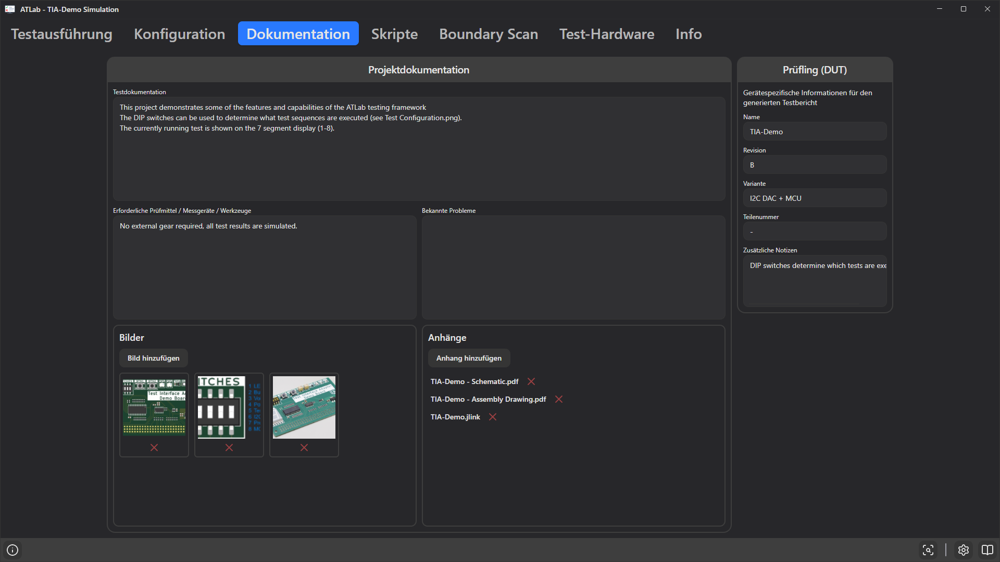

# 13. Registerkarte Dokumentation

Die Registerkarte **Dokumentation** hält das Wissen, das zum Ausführen eines Tests nötig ist, zusammen mit dem Test selbst fest: was er tut, welche Ausrüstung benötigt wird, bekannte Probleme, Bilder und Referenzdokumente. Außerdem enthält sie die Prüflingsdaten für den Testbericht.

Alle Inhalte werden in der Projektdatei gespeichert. Bilder und Anhänge werden als **Pfade** abgelegt (relativ, wenn sie im Projektordner liegen), nicht eingebettet – bewahren Sie die Dateien neben dem Projekt auf.

## Projektdokumentation

### Textfelder

| Feld | Vorgeschlagener Inhalt |
|------|------------------------|
| **Testdokumentation** | Zweck des Tests, was die Sequenz tut, wie der Prüfling vorbereitet und angeschlossen werden muss. |
| **Erforderliche Prüfmittel / Messgeräte / Werkzeuge** | Netzteile, Messgeräte, Kabel, Adapter, Programmiergeräte. |
| **Bekannte Probleme** | Einschränkungen, Workarounds, typische Fehlerursachen. |

### Bilder

- **Bild hinzufügen** fügt eine PNG-, JPG-, JPEG-, BMP-, GIF- oder WEBP-Datei hinzu. Ein Vorschaubild wird angezeigt.
- Ein Klick auf das Vorschaubild zeigt das Bild vergrößert; mit × schließen.
- Das rote × unter einem Vorschaubild entfernt das Bild aus dem Projekt (die Datei selbst wird nicht gelöscht).

Nützlich für Fotos der Prüfvorrichtung, Anschlusspläne oder die Lage von Testpunkten.

### Anhänge

- **Anhang hinzufügen** fügt eine beliebige Datei hinzu – Schaltpläne, Bestückungspläne, Datenblätter, Projektdateien für Programmiergeräte.
- Ein Klick auf den Namen eines Anhangs öffnet ihn mit der seinem Dateityp zugeordneten Anwendung.
- Das rote × entfernt den Anhang aus dem Projekt (die Datei wird nicht gelöscht).

Existiert ein referenziertes Bild oder eine Datei nicht mehr, wird ein Fehler protokolliert (*„Image not found: …“* / *„File not found: …“*).

## Prüfling (DUT)

*Gerätespezifische Informationen für den generierten Testbericht.*

| Feld | Bezeichnung im Bericht |
|------|------------------------|
| **Name** | Gerätename (auch im Berichtstitel verwendet) |
| **Revision** | Revision |
| **Variante** | Variante |
| **Teilenummer** | Teilenummer |
| **Zusätzliche Notizen** | Zusätzliche Informationen (eigener Abschnitt, nur gedruckt, wenn nicht leer) |

Leere Felder werden als `-` gedruckt. Die Seriennummer wird nicht hier eingegeben; sie stammt aus dem Seriennummer-Dialog zu Beginn jedes Tests.

Name, Revision, Variante und Teilenummer werden außerdem in der [Ergebnisleiste](14-running-tests.md#die-ergebnisleiste) auf der Registerkarte Testausführung angezeigt, damit der Bediener prüfen kann, ob der richtige Test geladen ist.
