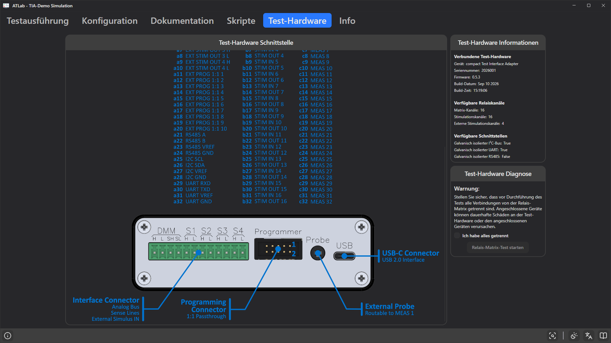

# 14. Registerkarte Test-Hardware

Die Registerkarte **Test-Hardware** zeigt, was angeschlossen ist, und ermöglicht die Prüfung der Relais-Matrix.

## Test-Hardware Schnittstelle

Eine Abbildung des Test Interface Adapters mit der Pinbelegung seiner Steckverbinder:

- **Interface Connector** – analoger Messbus, Sense-Leitungen und externe Stimulus-Eingänge (DMM H/L/SH/SL, S1–S4),
- **Programming Connector** – 1:1-Durchleitung für ein Programmiergerät,
- **External Probe** – auf den Messbus schaltbar,
- **USB-C** – Verbindung zum PC (USB 2.0).

Die Pintabelle (`a1…a32`, `b1…b32`, `c1…c32`) listet die Signale am prüflingsseitigen Steckverbinder: externe Stimulationsausgänge, externe Programmierleitungen, RS485-, I²C- und UART-Leitungen, Stimulationsein- und -ausgänge sowie die Matrix-Messkanäle (`MEAS 1…32`). Verwenden Sie sie beim Verdrahten einer Prüfvorrichtung.

## Test-Hardware Informationen

| Abschnitt | Information |
|-----------|-------------|
| **Verbundene Test-Hardware** | Gerätename, Seriennummer, Firmware-Version, Build-Datum und Build-Zeit des Adapters. |
| **Verfügbare Relaiskanäle** | Anzahl der Matrix-, Stimulations- und externen Stimulationskanäle. |
| **Verfügbare Schnittstellen** | Ob galvanisch isolierter I²C-Bus, UART und RS485 verfügbar sind (`True`/`False`). |

Im Simulatormodus wird das Gerät als `Simulator` mit `N/A` für Seriennummer und Firmware angezeigt, mit 32 / 16 / 4 Kanälen und allen Schnittstellen.

Die Kanalanzahlen bestimmen, wie viele Zeilen die [Kanalbezeichnungen](05-configuration.md#kanalbezeichnungen) und die Relaisauswahlen haben, und werden beim Öffnen eines Projekts geprüft (siehe [Prüfung der Hardware-Kompatibilität](04-projects.md#prüfung-der-hardware-kompatibilität)).

## Test-Hardware Diagnose

Der **Relais-Matrix-Test** prüft jedes Matrix-Relais des Adapters.

> **Warnung:** Stellen Sie sicher, dass vor Durchführung des Tests alle Verbindungen von der Relais-Matrix getrennt sind. Angeschlossene Geräte können dauerhafte Schäden an der Test-Hardware oder den angeschlossenen Geräten verursachen.

1. Prüfvorrichtung und alle Messgeräte vom Adapter trennen.
2. **Ich habe alles getrennt** anhaken.
3. **Relais-Matrix-Test starten** klicken.

Ergebnis:

- **Relay Matrix Test Passed** – alle Relais funktionieren.
- **Defective Relays Detected** – die defekten Relais werden getrennt für **Matrix H** und **Matrix L** aufgelistet.
- **Relay Matrix Test Failed: …** – der Test konnte nicht durchgeführt werden (Kommunikationsproblem).

Das Bestätigungs-Kontrollkästchen wird nach jedem Lauf zurückgesetzt und muss für den nächsten Lauf erneut angehakt werden. Im Simulatormodus besteht der Test immer.

## Matrix-Kanal mit der Prüfspitze ermitteln

So finden Sie heraus, mit welchem Matrix-Kanal ein Testpunkt verbunden ist (z. B. beim Bau einer Prüfvorrichtung oder beim Schreiben einer Sequenz):

1. Den Testpunkt mit der **externen Prüfspitze** berühren.
2. Die Prüfspitzen-Schaltfläche in der Statusleiste (**Matrix-Kanal über externe Prüfspitze ermitteln**) klicken oder `F12` drücken. Während ein Test läuft, ist das nicht möglich.
3. Die Statusleiste zeigt `Matrix Channel: <n>` oder `-`, wenn der Punkt mit keinem Matrix-Kanal verbunden ist. Wird keine Prüfspitze erkannt, erscheint *External probe not detected* und ein Fehler wird protokolliert.

Das funktioniert auf jeder Registerkarte.
