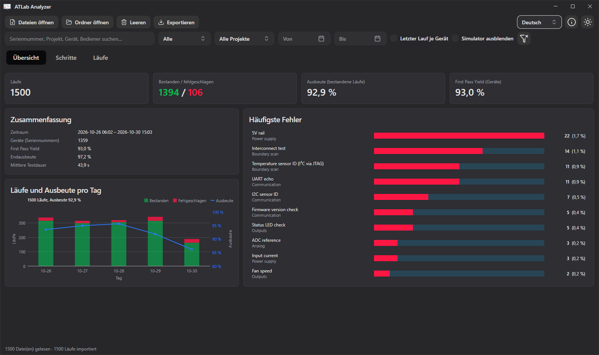
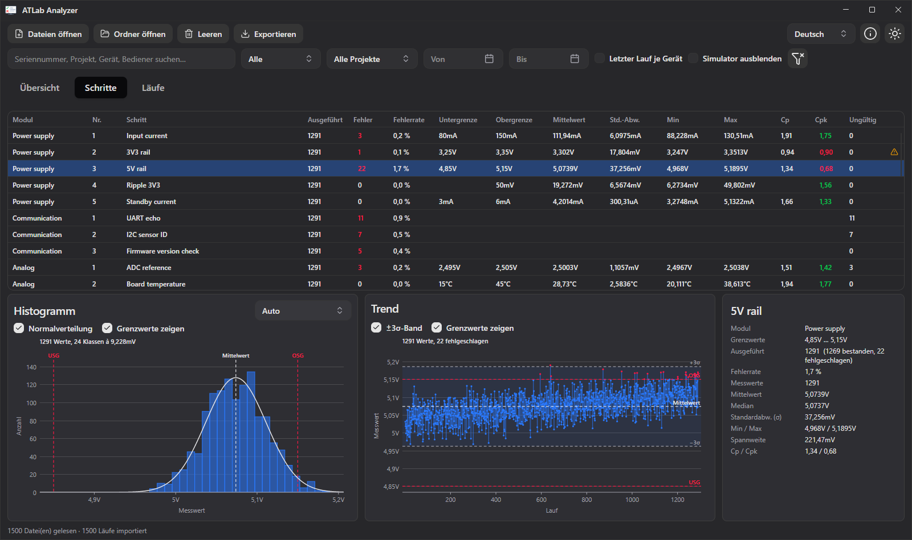
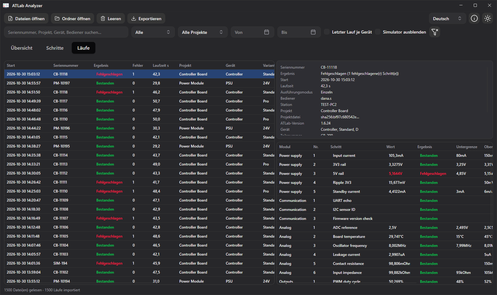

# 16. ATLab Analyzer

ATLab Analyzer wertet die JSON-Ergebnisdateien vieler Läufe aus: Ausbeute, die am häufigsten fehlschlagenden Schritte, Verteilung und Verlauf jedes Messwerts sowie die Prozessfähigkeit (Cp, Cpk). Er ist ein eigenes Programm, das zusammen mit ATLab installiert wird; er liest Ergebnisdateien und verändert sie nie.

## Voraussetzungen

Der Analyzer liest die **JSON-Ergebnisdateien**, die ATLab schreibt, wenn in den Projekteinstellungen **Ergebnisdatei für Auswertung exportieren (JSON)** aktiviert ist (siehe [Testergebnisse & Berichte](15-results-and-reports.md#json-ergebnisdatei)). CSV-Dateien und PDF-Berichte können nicht ausgewertet werden.

Starten Sie den Analyzer über das Startmenü (**ATLab Analyzer**) oder aus dem Unterordner `Analyzer` des Programmordners (`ATLab.Analyzer.exe`, unter Linux `ATLab.Analyzer`).

## Ergebnisdateien öffnen

| Aktion | So geht's |
|--------|-----------|
| Einzelne Dateien öffnen | **Dateien öffnen** oder `Strg+O` |
| Ordner öffnen | **Ordner öffnen** oder `Strg+Umschalt+O`. Alle JSON-Dateien im Ordner **und in seinen Unterordnern** werden gelesen, sodass sich der Ausgabepfad von ATLab mit den Unterordnern `Pass` und `Fail` auf einmal öffnen lässt. |
| Drag & Drop | Dateien oder Ordner auf das Fenster ziehen. |
| Kommandozeile | `ATLab.Analyzer.exe <Datei oder Ordner> …` öffnet die angegebenen Pfade beim Start. |

Geöffnete Läufe werden zu den bereits importierten hinzugefügt; eine erneut geöffnete Datei wird neu gelesen, sodass ein zweites **Ordner öffnen** neue Läufe übernimmt. **Leeren** entfernt alle Läufe.

Andere JSON-Dateien (z. B. Einstellungsdateien) und beschädigte Dateien werden übersprungen. Die Statusleiste zeigt, wie viele Dateien gelesen und übersprungen wurden; ein Klick auf **… Datei(en) übersprungen** zeigt die Liste mit dem Grund für jede Datei.

## Filter

Die Filterleiste gilt für alle Registerkarten und für jeden Export:

| Filter | Wirkung |
|--------|---------|
| Suche | Seriennummer, Dateiname, Projekt, Gerät, Variante, Bediener oder Station enthält den Text |
| **Alle / Bestanden / Fehlgeschlagen** | Gesamtergebnis des Laufs |
| Projekt | Läufe eines Projekts |
| **Von / Bis** | Startdatum des Laufs; *Bis* schließt den ganzen Tag ein |
| **Letzter Lauf je Gerät** | Nur der neueste Lauf jeder Seriennummer, angewendet nach den anderen Filtern (z. B. zusammen mit *Bestanden*: der letzte bestandene Lauf jedes Geräts). Läufe ohne Seriennummer bleiben erhalten. |
| **Simulator ausblenden** | Blendet Läufe im Simulatormodus aus |

Die Trichter-Schaltfläche setzt alle Filter zurück.

## Registerkarte Übersicht

Die Kacheln oben zeigen die Anzahl der Läufe, bestandene und fehlgeschlagene Läufe, die **Ausbeute** (Anteil bestandener Läufe) und den **First Pass Yield**.

**Zusammenfassung**

| Kennzahl | Bedeutung |
|----------|-----------|
| Zeitraum | Erster und letzter Startzeitpunkt der gefilterten Läufe |
| Geräte (Seriennummern) | Anzahl verschiedener Seriennummern |
| First Pass Yield | Anteil der Geräte, deren **erster** Lauf bestanden hat |
| Endausbeute | Anteil der Geräte, deren **letzter** Lauf bestanden hat, also nach Nacharbeit und Nachtests |
| Mittlere Testdauer | Durchschnittliche Dauer eines Laufs |

Geräte werden an ihrer Seriennummer unterschieden (Groß-/Kleinschreibung und Leerzeichen am Rand werden ignoriert); Läufe ohne Seriennummer zählen für die Ausbeute, aber nicht für die Gerätekennzahlen.

**Läufe und Ausbeute pro Tag** zeigt die bestandenen (grün) und fehlgeschlagenen (rot) Läufe jedes Tages als Balken und die Ausbeute des Tages als Linie an der rechten Achse. Tage ohne Läufe werden ausgelassen. Gibt es an mehr als 60 Tagen Läufe, werden sie nach Kalenderwochen zusammengefasst. Zeigen Sie auf einen Balken, um die Zahlen des Tages zu sehen.

**Häufigste Fehler** listet die zehn Schritte mit den meisten Fehlschlägen. Ein Klick auf einen Schritt öffnet ihn in der Registerkarte Schritte.

## Registerkarte Schritte

Die Tabelle zeigt jeden Schritt über alle gefilterten Läufe. Schritte werden über ihre Schritt-ID zugeordnet, sodass Umbenennen oder Umnummerieren eines Schritts im Projekt seine Historie nicht aufteilt. Name, Nummer und Grenzwerte stammen aus dem neuesten Lauf; ein ⚠ am Ende der Zeile bedeutet, dass sich die Grenzwerte zwischen den Läufen geändert haben; die Statistik verwendet dann die Grenzwerte des neuesten Laufs. Ein Klick auf eine Spaltenüberschrift sortiert.

| Spalte | Bedeutung |
|--------|-----------|
| Ausgeführt / Fehler / Fehlerrate | Anzahl der Läufe, die den Schritt ausgeführt haben, fehlgeschlagene Ergebnisse und deren Anteil |
| Untergrenze / Obergrenze | Grenzwerte des neuesten Laufs |
| Mittelwert, Std.-Abw., Min, Max | Statistik der Messwerte (Stichproben-Standardabweichung) |
| Cp | (Obergrenze − Untergrenze) / 6σ: passt die Streuung zwischen die Grenzwerte? |
| Cpk | Abstand des Mittelwerts zur näheren Grenze in Einheiten von 3σ: passt die Streuung an ihrer tatsächlichen Lage? Bei nur einer Grenze der einseitige Index. Grün ab 1,33, orange ab 1,00, darunter rot. |
| Ungültig | Ergebnisse ohne gültigen Wert: Timeout, NACK, Überlauf oder ein unlesbarer Wert |

Cp und Cpk bleiben leer ohne Streuung (weniger als zwei Werte oder alle Werte gleich) und bei Schritten, deren Unter- und Obergrenze gleich sind (z. B. `0 … 0` fehlerhafte Pins einer Boundary-Scan-Prüfung oder `1 … 1` für eine Bestätigung): Solche Schritte sind Gut/Schlecht-Prüfungen ohne Toleranz.

Unter der Tabelle wird der ausgewählte Schritt als Histogramm, Trend und Kennzahlen dargestellt.

### Histogramm

Das Histogramm zeigt, wie oft jeder Wertebereich gemessen wurde, mit den Grenzwerten (**USG**, **OSG**) als rote gestrichelte Linien und dem Mittelwert als gestrichelte Linie.

| Einstellung | Wirkung |
|-------------|---------|
| **Auto** | Klassen aus der Streuung der Werte (Freedman–Diaconis-Regel, robust gegen Ausreißer). Gestufte Werte, z. B. ganze Zahlen oder die Auflösung eines Messgeräts, liegen in der Mitte ihrer Klassen. |
| **Anzahl Klassen** | Einstellbar mit dem Schieberegler, 2 bis 200 |
| **Klassenbreite** | Eingabe in der Einheit des Schritts; SI-Präfixe sind erlaubt (`5m`, `5 mV`, `0,005`). Die Klassengrenzen liegen auf Vielfachen der Breite. Eine Eingabe in einer anderen Einheit (`5mA` bei einer Spannung) wird abgelehnt und rot markiert. |
| **Normalverteilung** | Normalverteilung mit gleichem Mittelwert und gleicher Standardabweichung. Wird nicht gezeichnet bei Werten mit zehn oder weniger verschiedenen Werten (Zählwerte, Ja/Nein-Bestätigungen). |
| **Grenzwerte zeigen** | Aus: Die Achse umfasst nur die Messwerte, nützlich bei weit entfernten Grenzwerten |

Zeigen Sie auf einen Balken, um Bereich und Anzahl zu sehen.

### Trend

Der Trend zeigt die Messwerte in der Reihenfolge der Läufe; fehlgeschlagene Ergebnisse sind rot. Das **±3σ-Band** markiert Mittelwert ± 3 Standardabweichungen: Bei normalverteilten Werten liegen 99,7 % der Werte darin, sodass Punkte außerhalb oder ein Band, das zu einer Grenze wandert, Aufmerksamkeit verdienen. **Grenzwerte zeigen** wirkt wie beim Histogramm. Zeigen Sie auf einen Wert, um Seriennummer und Startzeit seines Laufs zu sehen.

### Zoomen

Beide Diagramme lassen sich zoomen:

| Aktion | Histogramm | Trend |
|--------|------------|-------|
| Mausrad | Zoomt die Werteachse um den Mauszeiger | Zoomt die Laufachse um den Mauszeiger |
| `Strg` + Mausrad | – | Zoomt die Werteachse |
| Ziehen mit der linken Maustaste | Zoomt auf den gewählten Wertebereich | Zoomt auf das gewählte Rechteck |
| Doppelklick | Setzt den Zoom zurück | Setzt den Zoom zurück |

Nach dem Zoomen passt sich die andere Achse an die sichtbaren Werte an. Die Auswahl eines anderen Schritts setzt den Zoom zurück.

### Kennzahlen

Das Feld rechts zeigt Modul, Grenzwerte, ausgeführte/bestandene/fehlgeschlagene Läufe, Fehlerrate, Mittelwert, Median, Standardabweichung, Minimum und Maximum, Spannweite, Cp und Cpk des ausgewählten Schritts, und bei Schritten mit ungültigen Ergebnissen deren Anzahl nach Status (z. B. `10 (NACK 7, Timeout 3)`).

## Registerkarte Läufe

Die linke Tabelle listet die gefilterten Läufe, neueste zuerst, mit Startzeit, Seriennummer, Ergebnis, Anzahl fehlgeschlagener Schritte, Laufzeit, Projekt, Gerät, Variante, Bediener, Station, Ausführungsmodus und Dateiname. Rechts wird der ausgewählte Lauf mit seinen Metadaten (Projektdatei, ATLab-Version, Prüfling, Test-Hardware, Prüfmittel, Notizen, Dateipfad) und allen seinen Schritten mit Wert, Grenzwerten, Abweichung, Ergebnis und Details gezeigt. Die Details enthalten die zusätzlichen Meldungen eines Schritts, z. B. fehlerhafte Pins einer Boundary-Scan-Prüfung oder eine fehlgeschlagene Antwortprüfung; zeigen Sie auf eine Zelle, um den ganzen Text zu sehen.

## Export

**Exportieren** in der Werkzeugleiste schreibt Tabellen für Excel oder andere Programme:

| Export | Inhalt |
|--------|--------|
| **Schrittstatistik** | Eine Zeile pro Schritt mit den Kennzahlen der Registerkarte Schritte |
| **Laufliste** | Eine Zeile pro Lauf mit den Spalten der Registerkarte Läufe |
| **Ausgewählter Schritt (alle Läufe)** | Eine Zeile pro Lauf, der den ausgewählten Schritt ausgeführt hat: Startzeit, Seriennummer, Laufergebnis, Grenzwerte, Wert, Einheit, Abweichung, Ergebnis, Details, Bediener, Station |
| **Ausgewählter Lauf (alle Schritte)** | Die Schritte des ausgewählten Laufs mit denselben Spalten wie die CSV-Datendatei von ATLab |
| **Alle Werte (eine Zeile pro Lauf)** | Eine Zeile pro Lauf und eine Spalte pro Schritt mit dem Messwert, für Auswertungen in Excel oder Statistikprogrammen. Ein Schritt ohne Wert zeigt seinen Status (z. B. `Timeout`), ein vom Lauf nicht ausgeführter Schritt bleibt leer. |

Alle Exporte berücksichtigen die Filter. Wie die CSV-Datendatei von ATLab sind es tabulatorgetrennte UTF-8-Dateien mit Zahlen in einfacher Schreibweise, mit `.` als Dezimaltrennzeichen und ohne SI-Präfix (`0.005` für 5 mV). Spaltenüberschriften sind englisch.

## Werte und Einheiten

Werte werden wie in ATLab mit SI-Präfix angezeigt (`0.0047` V als `4,7mV`). Eine in ATLab in geschweiften Klammern geschriebene Einheit, z. B. `{°C}` oder `{rpm}`, wird ohne Präfix angezeigt.

## Sprache, Farbschema und Info

Sprache (Deutsch, Englisch) und helles oder dunkles Farbschema werden in der Werkzeugleiste umgeschaltet und gespeichert. Beim ersten Start übernimmt der Analyzer Sprache und Farbschema von ATLab. Die Schaltfläche ⓘ zeigt Version, Build- und Systeminformationen. Zahlen und Datumsangaben erscheinen immer im Format des Betriebssystems.

## Beispieldaten

Der Quellcode enthält einen Testdatengenerator, der synthetische Ergebnisdateien einer Fertigungslinie schreibt, z. B. um den Analyzer ohne echte Testdaten auszuprobieren. Siehe die [README](https://github.com/TobiasNetzer/ATLab#atlab-analyzer) des Repositorys.
