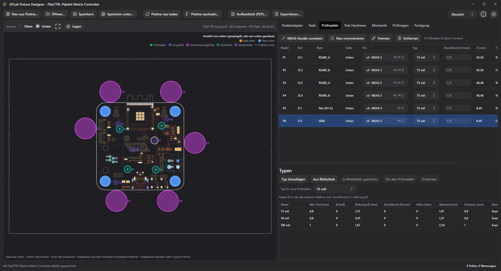

# 17. ATLab Fixture Designer

ATLab Fixture Designer entwirft einen Nadeladapter (Nadelbett) für den Test Interface Adapter aus der KiCad-Platine des Prüflings. Sie wählen, welche Pads eine Prüfnadel bekommen, von welcher Seite und mit welchem Nadeltyp, und verdrahten jede Prüfnadel mit einem Pin der Test-Hardware. Außerdem setzen Sie Fangstifte, Vorzentrierungsstifte, Stützstifte und Niederhalter. Der Fixture Designer prüft den Entwurf auf Fehler wie Kurzschlüsse zwischen Netzen, zu eng stehende Prüfnadeln oder Stifte, die auf ein Bauteil treffen. Er erstellt ein Aufbaublatt für den Bau des Nadeladapters und schreibt Zeichnungen und 3D-Modelle der Platten. Er ist ein eigenes Programm, das zusammen mit ATLab installiert wird; er liest KiCad-Platinen und verändert sie nie.

## Voraussetzungen

- Eine KiCad-Platinendatei (`.kicad_pcb`), gespeichert mit **KiCad 6 oder neuer**. Platinen aus KiCad 5 oder älter in einer aktuellen KiCad-Version öffnen und erneut speichern.
- Der Nadeladapter wird für den **compact Test Interface Adapter** (Geräte-ID `0xA101`) und seinen prüflingsseitigen Stecker J101 (DIN 41612, 3×32) entworfen.

Der Fixture Designer wird über das Startmenü (**ATLab Fixture Designer**) oder aus dem Unterordner `FixtureDesigner` des Programmordners gestartet (`ATLab.FixtureDesigner.exe`, unter Linux `ATLab.FixtureDesigner`). Das Installationsprogramm verknüpft `.atlabfix`-Dateien mit ihm, ein Doppelklick auf eine Nadeladapter-Datei öffnet sie also.

## Einen Nadeladapter beginnen

Ohne geöffneten Nadeladapter zeigt der Fixture Designer einen Willkommensbildschirm mit **Neu aus Platine…** und **Öffnen…**.

| Aktion | Vorgehen |
|--------|----------|
| Neuer Nadeladapter | **Neu aus Platine…** oder `Strg+N`, dann die `.kicad_pcb`-Datei wählen |
| Nadeladapter öffnen | **Öffnen…** oder `Strg+O`, dann eine `.atlabfix`-Datei wählen (eine `.kicad_pcb`-Datei beginnt einen neuen Nadeladapter) |
| Drag & Drop | Nadeladapter- oder Platinendatei auf das Fenster ziehen |
| Kommandozeile | `ATLab.FixtureDesigner.exe <Datei>` öffnet den Nadeladapter oder die Platine beim Start |

Ein neuer Nadeladapter übernimmt Name, Prüflingsname und Revision aus dem Schriftfeld der Platine. Sie lassen sich auf der Registerkarte **Nadeladapter** ändern.

## Arbeitsablauf

Die Registerkarten rechts folgen der Reihenfolge der Arbeit:

| Registerkarte | Was dort geschieht |
|---------------|--------------------|
| [Nadeladapter](#registerkarte-nadeladapter) | Name, Prüfling, Ersteller und Notizen; die Lagen der Zeichnungen im Aufbaublatt |
| [Pads](#registerkarte-pads) | Die zu kontaktierenden Pads finden |
| [Prüfnadeln](#registerkarte-prüfnadeln) | Nadeltyp und Pin der Test-Hardware jeder Prüfnadel; die Nadeltypen |
| [Verdrahtung](#registerkarte-verdrahtung) | Bauteile zwischen Platine und Test-Hardware sowie zusätzliche Verdrahtung |
| [Test-Hardware](#registerkarte-test-hardware) | Die Pins von J101 mit ihren Prüfnadeln und Netzen |
| [Mechanik](#registerkarte-mechanik) | Fangstifte, Vorzentrierungsstifte, Stützstifte und Niederhalter |
| [Prüfungen](#prüfungen) | Die im Entwurf gefundenen Probleme |
| [Fertigung](#registerkarte-fertigung) | Platten, Plattenumrisse und der Export der Fertigungsdateien |

## Die Platinenansicht

Links ist die Platine mit Umriss, Pads und Bohrungen zu sehen. Die Legende über der Platine nennt, was gezeichnet ist: Prüfnadeln, Fangstifte, Vorzentrierungsstifte, Stützstifte, Niederhalter, die Durchbrüche in den Platten und den Plattenumriss (gestrichelt). Pads der Oberseite sind orange, Pads der Unterseite blau; die nicht betrachtete Seite ist blass dargestellt.

| Option | Bedeutung |
|--------|-----------|
| **Unten** | Die Platine von unten gesehen, **gespiegelt**, wie die Platten unter der Platine sie sehen. Die übliche Ansicht für einen Nadeladapter. |
| **Oben** | Die Platine von oben gesehen, wie in KiCad. |

**Lagen** öffnet die Liste der KiCad-Lagen der Platine: Kupfer mit Leiterbahnen, Durchkontaktierungen und Flächen, Bestückungsdruck, Lötstopplack, Lotpaste, Fertigung, Bauteilfläche (Courtyard) und die Benutzerlagen, dazu Pads oben, Pads unten und Bohrungen. Die anzuzeigenden Lagen ankreuzen; **Alle anzeigen** / **Alle ausblenden** schalten alle um. Ein Klick auf das Farbfeld einer Lage gibt ihr eine andere Farbe; **Standardfarben** stellt die Farben von KiCad wieder her. Auswahl und Farben werden für alle Platinen gemerkt. Standardmäßig sind Pads, Bohrungen und beide Bestückungsdrucke sichtbar.

| Aktion | Wirkung |
|--------|---------|
| Mausrad | Zoom um den Mauszeiger |
| Ziehen | Verschieben; Ziehen an einem Stift oder Niederhalter verschiebt ihn |
| Klick auf ein Pad | Pad auswählen; alle Pads seines Netzes werden umrandet. Hat das Pad eine Prüfnadel, wird auch sie ausgewählt. |
| Doppelklick auf ein Pad | Prüfnadel auf dem Pad hinzufügen oder entfernen. Die Prüfnadel kommt von der betrachteten Seite; ein Pad ohne Kupfer auf dieser Seite bekommt seine Prüfnadel von der anderen Seite. |
| Klick auf die Platine beim Setzen | Ein Teil der auf der Registerkarte [Mechanik](#registerkarte-mechanik) gewählten Art setzen |
| `Entf` | Ausgewählte Prüfnadel oder ausgewähltes Teil entfernen |
| `Esc` | Setzen beenden |
| Doppelklick neben die Platine, `F` oder die Rahmen-Schaltfläche | Ganze Platine anzeigen |

Steht der Mauszeiger auf einem Pad, werden Referenz, Netz, Typ, Größe und die Prüfnadeln darauf angezeigt, auf einer Bohrung ihr Durchmesser und der Fangstift darin. Prüfnadeln der betrachteten Seite sind gefüllte Kreise mit ihrer Nummer (**P1**, **P2** …); Prüfnadeln von der anderen Seite sind gestrichelt. Fangstifte heißen **L1**, **L2** …, Vorzentrierungsstifte **C1** …, Stützstifte **S1** … und Niederhalter **R1** …. Eine rote Prüfnadel oder ein rotes Teil hat einen Fehler, eine orange eine Warnung (siehe [Prüfungen](#prüfungen)).

## Registerkarte Nadeladapter

Name, Prüfling, Revision, Ersteller und Notizen des Nadeladapters, wie sie auf dem Aufbaublatt stehen, dazu die Test-Hardware, die Nadeladapter-Datei und die Platinendatei.

**Platinenlagen…** legt fest, was die Zeichnungen des [Aufbaublatts](#aufbaublatt) von der Platine zeigen. Es gibt vier Spalten, eine je Art von Zeichnung: **Montage | oben**, **Montage | unten**, **Verdrahtung | oben** und **Verdrahtung | unten**. Eine in einer Spalte angekreuzte Lage wird dort gezeichnet. Die Pfeile ändern die Reihenfolge (oben in der Liste wird oben gezeichnet), das Farbfeld die Farbe und der Schieberegler die Deckkraft. Lagen der abgewandten Seite der Platine werden gestrichelt gezeichnet, wie durch die Platine hindurch gesehen.

| Schaltfläche | Wirkung |
|--------------|---------|
| **Alle anzeigen** / **Alle ausblenden** | Alle Lagen in allen Spalten umschalten |
| **Standarddarstellung** | Standardfarben und -deckkraft |
| **Standardreihenfolge** | Standard-Zeichenreihenfolge |
| **Als Standard speichern** | Diese Lagen für neue Nadeladapter und für Nadeladapter ohne eigene Auswahl verwenden |
| **Standard laden** | Die als Standard gespeicherten Lagen übernehmen |

Standardmäßig zeigen die Montagezeichnungen Pads, Bohrungen, Bestückungsdruck und Bauteilfläche ihrer Seite, die Verdrahtungszeichnungen Pads, Bohrungen und Bestückungsdruck ihrer Seite.

## Registerkarte Pads

Die Liste aller Pads der Platine, um die zu kontaktierenden Pads zu finden.

| Filter | Wirkung |
|--------|---------|
| Suche | Referenz, Pad (`TP3.1`), Netz oder Footprint, die den Text enthalten. `*` und `?` sind Platzhalter (`TP*`), mehrere Begriffe müssen alle passen (`J1 GND`). Die gefundenen Pads werden auf der Platine hervorgehoben. |
| **Nur Testpunkte** | Pads von Testpunkt-Footprints: Bibliotheksname enthält *TestPoint* oder die Referenz ist `TP` mit einer Zahl. Standardmäßig an, wenn die Platine Testpunkte hat. |
| **Nur mit Netz** | Blendet Pads ohne Netz aus |

Die Spalte **Erreichbar** zeigt, von welcher Seite eine Prüfnadel das Pad berühren kann: Kupfer auf dieser Seite, das nicht von Lötstopplack bedeckt ist. **Prüfnadel von unten** / **Prüfnadel von oben** fügen eine Prüfnadel auf dem ausgewählten Pad hinzu; ein Doppelklick auf eine Zeile wirkt wie ein Doppelklick auf der Platine.

## Registerkarte Prüfnadeln

Die Prüfnadeln des Nadeladapters mit Pad, Netz, Seite, Pin der Test-Hardware, Nadeltyp, Durchbruch und Position. Die Position ist in Millimetern vom **Ursprung** angegeben: dem Bohr-/Bestückungsursprung der Platine, wenn er in KiCad gesetzt ist, sonst der linken unteren Ecke des Platinenumrisses. X zeigt nach rechts und Y nach oben, **von oben gesehen**, auch für Prüfnadeln von unten.

- **Pin**: der Pin von J101, mit dem die Prüfnadel verdrahtet wird. Jeder Eintrag zeigt den Pin und die Ressource dahinter, z. B. `c7 · MEAS 7`, und die Prüfnadeln, die schon auf ihm liegen.
- **Typ**: der [Nadeltyp](#nadeltypen); neue Prüfnadeln bekommen den **Typ für neue Prüfnadeln**.
- **Durchbruch Ø**: das Loch in der Andruckplatte, durch das die Prüfnadel kommt (nur Prüfnadeln auf der Seite zur Andruckplatte). Leer bleibt der Durchbruch des Nadeltyps; ein Wert gilt für eine Prüfnadel, die einen größeren oder kleineren Durchbruch braucht.
- **Bemerkung**: freier Text für das Aufbaublatt, z. B. „langer Hub“.
- **Zusätzliche Verbindungen**: was die [Verbindungen](#registerkarte-verdrahtung) außer dem Pin mit der Prüfnadel verbinden, z. B. `R1.1`.

| Schaltfläche | Wirkung |
|--------------|---------|
| **MEAS-Kanäle zuweisen** | Legt jede Prüfnadel ohne Pin auf einen Matrixkanal: Eine Prüfnadel auf einem Netz, das schon auf einem MEAS-Kanal liegt, bekommt denselben Kanal, die anderen den nächsten freien Kanal. MEAS 1 bleibt frei, da er meist reserviert ist. |
| **Neu nummerieren** | Nummeriert die Prüfnadeln nach Seite (oben zuerst), dann zeilenweise von links oben, wie sie auf der Zeichnung zu finden sind. |
| **Trennen** | Entfernt Pin und Verbindungen der ausgewählten Prüfnadel. |
| **Entfernen** | Entfernt die ausgewählte Prüfnadel. |

Mehrere Prüfnadeln auf demselben Netz dürfen sich einen Pin teilen; sie werden einfach parallel verdrahtet.

### Nadeltypen

Ein Nadeltyp beschreibt eine Art Federkontaktstift mit seiner Hülse. Seine Maße nutzen die Prüfungen, die Plattendateien und die Stückliste; sie stammen aus dem Datenblatt der verwendeten Prüfnadeln. Der Nadeldurchmesser ist in mil angegeben, wie in Datenblättern üblich, alle anderen Maße in Millimetern. Die Liste **Typen** unter den Prüfnadeln zeigt die Typen des Nadeladapters; die Werte werden direkt in der Tabelle bearbeitet.

| Feld | Bedeutung |
|------|-----------|
| **Name** | Z. B. die Baureihe oder Bestellnummer |
| **Min. Pad** | Kleinstes Pad, das die Spitze sicher trifft |
| **Ø (mil)** | Durchmesser der Prüfnadel |
| **Bohrung Ø** | Loch für die Hülse in der Kontaktträgerplatte |
| **Durchbruch Ø** | Loch in der Andruckplatte, durch das die Prüfnadel kommt; 0 = Bohrungsdurchmesser |
| **Höhe** | Wie weit die Prüfnadel aus der Platte zur Platine hin herausragt |
| **Abstand** | Kleinster Abstand zwischen den Mitten zweier Prüfnadeln einer Platte |
| **Freiraum** | Kleinster Abstand der Prüfnadel zu einem anderen Bauteil ihrer Seite (seiner Bauteilfläche) |
| **Bemerkung** | Freier Text, z. B. die Bestellnummern von Nadel und Hülse |

| Schaltfläche | Wirkung |
|--------------|---------|
| **Typ hinzufügen** | Ein neuer Typ mit den Werten des ausgewählten |
| **Aus Bibliothek** | Fügt einen Typ aus Ihrer Nadelbibliothek hinzu oder aktualisiert die Kopie im Nadeladapter |
| **In Bibliothek speichern** | Speichert den ausgewählten Typ in Ihrer Nadelbibliothek, für andere Nadeladapter |
| **Für alle Prüfnadeln** | Gibt allen Prüfnadeln den ausgewählten Typ |
| **Entfernen** | Entfernt den Typ; seine Prüfnadeln bekommen den Standardtyp |

Die Nadeladapter-Datei enthält eine eigene Kopie der Typen; sie ist also für sich vollständig und ändert sich nicht, wenn sich die Bibliothek ändert. Ein neuer Nadeladapter beginnt mit den Typen der Bibliothek. Bevor der erste Typ in der Bibliothek gespeichert wird, enthält sie drei Beispiele (100, 75 und 50 mil) mit typischen Werten, die aber nicht die eines bestimmten Herstellers sind: mit dem Datenblatt abgleichen.

## Registerkarte Verdrahtung

Manchmal sitzt etwas zwischen Platine und Test-Hardware, z. B. ein Vorwiderstand, ein Relais oder ein Steckverbinder zu einem anderen Gerät. Die Registerkarte **Verdrahtung** beschreibt es. Die Bauteile gehören nur zur Verdrahtung und bekommen keinen Platz auf einer Platte.

**Bauteile**: **Bauteil hinzufügen** fügt eine Zeile mit dem Bezeichner `?` und den Anschlüssen `1, 2` hinzu. Tragen Sie den Bezeichner (R1, K1, U1 …), eine Beschreibung (Wert oder Teilenummer, für die Stückliste) und die Anschlüsse ein, mit Komma getrennt. Anschlüsse können beliebig heißen, z. B. `A1, A2, COM, NC, NO` für ein Relais oder `VIN, VOUT, GND` für ein Modul. **Nicht verdrahtet** zeigt die Anschlüsse ohne Verbindung.

**Verbindungen**: jede Verbindung neben dem Pin einer Prüfnadel. Jedes Ende ist eine Prüfnadel, ein Pin von J101 oder ein Bauteilanschluss. **Verbindung hinzufügen** beginnt an der ausgewählten Prüfnadel. Beispiele:

| Von | Nach | Bedeutung |
|-----|------|-----------|
| P3 | R1.1 | Prüfnadel auf einen Vorwiderstand … |
| R1.2 | c7 | … und der Widerstand auf MEAS 7 |
| P5 | P6 | Brücke zwischen zwei Prüfnadeln |
| P8 | K1.COM | Prüfnadel auf einen Relaiskontakt |

Ein Bauteil verbindet seine Anschlüsse **nicht**. Im Beispiel liegt c7 daher nicht auf dem Netz von P3: Der Pin bekommt kein Netz der Platine, ATLab zeigt für ihn kein Netz, und die Kurzschlussprüfung schaut nicht durch R1 hindurch. Netze verbinden nur Verbindungen, der Pin einer Prüfnadel und Brücken zwischen Prüfnadeln.

## Registerkarte Test-Hardware

Die Pins von J101 führen zu diesen Ressourcen des Test Interface Adapters (siehe [Registerkarte Test-Hardware](04-test-hardware.md)):

| Ressource | Pins | Verwendung |
|-----------|------|------------|
| **MEAS 1 … 32** | c1 … c32 | Matrixkanäle. Jeder lässt sich in einem Testschritt auf die H- oder L-Seite des Messbusses schalten, ein Kanal pro Netz genügt also. |
| **STIM 1 … 16 In / Out** | b1 … b32 | Die beiden Kontakte eines Stimulationsrelais |
| **EXT STIM 1 … 4 H / L** | a3 … a10 | Ausgänge der externen Stimulationsrelais (Eingänge am Schnittstellenstecker) |
| **SENSE H / L** | a1, a2 | Sense-Leitungen des Messbusses |
| **PROG 1 … 10** | a11 … a20 | 1:1 zum Programmierstecker durchgeführt |
| **RS485**, **I²C**, **UART** | a21 … a32 | Isolierte Schnittstellen mit Signalen, VREF und GND |

Die Registerkarte listet jeden Pin mit Ressource, Signal, Netz und dem, was mit ihm verbunden ist (Prüfnadeln, Bauteilanschlüsse, andere Pins), und zeigt, wie viele Pins und Matrixkanäle belegt sind.

## Registerkarte Mechanik

Neben den Prüfnadeln braucht ein Nadeladapter Stifte, die die Platine ausrichten und halten:

| Teil | Platte | Zweck |
|------|--------|-------|
| **Fangstift** (L) | Andruckplatte | Steht in einer Bohrung der Platine, durchkontaktiert oder nicht, und richtet sie genau aus |
| **Vorzentrierungsstift** (C) | Andruckplatte | Steht neben der Platinenkante und zentriert die Platine grob beim Einlegen |
| **Stützstift** (S) | Andruckplatte | Die Platine liegt auf ihm auf, damit sie sich unter den Prüfnadeln nicht durchbiegt |
| **Niederhalter** (R) | Niederhalterplatte | Drückt die Platine auf die Prüfnadeln |

Die Schaltfläche einer Art (**Fangstift**, **Vorzentrierungsstift**, **Stützstift**, **Niederhalter**) anklicken und auf die Platine klicken, um ein Teil zu setzen; jeder Klick setzt ein weiteres, bis `Esc` gedrückt oder die Schaltfläche erneut angeklickt wird. Ein Teil wird durch Ziehen verschoben oder durch Eingabe von **X** und **Y** in der Liste.

- Ein **Fangstift** gehört in eine Bohrung: auf oder neben eine Bohrung der Platine klicken, der Stift springt hinein. Beim Ziehen springt er in die nächste Bohrung oder, wenn keine in der Nähe ist, zurück in seine.
- Ein **Vorzentrierungsstift** springt neben die Platinenkante, mit dem **Kantenabstand** seines Typs, damit die Platine frei hineinfällt.
- **Stützstifte** und **Niederhalter** bleiben, wo sie gesetzt werden. Ein Niederhalter kann einen eigenen **Durchbruch Ø** in der Kontaktträgerplatte oben haben, wie eine Prüfnadel in der Andruckplatte.

### Teiletypen

Die Liste **Typen** unter den Teilen funktioniert wie die Nadeltypen: **Typ hinzufügen**, **Aus Bibliothek**, **In Bibliothek speichern** und **Entfernen**. Jeder Typ hat eine **Art**; ein Teil kann nur einen Typ seiner Art bekommen. Alle Maße in Millimetern.

| Feld | Bedeutung |
|------|-----------|
| **Name** | Z. B. die Bestellnummer |
| **Art** | Fangstift, Vorzentrierungsstift, Stützstift oder Niederhalter |
| **Ø** | Durchmesser, wo er die Platine berührt |
| **Bohrung Ø** | Loch für ihn in seiner Platte |
| **Durchbruch Ø** | Nur Niederhalter: Loch, durch das er durch die Kontaktträgerplatte oben kommt; 0 = Bohrungsdurchmesser |
| **Kantenabstand** | Nur Vorzentrierungsstifte: Spalt zwischen Stift und Platinenkante |
| **Höhe** | Wie weit er aus der Platte zur Platine hin herausragt |
| **Freiraum** | Kleinster Abstand von seinem Rand zu einem Bauteil seiner Seite |
| **Bemerkung** | Freier Text |

## Prüfungen

Die Prüfungen laufen nach jeder Änderung. Die Registerkarte **Prüfungen** listet die Ergebnisse, die Statusleiste zeigt die Zahl der Fehler und Warnungen; ein Klick auf ein Ergebnis wählt seine Prüfnadel oder sein Teil aus.

| Schwere | Prüfung |
|---------|---------|
| Fehler | **Kurzschluss:** Die Verdrahtung verbindet Prüfnadeln auf verschiedenen Netzen, über einen Pin oder über Verbindungen. |
| Fehler | Ein Bauteil hat **keinen Bezeichner**, oder zwei Bauteile haben **denselben Bezeichner**. |
| Fehler | Eine Verbindung führt zu einem **Anschluss, den das Bauteil nicht hat** (z. B. nach Ändern der Anschlüsse). |
| Fehler | Das Pad hat auf der Seite der Prüfnadel **kein Kupfer** oder ist dort **mit Lötstopplack bedeckt**. |
| Fehler | Das Pad **gibt es nicht mehr** auf der Platine, z. B. nach einer Platinenänderung. |
| Fehler | Zwei Prüfnadeln auf **demselben Pad** von derselben Seite. |
| Fehler | Zwei Prüfnadeln einer Platte stehen **enger** als der Abstand ihrer Nadeltypen. |
| Fehler | Ein Fangstift steht **in keiner Bohrung** oder **passt nicht** hinein. |
| Fehler | Der Durchbruch einer Prüfnadel in der Andruckplatte **überschneidet die Bohrung eines Fangstifts**. |
| Fehler | Ein Vorzentrierungsstift **überdeckt die Platine**. |
| Fehler | Ein Stützstift oder Niederhalter steht **nicht unter der Platine** oder **berührt ein Bauteil**. |
| Fehler | Der Typ eines Teils hat **keinen Bohrungsdurchmesser**. |
| Warnung | Eine Prüfnadel ist **nicht verdrahtet**: Sie hat weder Pin noch Verbindung. |
| Warnung | Ein Bauteil oder einige seiner **Anschlüsse sind nicht verdrahtet**, oder es hat keine Anschlüsse. |
| Warnung | Eine Verbindung hat **nicht beide Enden** oder führt zu ihrem Anfang zurück. |
| Warnung | Eine Prüfnadel oder ein Teil hat **keinen Typ**, oder ein Nadeltyp hat keinen Bohrungsdurchmesser. |
| Warnung | Das Pad ist **kleiner** als das minimale Pad des Nadeltyps. |
| Warnung | Eine Prüfnadel liegt **auf oder nahe einem anderen Bauteil** ihrer Seite: näher an seiner Bauteilfläche als der Freiraum des Nadeltyps. Der Footprint des kontaktierten Pads selbst zählt nicht. |
| Warnung | Ein Teil liegt **näher an einem Bauteil** als der Freiraum seines Typs. |
| Warnung | Ein Vorzentrierungsstift steht nicht im **Kantenabstand** seines Typs zur Platinenkante. |
| Warnung | Das Pad hat **kein Netz**. |
| Warnung | Ein Netz liegt auf **mehreren MEAS-Kanälen**. |
| Warnung | Eine **Schnittstelle** ist nur teilweise verdrahtet: Eine isolierte Schnittstelle braucht alle ihre Leitungen vom Prüfling, auch VREF und GND. |
| Warnung | Bei einer **externen Stimulation** ist nur die H- oder nur die L-Leitung verdrahtet. |
| Warnung | **Netz** oder **Position** eines Pads haben sich seit dem Speichern des Nadeladapters geändert. |
| Hinweis | Bei einem **Stimulationskanal** ist nur einer seiner Kontakte verdrahtet: Der andere muss im Nadeladapter verdrahtet werden, z. B. mit einer Versorgung. |
| Hinweis | Die Platinendatei hat sich seit dem Speichern des Nadeladapters geändert. |

## Registerkarte Fertigung

### Platten

Ein Nadeladapter besteht aus mehreren Platten. Von unten nach oben:

| Platte | Inhalt |
|--------|--------|
| **Kontaktträgerplatte unten** | Die Hülsen der Prüfnadeln von unten |
| **Andruckplatte** | Auf ihr liegt die Platine. Bohrungen für Fang-, Vorzentrierungs- und Stützstifte und Durchbrüche, durch die die Prüfnadeln von unten kommen. |
| **Kontaktträgerplatte oben** | Die Hülsen der Prüfnadeln von oben und Durchbrüche, durch die die Niederhalter kommen. Nur mit Prüfnadeln von oben nötig. |
| **Niederhalterplatte** | Die Niederhalter |

Die Liste zeigt jede Platte mit Größe und Inhalt (Nadelbohrungen, Durchbrüche, Stift- und Niederhalterbohrungen, Rahmenbohrungen, Ausschnitte). Die **Dicke** jeder Platte wird für die STEP-Dateien eingegeben. Durchbrüche, die sich überschneiden oder weniger als 0,2 mm Material zwischen sich lassen, werden zu einem Durchbruch zusammengefasst; die Liste zeigt, wie viele.

**Platine kopfüber** gilt für eine Platine, die mit der Oberseite nach unten im Nadeladapter liegt. Dann kommen die Prüfnadeln der Oberseite in die Kontaktträgerplatte unten, die Stifte berühren die Oberseite und die Niederhalter die Unterseite.

Probleme, die die Fertigung einer Platte verhindern, stehen unter den Platten: eine Bohrung ohne Durchmesser, sich überschneidende Bohrungen oder Bohrungen zu nah am Plattenrand oder an einem Ausschnitt.

### Umriss

Alle Platten teilen sich einen Umriss, außer bei einer Platte ist **Eigener Umriss** angekreuzt. Mit eigenen Umrissen wählt **Umriss bearbeiten von**, welchen Umriss die Einstellungen darunter ändern: den gemeinsamen oder den einer Platte.

| Plattenumriss | Bedeutung |
|---------------|-----------|
| **Platinenumriss + Rand** | Der Platinenumriss, vergrößert um den **Plattenrand** |
| **Feste Größe** | Ein Rechteck aus **Breite** × **Höhe** |
| **DXF-Datei** / **SVG-Datei** | Der Umriss aus einer Zeichnung, z. B. des Adaptergehäuses. **Auswählen…** wählt die Datei, die Aktualisieren-Schaltfläche liest sie erneut. |
| **Platinenlage** | Der Umriss, der in KiCad auf einer Lage der Platine gezeichnet ist, z. B. `User.1`, `Dwgs.User` oder `Margin` |

Eine feste Größe oder ein Umriss aus Datei oder Lage wird auf der Platine zentriert; **Versatz X** / **Versatz Y** verschieben ihn von dort. In einer Zeichnung wird die größte geschlossene Kontur der Umriss, geschlossene Konturen darin werden **Ausschnitte** und Kreise darin **Rahmenbohrungen**, z. B. für die Schrauben der Platte. Bögen bleiben Bögen. DXF-Dateien dürfen Linien, Bögen, Kreise, Polylinien, Ellipsen und Splines enthalten; die Einheit kommt aus der Datei (Millimeter, wenn sie keine angibt). SVG-Dateien dürfen Pfade und alle Grundformen enthalten. Unter den Einstellungen zeigt eine Zeile die Größe der Platte und die Zahl der Rahmenbohrungen und Ausschnitte, oder was nicht verwendet werden konnte.

### Export

**Exportieren…** (`Strg+E`) schreibt die Fertigungsdateien in einen Ordner. Die zu schreibenden Dateien und Platten ankreuzen; die Auswahl wird gemerkt.

| Datei | Inhalt |
|-------|--------|
| **Zeichnung (DXF)** | DXF R12 für CAM und CAD, in Millimetern. Nur was gefertigt wird: der Plattenumriss als eine geschlossene Polylinie, die Bohrungen als Kreise auf einer Lage je Art (`PLATE_OUTLINE`, `PROBE_HOLES`, `PROBE_OPENINGS`, `LOCATING_PIN_HOLES`, `PRE_CENTERING_PINS`, `SUPPORT_PINS`, `PUSH_RODS`, `PUSH_ROD_OPENINGS`, `FRAME_HOLES`, `CUTOUTS`), damit jede ihr Werkzeug bekommt. |
| **Zeichnung (SVG)** | Dasselbe als SVG, z. B. für Laserschneider und Inkscape: eine Gruppe (Inkscape-Ebene) je Art, Haarlinien ohne Füllung |
| **3D-Modell (STEP)** | Die Platte als Volumenkörper mit Dicke, Bohrungen und Ausschnitten, die Seite zur Platine bei Z = 0 |

Die Dateien heißen `<Nadeladapter> - <Platte>`, z. B. `Netzteil - Andruckplatte.dxf`. Jede Datei zeigt ihre Platte **von der Seite zur Platine gesehen**: die Platten unter der Platine von oben, die Platten über der Platine von unten, also links-rechts gespiegelt. Die Koordinaten sind in Millimetern vom Ursprung des Aufbaublatts. Solange eine Platte Probleme hat, werden die Dateien nicht geschrieben; die Meldung nennt sie. Vorhandene Dateien werden erst nach Rückfrage ersetzt.

## Wenn sich die Platine ändert

Der Nadeladapter bezieht sich auf Pads über Footprint-Referenz und Padnummer (z. B. `TP12.1`), eine geänderte Platine behält die Prüfnadeln also auf ihren Pads.

- **Platine neu laden** (`F5`) liest die Platinendatei erneut, z. B. nach einer Änderung in KiCad.
- **Platine wechseln…** verwendet eine andere Platinendatei, z. B. eine neue Revision des Prüflings.

Positionen und Netze kommen immer aus der aktuellen Platinendatei. Die Prüfungen melden dann Prüfnadeln, deren Pad sich verschoben, sein Netz gewechselt hat oder verschwunden ist, verglichen mit dem Stand beim letzten Speichern des Nadeladapters.

## Aufbaublatt

**Aufbaublatt (PDF)…** (`Strg+P`) erstellt ein PDF (A4 quer) in der Reihenfolge der Arbeit:

- Angaben zu Nadeladapter und Platine, einschließlich der Prüfsumme der Platinendatei, der Lage der Platine (kopfüber oder nicht) und der Bedeutung der Koordinaten,
- die **Stückliste**: jeder Nadeltyp und Teiletyp mit Anzahl, Durchmesser, Bohrung, Durchbruch und Höhe sowie die Bauteile der Verdrahtung nach Beschreibung mit ihrer Bemerkung,
- die **Prüfnadelliste**: Prüfnadel, Pad, Netz, Seite, Position, Padtyp und -größe, Nadeltyp, Pin, Ressource und Bemerkung,
- die Liste der **Stifte und Niederhalter** mit Art, Typ, Position und Platte,
- die **Verdrahtung**: jede herzustellende Verbindung mit beiden Enden und der Bemerkung, bei Prüfnadeln von beiden Seiten auch mit der Seite ihrer Prüfnadeln: zuerst jede Prüfnadel zu ihrem Pin (nach Pin sortiert), dann die Verbindungen der [Registerkarte Verdrahtung](#registerkarte-verdrahtung) unter ihrem Namen dort (W1, W2 …). Entfällt, wenn der Nadeladapter keine Verdrahtung hat.
- eine **Montagezeichnung** jeder Seite mit Prüfnadeln oder Teilen: die Platten dieser Seite mit Umrissen und Durchbrüchen, die Prüfnadeln und Teile, gesehen von der Seite, an der sie die Platine berühren (die Platten oben von oben, die Platten unten von unten, gespiegelt). Verschiedene Platten sind in verschiedenen Farben und Linienarten gezeichnet und in einer Legende erklärt.
- eine **Verdrahtungszeichnung** jeder Kontaktträgerplatte, von ihrer Außenseite gesehen, wo die Drähte angeschlossen werden.

Stückliste, Prüfnadelliste, Teileliste und Verdrahtung haben ein Feld **Erl.** zum Abhaken beim Bau. Die Platinenlagen der Zeichnungen werden auf der [Registerkarte Nadeladapter](#registerkarte-nadeladapter) gewählt. Haben die Prüfungen Fehler gefunden, fragt der Fixture Designer vor dem Export nach.

## Nadeladapter-Datei

Ein Nadeladapter wird als `.atlabfix`-Datei gespeichert (`Strg+S`, **Speichern unter…** `Strg+Umschalt+S`): einfaches JSON wie die Projektdateien von ATLab, gut geeignet für Versionsverwaltung. Sie enthält:

- die Angaben zum Nadeladapter und die Test-Hardware,
- den Pfad der Platinendatei (relativ zur Nadeladapter-Datei, wenn beide auf demselben Laufwerk liegen) und ihre Prüfsumme,
- die Nadeltypen und Teiletypen,
- jede Prüfnadel mit Nummer, Pad, Seite, Nadeltyp, Pin, Durchbruch und Bemerkung sowie dem Netz und der Position, die das Pad beim Speichern hatte,
- die Bauteile der Verdrahtung und die zusätzlichen Verbindungen,
- jedes Teil mit Art, Typ, Position und Durchbruch,
- die Plattenumrisse (mit einer Kopie importierter Zeichnungen, damit der Nadeladapter vollständig bleibt, wenn die Zeichnung verschoben wird), die Plattendicken und die Lage der Platine,
- die Lagen der Zeichnungen im Aufbaublatt.

Wird die Platinendatei beim Öffnen eines Nadeladapters nicht gefunden, fragt der Fixture Designer nach ihrem neuen Ort. Beim Schließen oder Öffnen eines anderen Nadeladapters mit ungespeicherten Änderungen fragt er, ob sie gespeichert werden sollen.

## Den Nadeladapter in ATLab verwenden

In ATLab übernimmt **Nadeladapter importieren…** im Bereich [Platine und Netze](06-configuration.md#platine-und-netze) die Platine, das Netz auf jedem verdrahteten Pin der Test-Hardware und die Positionen der Prüfnadeln eines Nadeladapters. Ein Pin, der nur über ein Bauteil des Nadeladapters mit der Platine verbunden ist, bekommt kein Netz. Die [Platinenansicht](14-running-tests.md#platinenansicht) der Registerkarte Testausführung zeigt dann für jeden Schritt, wo er mit der Platine verbunden ist, einschließlich der Prüfnadeln. Auf Wunsch werden die Netze auch zu den Kanalbezeichnungen des Projekts.

## Sprache, Design, Farben und Info

Sprache (Deutsch, Englisch) und helles oder dunkles Design werden in der Werkzeugleiste umgeschaltet und gemerkt. Beim ersten Start übernimmt der Fixture Designer Sprache und Design von ATLab. Die Palettenschaltfläche legt die Farben der Prüfnadeln, Fang-, Vorzentrierungs- und Stützstifte, Niederhalter und der Umrisse von Kontaktträgerplatten, Andruckplatte und Niederhalterplatte fest. Sie gelten für die Platinenansicht und die Zeichnungen des Aufbaublatts und werden gemerkt; **Standardfarben** stellt sie wieder her. Die Plattendateien (DXF, SVG) sind immer schwarz. Die Schaltfläche ⓘ zeigt Version, Build und Systeminformationen.
