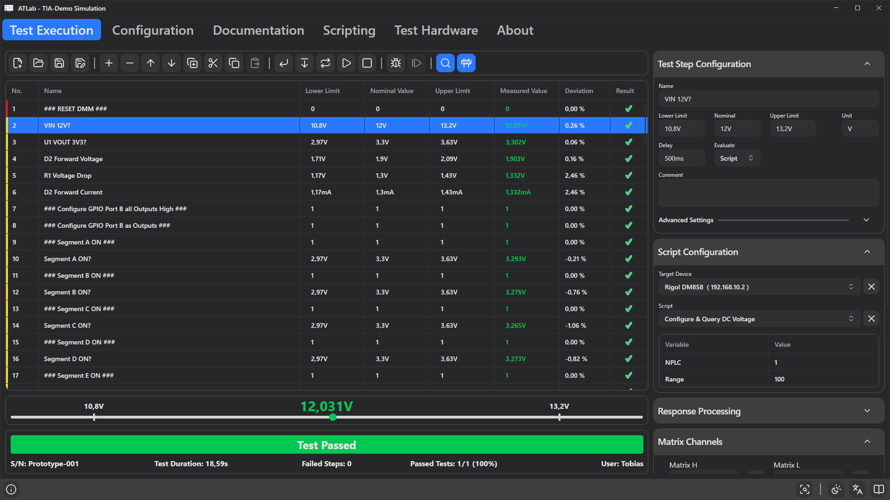

# 1. Introduction

ATLab is an automated testing framework for electronic assemblies. A test engineer builds a **test sequence**: a list of steps, each of which switches relays, talks to an instrument or the device under test, obtains a numeric result and compares it against limits. An operator then runs that sequence, enters a serial number, and gets a pass/fail verdict plus an optional PDF test report.

## What ATLab can do

- **Route signals** through the Test Interface Adapter's relay matrix and switch its stimulation and external stimulation relays per step.
- **Remote-control instruments** (multimeters, power supplies, oscilloscopes …) over serial port (VCOM/RS232), raw TCP/IP sockets or NI-VISA. The command system is designed primarily for SCPI.
- **Talk to the DUT** through the adapter's isolated I²C and UART interfaces.
- **Run local programs** or shell commands and use their exit code as a result.
- **Ask the operator** to confirm a visual check (Passed / Failed).
- **Compute values** from runtime variables using expressions.
- **Read files** from disk and extract a value from them.
- **Branch**: repeat a step, jump to another step, or end the test depending on the result.
- **Document and report**: store test notes, images and attachments in the project, and export results as CSV and PDF.

ATLab runs on Windows and Linux, offers light and dark themes, and is available in English and German.

## Key concepts

| Term | Meaning |
|------|---------|
| **Project** | One `.atlab` file containing the test sequence, devices, runtime variables, channel names, project settings, documentation and DUT information. See [Working with Projects](04-projects.md). |
| **Test step** | One row in the sequence. It has a name, limits, a unit, a delay, an evaluation source, relay states and pass/fail actions. |
| **Evaluation source** | Where a step gets its measured value from: *None, Script, Device Command, Interface Command, Shell Command, User Response, Expression* or *File*. See [Evaluation Sources](08-evaluation-sources.md). |
| **Device** | An external instrument (or a DUT reachable over serial/TCP/VISA) defined in the Device Manager. |
| **Script** | A reusable, named list of instrument commands stored as a JSON file in a *script repository* folder, so it can be shared across projects. |
| **Script variable** | A placeholder such as `{Range}` inside a script, given a concrete value per test step. |
| **Runtime variable** | A project-wide variable that can be read in commands, limits and expressions, and written by a step via *Assign Result to Variable*. |
| **Relay matrix** | The adapter's measurement matrix. Each step selects one channel for **Matrix H** and one for **Matrix L** (or *Off*). |
| **Stimulation / Ext. stimulation channels** | Individually switchable relays on the adapter, set per step. |
| **Development mode** | The editing mode of the Test Execution tab. When it is off, the tab shows only the sequence and results — the operator view. |
| **Simulator** | A virtual Test Interface Adapter used when no hardware is connected. Relay and interface commands succeed without doing anything. |

## How a test step is executed

Every step goes through the same stages:

1. **Comment dialog (optional)** — if *Show Comment* is enabled, the comment is shown and the operator must click **Continue**.
2. **Resolve values** — limits, nominal value and delay are calculated, including any `{Variable}` references.
3. **Switch relays** — matrix, stimulation and external stimulation relays are set to the step's configuration.
4. **Wait** — the step's delay elapses (a progress bar appears for delays over one second).
5. **Acquire** — the evaluation source produces a raw value; response processing may extract a number from it.
6. **Evaluate** — the value is compared against the lower and upper limit; the deviation from nominal is calculated.
7. **Decide** — the Pass-Action or Fail-Action determines what happens next (continue, repeat, jump, end, or show a comment).

Before the first step and after the last one, all relays are cleared.

## Who this guide is for

- **Test engineers** who design sequences: read chapters 4–10.
- **Operators** who run released sequences: chapters 3 and 11 are enough.
- **Administrators** who install ATLab on test stations: chapter 2 and the [Reference](16-reference.md).
