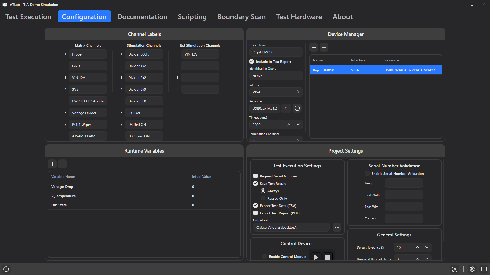

# 6. Configuration Tab

The **Configuration** tab holds the project-wide setup. Everything here is saved in the project file.

It is divided into four panels:

- [Channel Labels](#channel-labels)
- [Device Manager](#device-manager)
- [Runtime Variables](#runtime-variables)
- [Project Settings](#project-settings)

---

## Channel Labels

Give the adapter's relay channels meaningful names, such as `GND`, `VIN 12V` or `TP12 3V3`. There are three columns:

| Column | Channels |
|--------|----------|
| **Matrix Channels** | Measurement matrix channels, selectable as Matrix H / Matrix L in each step |
| **Stimulation Channels** | Stimulation relays |
| **Ext Stimulation Channels** | External stimulation relays |

The number of rows matches the connected adapter (or the simulator). The names appear in the relay selectors of the step configuration (displayed as `<number> <name>`), which makes sequences far easier to read and review. Leave a field empty if the channel is unused.

> **Tip:** In the matrix selector you can type the channel number on the keyboard to jump to it.

---

## Device Manager

The Device Manager lists the external devices that steps can talk to: instruments such as multimeters and power supplies, or a DUT with its own serial/TCP interface.

- **+** (**Add new device**) creates a device named `New Device` with interface *Serial Port*.
- **−** (**Remove device**) deletes the selected device.
- Select a device in the table on the right to edit it on the left.

Steps refer to devices by an internal ID, so renaming a device does not break the steps that use it. Removing a device does: those steps then fail with *"Target Device ID … not found."*

### Common fields

| Field | Description |
|-------|-------------|
| **Device Name** | Name shown in the step editors and in the test report. |
| **Include in Test Report** | Lists the device under *Used Test Equipment* in the PDF report. |
| **Identification Query** | Command sent when a report is generated, for example `*IDN?`. The answer (manufacturer, model, serial, firmware) is printed in the report. Only used if *Include in Test Report* is enabled. |
| **Interface** | `Serial Port`, `TCP/IP` or `VISA`. The remaining fields depend on this choice. |

### Serial Port

| Field | Default | Description |
|-------|---------|-------------|
| **Port** | – | COM port (Windows) or `/dev/tty…` (Linux). Use the refresh button to rescan. |
| **Baud Rate** | 115200 | |
| **Data Bits** | 8 | |
| **Parity** | None | |
| **Stop Bits** | One | |
| **Handshake** | None | |
| **Termination Character** | NONE | Appended to every command sent: `NONE`, `LF`, `CR` or `CRLF`. |
| **Framing Mode** | Chunk | How the end of a response is detected (see below). |
| **Timeout (ms)** | 100 | Only for *Timeout Based* framing: the silence period that ends a response. |

**Framing modes**

| Mode | A response is complete when … |
|------|-------------------------------|
| **Chunk** | … any data has been received (the first received block is the answer). Fast, but long answers may be cut. |
| **LF Terminated** | … a line feed (`\n`) arrives. Best for SCPI instruments over serial. |
| **CRLF Terminated** | … a `\r\n` sequence arrives. |
| **Timeout Based** | … no further byte has arrived for the configured *Timeout (ms)*. Good for binary protocols without terminator. |

### TCP/IP (raw socket)

| Field | Default | Description |
|-------|---------|-------------|
| **IP-Address** | – | e.g. `192.168.20.2` |
| **Port** | 5025 | 5025 is the usual SCPI-RAW port. |
| **Timeout (ms)** | 2000 | Connection timeout. |
| **Termination Character** | LF | Appended to every command. |

### VISA (Windows, requires NI-VISA)

| Field | Default | Description |
|-------|---------|-------------|
| **Resource** | – | VISA resource string, e.g. `USB0::0x1AB1::0x0588::DM3R123456::INSTR` or `TCPIP0::192.168.1.10::inst0::INSTR`. The refresh button lists all USB, GPIB, serial (ASRL) and TCPIP resources found by NI-VISA. |
| **Timeout (ms)** | 2000 | VISA I/O timeout. |
| **Termination Character** | LF | Termination character for *reading* responses. |

> **Note:** For VISA, the termination setting applies to reading. Commands are written exactly as entered. If your instrument needs a terminator on every command (typical for `::SOCKET` resources), append it explicitly, e.g. `MEAS:VOLT?{hex:0A}`. See [Commands, Variables & Expressions](10-commands-variables-expressions.md#encoding-blocks).

### Connection handling

ATLab opens the connection to a device the first time a step needs it and keeps it open while consecutive steps talk to the same device. It reconnects when a step addresses a different device or when the device configuration has changed, and it releases the device at the end of each test run.

---

## Runtime Variables

Runtime variables are named values that live for the duration of a session. Use them to

- parametrise commands and limits (e.g. `{V_Supply}`),
- store a measured value from one step and reuse it in a later step,
- compute derived results with an **Expression** step.

| Column | Description |
|--------|-------------|
| **Variable Name** | Letters, digits and `_` only. Spaces are converted to `_`, other characters are removed automatically. |
| **Initial Value** | The value the variable starts with. |

Add and remove variables with **+**/**−** or the context menu.

**Lifetime of values**

- When a project is opened, or when you edit the Runtime Variables table, all variables are reset to their initial values.
- A step with **Assign Result to Variable** overwrites the value during a run (see [Building Test Sequences](08-building-test-sequences.md#advanced-settings)).
- Values written during a run are **kept for the next run** until the project is reopened or the table is edited. If a sequence relies on a variable starting at its initial value every time, set it explicitly in an early step (for example an Expression step that assigns a constant).

How to reference variables is explained in [Commands, Variables & Expressions](10-commands-variables-expressions.md).

---

## Project Settings

### Test Execution Settings

| Setting | Description |
|---------|-------------|
| **Request Serial Number** | Before **Start test execution** and **Start continuous test execution**, the operator must enter a serial number. |
| **Save Test Result** | Exports results automatically after each completed run. Only available when *Request Serial Number* is enabled, because the serial number is part of the file name. |
| **Always / Passed Only** | Export after every run, or only after passed runs. |
| **Export Test Data (CSV)** | Writes a tab-separated data file. |
| **Export Test Report (PDF)** | Writes a formatted test report. |
| **Output Path** | Folder for exported files. Click **…** to choose. Created if it does not exist. |

Details on the exported files: [Test Results & Reports](15-results-and-reports.md).

### Control Devices

| Setting | Description |
|---------|-------------|
| **Enable Control Module** | Connects the USB control module (Start/Stop buttons with status LEDs). See [Running Tests](14-running-tests.md#control-module). |

### Serial Number Validation

When **Enable Serial Number Validation** is on, the **Start** button of the serial-number dialog is only enabled if the entered text matches all non-empty rules:

| Rule | Example | Matches |
|------|---------|---------|
| **Length** | `10` | exactly 10 characters (`0` or empty = any length) |
| **Starts With** | `PB-` | `PB-2026001` |
| **Ends With** | `-A` | `…-A` |
| **Contains** | `2026` | anything containing `2026` |

Checks are case-sensitive.

### General Settings

| Setting | Default | Description |
|---------|---------|-------------|
| **Default Tolerance (%)** | 10 | When you enter a nominal value, the lower and upper limits are set to nominal −/+ this percentage. |
| **Displayed Decimal Places** | 3 | Number of decimals shown for measured values. Trailing zeros are omitted. |
| **Log Level** | Info | Minimum severity for pop-up notifications and for the log file `events.log`: `Info`, `Warning`, `Error`. Success messages always pop up, but count as `Info` for the log file. The event log in the window always lists all messages of the session. |
