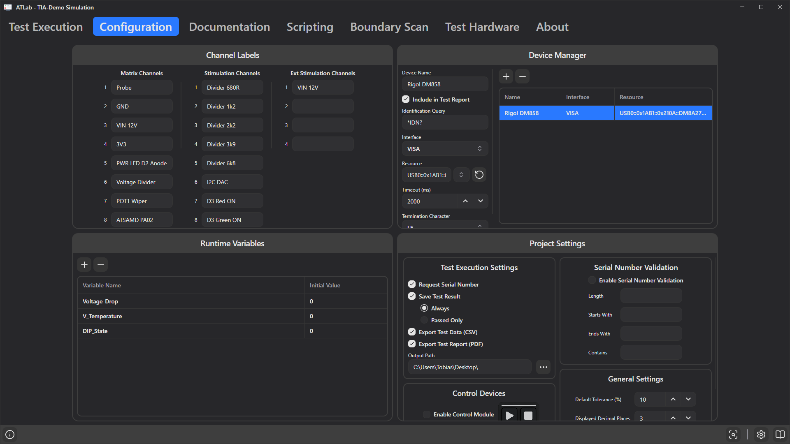

# 6. Configuration Tab

The **Configuration** tab holds the project-wide setup. Everything here is saved in the project file.

It is divided into five panels:

- [Channel Labels](#channel-labels)
- [Device Manager](#device-manager)
- [Runtime Variables](#runtime-variables)
- [Project Settings](#project-settings)
- [Board and Nets](#board-and-nets)

---

## Channel Labels

Give the relay channels of the test hardware meaningful names, such as `GND`, `VIN 12V` or `TP12 3V3`. There are three columns:

| Column | Channels |
|--------|----------|
| **Matrix Channels** | Measurement matrix channels, selectable as Matrix H / Matrix L in each step |
| **Stimulation Channels** | Stimulation relays |
| **Ext Stimulation Channels** | External stimulation relays |

The number of rows matches the connected test hardware (or the simulator). The names appear in the relay selectors of the step configuration (displayed as `<number> <name>`), which makes sequences far easier to read and review. Leave a field empty if the channel is unused.

With **Use net names as channel labels** turned on, every channel is named after the net on its test hardware pins instead (assigned under [Board and Nets](#board-and-nets)):

- MEAS channels get their net,
- stimulation channels the net on Out (or, if there is none, on In),
- external stimuli the net on H (or on L).

Only the last part of the net path is used (`/SENSE/VREF` becomes `VREF`). When the nets change, the labels change with them; a channel without a net has no label. While the option is on, the label fields cannot be edited. Your own labels stay in the project and come back as soon as the option is turned off.

> **Tip:** In the matrix selector you can type the channel number on the keyboard to jump to it.

---

## Device Manager

The Device Manager lists the external devices that steps can talk to: instruments such as multimeters and power supplies, or a DUT with its own serial/TCP interface.

- **+** (**Add new device**) creates a device named `New Device` with interface *Serial Port*.
- **−** (**Remove device**) deletes the selected device.
- Select a device in the table on the right to edit it on the left. A long resource string ends with "…" in the table; hover over it to see it in full.

Steps refer to devices by an internal ID, so renaming a device does not break the steps that use it. Removing a device does: those steps then fail with *"Target Device ID … not found."*

### Common fields

| Field | Description |
|-------|-------------|
| **Device Name** | Name shown in the step editors and in the test report. |
| **Include in Test Report** | Lists the device under *Used Test Equipment* in the PDF report. |
| **Identification Query** | Command sent when a report is generated, for example `*IDN?`. The answer (manufacturer, model, serial, firmware) is printed in the report. Only used if *Include in Test Report* is enabled. |
| **Interface** | `Serial Port`, `TCP/IP` or `VISA`. The remaining fields depend on this choice. |

### Serial Port

| Field | Default | Description |
|-------|---------|-------------|
| **Port** | – | COM port (Windows) or `/dev/tty…` (Linux). Use the refresh button to rescan. |
| **Baud Rate** | 115200 | |
| **Data Bits** | 8 | |
| **Parity** | None | |
| **Stop Bits** | One | |
| **Handshake** | None | |
| **Termination Character** | NONE | Appended to every command sent: `NONE`, `LF`, `CR` or `CRLF`. |
| **Framing Mode** | Chunk | How the end of a response is detected (see below). |
| **Timeout (ms)** | 100 | Only for *Timeout Based* framing: the silence period that ends a response. |

**Framing modes**

| Mode | A response is complete when … |
|------|-------------------------------|
| **Chunk** | … any data has been received (the first received block is the answer). Fast, but long answers may be cut. |
| **LF Terminated** | … a line feed (`\n`) arrives. Best for SCPI instruments over serial. |
| **CRLF Terminated** | … a `\r\n` sequence arrives. |
| **Timeout Based** | … no further byte has arrived for the configured *Timeout (ms)*. Good for binary protocols without terminator. |

### TCP/IP (raw socket)

| Field | Default | Description |
|-------|---------|-------------|
| **IP-Address** | – | e.g. `192.168.20.2` |
| **Port** | 5025 | 5025 is the usual SCPI-RAW port. |
| **Timeout (ms)** | 2000 | Connection timeout. |
| **Termination Character** | LF | Appended to every command. |

### VISA (Windows, requires NI-VISA)

| Field | Default | Description |
|-------|---------|-------------|
| **Resource** | – | VISA resource string, e.g. `USB0::0x1AB1::0x0588::DM3R123456::INSTR` or `TCPIP0::192.168.1.10::inst0::INSTR`. The refresh button lists all USB, GPIB, serial (ASRL) and TCPIP resources found by NI-VISA. |
| **Timeout (ms)** | 2000 | VISA I/O timeout. |
| **Termination Character** | LF | Termination character for *reading* responses. |

> **Note:** For VISA, the termination setting applies to reading. Commands are written exactly as entered. If your instrument needs a terminator on every command (typical for `::SOCKET` resources), append it explicitly, e.g. `MEAS:VOLT?{hex:0A}`. See [Commands, Variables & Expressions](10-commands-variables-expressions.md#encoding-blocks).

### Connection handling

ATLab opens the connection to a device the first time a step needs it and keeps it open while consecutive steps talk to the same device. It reconnects when a step addresses a different device or when the device configuration has changed, and it releases the device at the end of each test run.

---

## Runtime Variables

Runtime variables are named values that live for the duration of a session. Use them to

- parametrise commands and limits (e.g. `{V_Supply}`),
- store a measured value from one step and reuse it in a later step,
- compute derived results with an **Expression** step.

| Column | Description |
|--------|-------------|
| **Variable Name** | Letters, digits and `_` only. Spaces are converted to `_`, other characters are removed automatically. |
| **Initial Value** | The value the variable starts with. |

Add and remove variables with **+**/**−** or the context menu.

**Lifetime of values**

- When a project is opened, or when you edit the Runtime Variables table, all variables are reset to their initial values.
- A step with **Assign Result to Variable** overwrites the value during a run (see [Building Test Sequences](08-building-test-sequences.md#advanced-settings)).
- Values written during a run are **kept for the next run** until the project is reopened or the table is edited. If a sequence relies on a variable starting at its initial value every time, set it explicitly in an early step (for example an Expression step that assigns a constant).

How to reference variables is explained in [Commands, Variables & Expressions](10-commands-variables-expressions.md).

---

## Project Settings

### Test Execution Settings

| Setting | Description |
|---------|-------------|
| **Request Serial Number** | Before **Start test execution** and **Start continuous test execution**, the operator must enter a serial number. |
| **Save Test Result** | Exports results automatically after each completed run. Only available when *Request Serial Number* is enabled, because the serial number is part of the file name. |
| **Always / Passed Only** | Export after every run, or only after passed runs. |
| **Sort into Pass / Fail Subfolders** | Writes the files of passed runs to the subfolder `Pass` and of failed runs to `Fail` in the folder of each format (see [Folders](15-results-and-reports.md#folders)). |
| **Export Test Data (CSV)** | Writes a tab-separated data file. |
| **Export Result File for Evaluation (JSON)** | Writes the results together with run, project, DUT and equipment metadata for evaluation tools (see [JSON result file](15-results-and-reports.md#json-result-file)). |
| **Export Test Report (PDF)** | Writes a formatted test report. |
| **Show failed steps on the board** | Below *Export Test Report (PDF)*: adds a picture of every failed step on the board to the report (see [Test report](15-results-and-reports.md#pdf-test-report)). Needs a board in the project. |
| **Board layers…** | What the board pictures in the report show, see [Board pictures in the report](#board-pictures-in-the-report). |
| **Output folder** | Appears below each enabled export format: the folder for the files of this format, e.g. the PDF reports on a network share and the JSON files in a folder for evaluation. Every enabled format needs a folder; several formats can use the same one. Click **…** to choose. Created if it does not exist. |

Details on the exported files: [Test Results & Reports](15-results-and-reports.md).

#### Board pictures in the report

**Board layers…** sets up the board pictures of failed steps in the PDF report:

- **View**: with **Automatic**, every step is shown from the side that holds most of the copper of its nets. **Top** or **Bottom** always shows that side.
- The layer list has two columns: layers ticked under **Top** appear in pictures of the top side, layers under **Bottom** in pictures of the bottom side. The arrows change the order (what is at the top of the list is drawn on top), the swatch changes the color and the slider the opacity. Layers on the far side of the board are drawn dashed.
- **Show all** / **Hide all**, **Default style** and **Default order** reset the list. **Save as default** uses these layers for new projects and projects without a choice of their own; **Load default** takes over the layers saved as default.

The choice is saved in the project. The nets of the steps are drawn in the colors of the [board view](14-running-tests.md#board-view).

### Control Devices

| Setting | Description |
|---------|-------------|
| **Enable Control Module** | Connects the USB control module (Start/Stop buttons with status LEDs). See [Running Tests](14-running-tests.md#control-module). |

### Serial Number Validation

When **Enable Serial Number Validation** is on, the **Start** button of the serial-number dialog is only enabled if the entered text matches all non-empty rules:

| Rule | Example | Matches |
|------|---------|---------|
| **Length** | `10` | exactly 10 characters (`0` or empty = any length) |
| **Starts With** | `PB-` | `PB-2026001` |
| **Ends With** | `-A` | `…-A` |
| **Contains** | `2026` | anything containing `2026` |

Checks are case-sensitive.

### General Settings

| Setting | Default | Description |
|---------|---------|-------------|
| **Default Tolerance (%)** | 10 | When you enter a nominal value, the lower and upper limits are set to nominal −/+ this percentage. |
| **Displayed Decimal Places** | 3 | Number of decimals shown for measured values. Trailing zeros are omitted. |
| **Log Level** | Info | Minimum severity for pop-up notifications and for the log file `events.log`: `Info`, `Warning`, `Error`. Success messages always pop up, but count as `Info` for the log file. The event log in the window always lists all messages of the session. |

---

## Board and Nets

This section holds the KiCad board of the device under test and the net on every pin of the test hardware's DUT connector. Both are used by the [board view](14-running-tests.md#board-view) of the Test Execution tab. Both are optional; a project without a board works as before.

| Element | Effect |
|---------|--------|
| **Board** | Folder button: choose the `.kicad_pcb` file (KiCad 6 or newer). Refresh button: read it again, e.g. after a change in KiCad. × button: remove the board from the project; the nets stay. |
| Status line | The loaded board with its number of footprints and nets, or why it could not be read. |
| **Import fixture…** | Takes over board, nets and probe positions from a fixture file of [ATLab Fixture Designer](17-fixture-designer.md) (`.atlabfix`). Every pin that a probe is wired to gets the net of the probe's pad. ATLab then asks whether the nets should also become the [channel labels](#channel-labels), following the same rules as **Use net names as channel labels**. While that option is on, ATLab does not ask. |
| **Clear nets** | Removes the nets and probes of all pins. |
| **Assigned only** | Lists only pins with a net. |
| Table | Every pin of J101 with its resource (e.g. pin `c7` is `MEAS 7`) and its net. Type the net or pick it from the suggestions, which list the nets of the board. **Probes** shows the probes of an imported fixture on the pin. |

The board is stored with a path relative to the project file, together with a checksum of the file. If the board file changes later, e.g. a new revision with other nets, the status line and the board view say so. Check the nets of the pins, then click **Nets checked**; this makes the current file the new reference.
