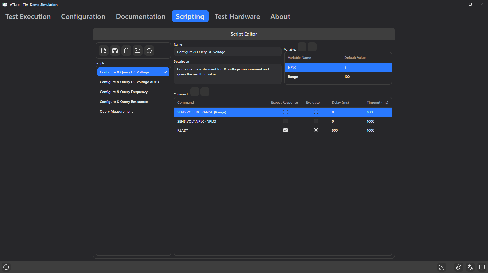

# 6. Scripting Tab

A **script** is a named, reusable sequence of instrument commands, for example *"Configure & Query DC Voltage"*. Instead of typing the same SCPI commands into many steps, you write them once as a script and select the script in each step. Variables let one script serve many steps with different settings.

## The script repository

Scripts are stored as individual JSON files (`<id>.json`) in a **repository folder**, independent of any project. Several projects can share one repository.

- The repository path is saved in the project. If it lies inside the project folder, it is stored relatively.
- A new project uses the default repository:
  - Windows: `%LOCALAPPDATA%\ATLab\Scripts`
  - Linux: `~/.local/share/ATLab/Scripts`
- If the configured folder does not exist, ATLab tries to create it; if that fails it falls back to the default folder and logs a message.

## Toolbar

| Button | Function |
|--------|----------|
| **New script** | Creates a new, empty script and saves it to the repository immediately. |
| **Save script** | Saves the selected script. |
| **Delete script** | Permanently deletes the selected script file after confirmation. |
| **Change repository folder** | Selects another folder as repository and reloads the list. |
| **Reload script repository** | Re-reads all scripts from disk, e.g. after pulling changes from version control. |

Scripts with unsaved changes are marked with `*` in the list, and the tab title shows **Scripting\*** while any script is unsaved. Script changes are **not** saved with the project — use **Save script**.

## Editing a script

Select a script in the **Scripts** list. On the right you can edit:

- **Name** – shown in the step's script selector.
- **Description** – shown as a tooltip in the script selector.
- **Variables** – placeholders with default values.
- **Commands** – the command list.

### Variables

| Column | Description |
|--------|-------------|
| **Variable Name** | Letters, digits and `_` only. |
| **Default Value** | Value a step starts with when the script is first selected. |

Use a variable in a command by writing its name in curly braces, e.g. `SENS:VOLT:DC:RANGE {Range}`. Each test step that uses the script gets its own copy of the variables and can override the values (see [Script evaluation](08-evaluation-sources.md#script)).

### Commands

| Column | Description |
|--------|-------------|
| **Command** | Text sent to the instrument. May contain script variables, runtime variables, encoding blocks and expressions ([chapter 9](09-commands-variables-expressions.md)). Empty commands are skipped. |
| **Expect Response** | Send the command and wait for an answer (a query). If off, the command is only written. |
| **Evaluate** | Use the answer of this command as the step's measured value. Only **one** command per script can be marked; marking another clears the previous one. Requires **Expect Response** to be on as well. |
| **Delay (ms)** | Wait time **before** the command is sent. |
| **Timeout (ms)** | How long to wait for the answer (default 1000 ms). Exceeding it ends the step with result `Timeout`. |

Commands are executed from top to bottom. Add or remove commands with **+**/**−** or the context menu; a new command is inserted below the selected one.

## Example: DC voltage measurement

**Variables**

| Variable Name | Default Value |
|---------------|---------------|
| `Range` | `100` |
| `NPLC` | `5` |

**Commands**

| Command | Expect Response | Evaluate | Delay (ms) | Timeout (ms) |
|---------|:---:|:---:|---:|---:|
| `SENS:VOLT:DC:RANGE {Range}` | | | 0 | 1000 |
| `SENS:VOLT:NPLC {NPLC}` | | | 0 | 1000 |
| `READ?` | ✔ | ✔ | 500 | 1000 |

A step using this script sends the two configuration commands, waits 500 ms, queries `READ?` and uses the instrument's answer (e.g. `+1.2001555E+01`) as its measured value.

## Good practice

- Keep scripts small and generic; push step-specific values into variables.
- Put the repository folder next to your projects and under version control.
- If a script returns more than a bare number, use [Response Processing](10-response-processing.md) in the step to extract the value.
- If no command is marked **Evaluate**, the step's measured value is `0`.
