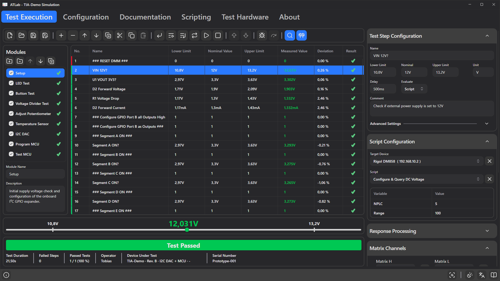

# 7. Building Test Sequences

Test sequences are built on the **Test Execution** tab with **development mode** enabled (construction-cone button at the right end of the toolbar). In development mode the configuration panels appear to the right of the step list.

## Modules

A project is divided into **modules**, e.g. *Power Supply*, *Programming* or *LED Test*. Each module has its own list of test steps. The **Modules** panel to the left of the step list shows all modules of the project; click a module to show its steps.

| Element | Meaning |
|---------|---------|
| Checkbox | Includes the module in test execution. Disabled modules are shown dimmed and are skipped completely. |
| Spinner / ✔ / ✘ | A spinning icon while the module is running, otherwise the result of the module after a run (✘ if any executed step failed). |

In development mode the panel offers buttons to **add**, **remove**, **move up / down** and **duplicate** modules, plus fields for the selected module's **name** and **description** (the description is shown as tooltip in the list). A project always contains at least one module. Enabling or disabling modules is only possible in development mode.

Modules are executed in list order, and the steps of all enabled modules form one continuous sequence. Step numbers start at 1 in every module.

To move steps to another module, cut them, select the target module and paste them.

## The step list

| Column | Content |
|--------|---------|
| **No.** | Step number. The coloured stripe on the left shows the step's *Accent Color*. |
| **Name** | Step name. |
| **Lower Limit / Nominal Value / Upper Limit** | Limits, formatted with the step's unit and SI prefix (e.g. `10,8V`, `1,3mA`). |
| **Measured Value** | Result of the last run; green when passed, red when failed. Can also show `Timeout` or `Overflow`. |
| **Deviation** | Deviation from the nominal value in percent. |
| **Result** | ✔ or ✘ after the step has been executed. |

Ignored steps are shown dimmed. Columns can be resized and reordered; the list cannot be sorted. If the columns don't fit, e.g. on small displays, the list scrolls horizontally. Editing is disabled while a test runs.

### Selecting several steps

Use `Ctrl`+click and `Shift`+click to select multiple steps. The configuration panel shows the step you clicked last. **Any change you make there is applied to all selected steps** — a quick way to set the same unit, delay, device or relay state for a whole block of steps.

## Editing commands

| Toolbar button | Context menu | Shortcut | Action |
|----------------|--------------|----------|--------|
| **Add a new test step** (`+`) | Add | `Insert` | Inserts a new step after the selection (or at the end). |
| **Remove selected test steps** (`−`) | Remove | `Delete` | Deletes the selected steps. |
| **Move selected test step up / down** (↑ / ↓) | Move Up / Move Down | | Moves the selected step by one position within its module. Disabled when the step is already first (up) or last (down). |
| **Duplicate selected test steps** | Duplicate | `Ctrl+D` | Inserts copies directly after the selection. |
| **Cut selected test steps** | Cut | `Ctrl+X` | Removes the steps and keeps them for pasting. |
| **Copy selected test steps** | Copy | `Ctrl+C` | Copies the steps. |
| **Paste test steps** | Paste | `Ctrl+V` | Inserts the copied/cut steps after the selection. |

Steps are renumbered automatically within their module. Copies get new internal IDs, so *Jump To* targets in copied steps still point to the original steps. When a whole module is duplicated, jumps between steps inside that module are redirected to the copied steps.

---

## Test Step Configuration

The top panel on the right edits the basic properties of the selected step. If no step is selected, e.g. in an empty module, all panels are disabled and show default values. Panels can be collapsed with the arrow in their header; ATLab remembers which panels are open.

### Name, limits and unit

| Field | Description |
|-------|-------------|
| **Name** | Free text, shown in the list and in reports. |
| **Lower Limit** | Smallest value that passes. |
| **Nominal** | Expected value; used for the deviation. |
| **Upper Limit** | Largest value that passes. |
| **Unit** | Unit symbol such as `V`, `A`, `Ohm`, `Hz`. Used for display and when parsing entered values. |

A step **passes** when `Lower Limit ≤ measured value ≤ Upper Limit`. Value and limits are compared with 15 significant digits, so tiny floating-point errors (e.g. `0.1 + 0.2` giving `0.30000000000000004`) do not turn a value that equals a limit into a failure. The **deviation** is `(measured − nominal) / nominal × 100 %`; if the nominal is 0, the absolute difference is shown instead.

**Entering values**

- SI prefixes are understood: `p` (10⁻¹²), `n` (10⁻⁹), `u` (10⁻⁶), `m` (10⁻³), `k` (10³), `M` (10⁶). Examples with unit `V`: `3.3`, `3.3V`, `500mV`, `0.5`.
- Both `.` and `,` are accepted as decimal separator.
- When you enter a **Nominal** value, the lower and upper limits are recalculated from the project's **Default Tolerance** (e.g. nominal `12` with 10 % → `10.8` … `13.2`). Enter the nominal value first, then adjust the limits.
- A literal lower limit cannot be greater than the nominal value, and a literal upper limit cannot be less than it; ATLab corrects such entries.
- To check for an exact value, set all three to the same number (e.g. `1` for a user confirmation or a match).

**Display of units**

Values are displayed with an automatic SI prefix (`0.0013 A` → `1,3mA`). If you put the unit in braces, e.g. `{°C}` or `{rpm}`, the prefix scaling is disabled and the value is shown as is with the unit text.

**Variables in limits**

Limits, nominal value and delay can reference runtime variables, e.g. `{V_Ref}` or an expression such as `{expr:{V_Ref}*1.05}`. They are resolved each time the step runs. Automatic tolerance calculation is skipped when any of the three values contains a variable. See [chapter 9](09-commands-variables-expressions.md).

### Delay

Wait time between switching the relays and acquiring the value, for settling. The value is in **seconds** unless you give a prefix: `0.5`, `500ms`, `2`, `2s`. Delays longer than one second show a progress bar labelled *Waiting…*.

### Evaluate

Selects the [evaluation source](08-evaluation-sources.md): **None**, **Script**, **Device Command**, **Interface Command**, **Shell Command**, **User Confirmation**, **User Input**, **Expression** or **File**. The matching editor panel appears below.

### Comment

Text for the operator. It is shown in a dialog when *Show Comment* is enabled, when the pass/fail action is *Show Comment*, and as the question for *User Confirmation* and *User Input* steps. The comment may contain `{Variable}` references, which are replaced by their current value.

---

## Advanced Settings

Click **Advanced Settings** to expand.

| Setting | Description |
|---------|-------------|
| **Ignore Step** | The step is skipped during execution and omitted from exports. Useful for temporarily disabling a step. |
| **Exclude from Export** | The step runs and counts for pass/fail, but is not written to CSV or PDF (e.g. setup steps). |
| **Accent Color** | Colour of the stripe next to the step number. Use it to group steps visually. |
| **Show Comment** | Before the step executes, the comment is shown in a dialog with **Continue** / **Cancel**. Cancel aborts the test. Use the image button next to it to add a picture (PNG, JPG, BMP, GIF, WEBP) to the dialog — e.g. a photo showing where to connect a probe. For *User Confirmation* and *User Input* steps the checkbox is disabled, because their dialog already shows the comment; the image is shown in that dialog. |
| **Assign Result to Variable** | After execution, the measured value is written to the selected runtime variable. `Timeout` and `Overflow` are written as text. |

### Pass-Action and Fail-Action

After evaluation, ATLab applies the **Pass-Action** if the value is within limits, otherwise the **Fail-Action**. Each action offers:

| Option | Effect |
|--------|--------|
| **Continue** | Go to the next step (default). |
| **Repeat** | Execute the same step again. Useful for "wait until" loops, e.g. repeat on fail until a voltage has settled. |
| **End Test** | Stop the sequence after this step. The run is evaluated normally. |
| **Jump To** | Continue with the step selected in the drop-down (forwards or backwards). The target can be in any module; the drop-down lists steps as *Module / No.: Name*; hover an entry to see the full text. |
| **Show Comment** | Show the comment in a dialog, then continue with the next step. With **Include Result**, the dialog also shows the measured value and its pass/fail state. **Cancel** aborts the test. |
| **Invert Result** | Flips the step's verdict *after* the action has been chosen. In the Fail-Action this means "a value outside the limits counts as pass"; in the Pass-Action, "a value inside the limits counts as fail". |

Notes:

- A repeating step can be ended manually with the **Continue test execution** button in the toolbar (or `Enter`). The sequence then proceeds with the next step.
- Without a delay, repeated steps run as fast as possible (with a minimal pause to keep the UI responsive). Add a delay to limit the polling rate.
- Jumping to a deleted or ignored step, or to a step in a disabled module, logs an error, marks the step as failed and ends the test.
- Each repetition overwrites the previous result; only the final one counts.

**Example – wait for a supply to come up (max. ~10 s):**

| Step | Evaluate | Limits | Delay | Fail-Action |
|------|----------|--------|-------|-------------|
| 5 *Wait for 3V3* | Script *Query DC Voltage* | 3.2 … 3.4 V | 0.5 s | Repeat |

Combine with a counter variable and a jump if you need a hard timeout.

---

## Relay routing

The bottom three panels set the Test Interface Adapter's relays **for the selected step**. When a step starts, exactly this configuration is applied; when the test ends (or is stopped), all relays are cleared.

### Matrix Channels

| Control | Description |
|---------|-------------|
| **Matrix H** | Channel connected to the high side of the measurement bus. |
| **Matrix L** | Channel connected to the low side. |
| Swap button | **Swap channels** — exchanges H and L. |
| Probe button | **Enable external probe** — routes the external probe instead of a matrix channel. |

Choose **Off** to leave a side unconnected. The list shows channel numbers with their custom names. If a step refers to a channel that the connected adapter does not have, the step fails with *"Matrix Channel is not available."*

### Stimulation Channels / External Stimulation Channels

One checkbox per relay. Tick the relays that must be closed during this step. Channel names from the Configuration tab are shown next to the numbers.

> **Tip:** To keep a stimulus (e.g. supply voltage) active over many steps, select all those steps and enable the relay once — the change is applied to the whole selection.
