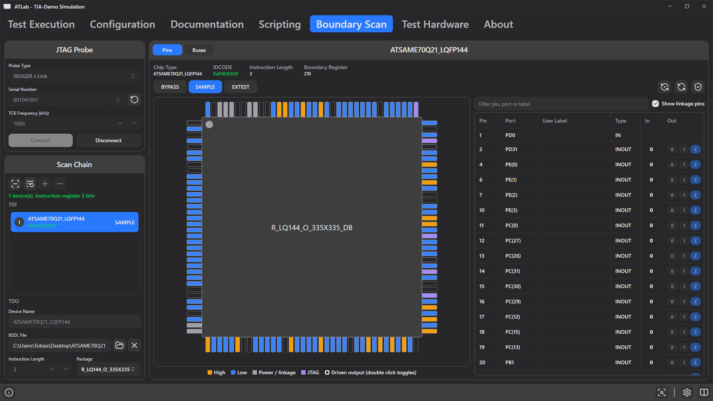

# 12. Boundary Scan Tab

**Boundary scan** (IEEE 1149.1, also called JTAG) gives access to the pins of chips on a board without touching them with a probe. Every pin of a boundary-scan capable chip has a cell in the chip's *boundary register*. Through a JTAG probe, ATLab can read the levels of these pins and drive them, while the chip's own logic is disconnected from them. Typical uses:

- checking connections between chips (interconnect test) and to connectors, LEDs, buttons or jumpers,
- reading board straps or DIP switches,
- talking to I²C or SPI devices (EEPROMs, sensors, flash memories) whose bus lines are connected to a boundary-scan chip,
- debugging a board that does not boot.

The **Boundary Scan** tab is used to set up the scan chain and to work with the pins by hand. Test steps then use this setup through the evaluation sources [Boundary Scan](09-evaluation-sources.md#boundary-scan) and [Boundary Scan Bus](09-evaluation-sources.md#boundary-scan-bus).

Boundary scan does not use the Test Interface Adapter. It needs a separate JTAG probe connected to the JTAG header of the board.

## Requirements

### Supported probes

| Probe | Driver / library | Notes |
|-------|------------------|-------|
| **SEGGER J-Link** | *J-Link Software and Documentation Pack* from SEGGER (`JLink_x64.dll` on Windows, `libjlinkarm.so` on Linux) | All J-Link models with JTAG support. |
| **FTDI MPSSE** (FT2232H, FT232H, FT4232H) | FTDI *D2XX* driver (`ftd2xx.dll` on Windows, `libftd2xx.so` on Linux) | Pinout on the A channel: ADBUS0 = TCK, ADBUS1 = TDI, ADBUS2 = TDO, ADBUS3 = TMS. |

ATLab looks for the probe library in this order:

1. the **ATLab program folder**,
2. the operating system's search path (`PATH`, `System32`, library cache),
3. the default install folders of the vendor, e.g. `C:\Program Files\SEGGER\JLink…` (newest version first).

If the library is not found automatically, copy it into the ATLab program folder. The library is searched again on the next attempt, so ATLab does not have to be restarted.

### BSDL files

To read or drive pins, ATLab needs the **BSDL file** (Boundary Scan Description Language, `.bsd` or `.bsdl`) of each chip. It describes the instruction register, the boundary register cells and the package pinout. BSDL files are provided by the chip manufacturer, usually on the product page or in the support section of its website. Make sure the file matches the exact chip and package.

## Overview

The tab is divided into three areas:

- **JTAG Probe** (top left) – probe selection and connection,
- **Scan Chain** (bottom left) – the chips in the chain and their settings,
- the right panel, which shows the **Pins** of the selected chip, the **Buses** or the **Interconnect** test. Switch between them with the buttons in its header.

While a test run controls the chain, the tab is locked and a blue banner says so (see [Boundary scan during test execution](#boundary-scan-during-test-execution)).

## Connecting the probe

| Field | Description |
|-------|-------------|
| **Probe Type** | `SEGGER J-Link` or `FTDI MPSSE (FT2232H / FT232H / FT4232H)`. |
| **Serial Number** | Serial number of the probe to use. Leave it empty to use the first available probe. The search button lists the connected probes; pick one from the drop-down next to the field to fill it in. FTDI channels appear separately, e.g. `…A` and `…B`; JTAG normally uses channel A. |
| **TCK Frequency (kHz)** | JTAG clock frequency, default 1000 kHz. Reduce it if the chain detection fails on long cables or slow chips. |
| **ADBUS Value (hex)** / **ADBUS Direction (hex)** | FTDI only. Start level and direction of ADBUS0–7. TCK, TDI, TDO and TMS are fixed; the other pins can enable buffers or level shifters of the adapter board. Defaults `08` / `0B`. |
| **Connect** / **Disconnect** | Opens or closes the probe. After connecting, the chain is scanned automatically and compared with the configured chain (see [Scan chain](#scan-chain)). |

Probe settings are saved in the project. **Disconnect** returns all chips to normal operation (Test-Logic-Reset) before the probe is closed; the same happens when ATLab is closed.

## Scan chain

The chain list shows the chips in chain order, from **TDI** (top) to **TDO** (bottom). Each entry shows:

- the position in the chain and the name (the **Device Name**, or the chip type if no name is set),
- the IDCODE read from the chip, green if it matches the BSDL file and red if it does not,
- the instruction currently loaded (`BYPASS`, `SAMPLE`, `EXTEST`) while connected,
- *No BSDL* if no BSDL file is assigned yet.

| Button | Function |
|--------|----------|
| **Detect the devices in the scan chain** | Scans the chain again: number of chips, total instruction register length and IDCODEs, and compares it with the configured chain. |
| **Adopt detected chain** | Replaces the configured chain with the chips found on the board, after a confirmation. Chips that are found again keep their settings; all others are removed together with their BSDL file, package and user labels. |
| **Add device** / **Remove selected device** | Edits the chain by hand, for example to prepare a project without hardware. Only possible while disconnected. |

Scanning **never changes an existing chain configuration**. If another board is connected, a chip is missing or the chain is broken, your setup with its BSDL files and user labels stays as it is. Only an empty configuration takes over the detected chain automatically, which makes setting up a new project easy. To rebuild an existing configuration from the board, use **Adopt detected chain**.

A chip counts as found again if its IDCODE matches its BSDL file. The BSDL file usually masks the version bits, so other silicon revisions of the same chip match as well. Chips without BSDL file must have the stored IDCODE.

While connected, the chain list shows the IDCODEs read from the board. The status line above the list shows `<n> device(s), instruction register <bits> bits` when the board matches the configuration, otherwise every difference, for example *Found 2 device(s), the project expects 3.*, *Device 2 (U3): IDCODE 0x… does not match the BSDL file of …* or *Device 1 (U1): instruction length unknown*. Instructions can only be loaded once the status is green.

### Device settings

| Field | Description |
|-------|-------------|
| **Device Name** | Reference designator or name, e.g. `U3`. Used in the chain list, in test steps and in result messages. |
| **BSDL File** | Folder button: import the BSDL file. × button: remove it. The file is parsed immediately; warnings (e.g. missing instructions) appear in the event log. BSDL files inside the project folder are stored with relative paths. |
| **Instruction Length** | Taken from the BSDL file. For chips without a BSDL file it must be entered by hand. If only one chip in the chain has an unknown length, ATLab calculates it from the total length. |
| **Package** | Package variant from the BSDL file (e.g. `TQFP144`, `BGA256`). Determines the pin names and the package drawing. |
| **Footprint on the board** | Reference of the chip on the KiCad board of the project, e.g. `U3`. With it, the [board view](14-running-tests.md#board-view) can outline the chip for boundary scan steps and highlight the pins they use, together with their nets. For this, the package pin numbers must match the pad numbers of the footprint. The [interconnect test](#interconnect-view) needs this field too. |

Chips without a BSDL file can stay in the chain; they are always kept in BYPASS.

## Pins view

The **Pins** view shows the selected chip: **Chip Type** (the entity name from the BSDL file, e.g. `STM32F407_LQFP100`), **IDCODE**, **Instruction Length** and the length of the **Boundary Register**.

### Instructions

| Button | Effect |
|--------|--------|
| **BYPASS** | The chip is bypassed; its pins work normally. |
| **SAMPLE** | The pin levels are read without affecting the chip. Use it to watch signals while the board runs normally. |
| **EXTEST** | The pins are taken over by the boundary register: outputs are driven from it and inputs are read. The chip stops normal operation. |

Before EXTEST becomes active, ATLab loads the requested output values first (PRELOAD), so the outputs never start with random levels. When a BSDL file is loaded, all cells start with the **safe values** from the BSDL file, which usually means that all outputs are disabled.

> **Caution:** In EXTEST, outputs are driven against whatever else is connected to the net. Before driving a pin, make sure no other driver on the board works against it, otherwise the chips can be damaged.

| Control | Function |
|---------|----------|
| Auto refresh button | Reads the pins continuously (about 10 times per second) while a chip is in SAMPLE or EXTEST. Click again to stop; the button is highlighted while active. |
| Refresh button | Reads the pins once. |
| Shield button | **Reset all outputs to the safe values of the BSDL file.** |

### Package view

The drawing shows the package with the live state of every pin. The layout is derived from the pin names: numbered pins are placed around a quad package (QFP, QFN) or on two sides (SOIC, TSOP, DIP), letter-number names such as `A1` form a BGA grid.

| Display | Meaning |
|---------|---------|
| Orange | Pin reads high |
| Blue | Pin reads low |
| Grey | Power or linkage pin (no boundary cell) |
| Purple | JTAG pin (TCK, TMS, TDI, TDO, TRST) |
| Thick white/black outline | Output driven by boundary scan (EXTEST) |
| Blue ring | Selected pin |

Hovering a pin shows its details in the line at the bottom of the drawing, e.g. `Pin 8 · IO(3) · LED_RED · INOUT · In 0 · Out Z · Cells I11 O10 C9`. Click a pin to select it in the table; **double-click** a driven output to toggle it between 0 and 1.

### Pin table

| Column | Content |
|--------|---------|
| **Pin** | Package pin name. |
| **Port** | Port name from the BSDL file, e.g. `PA3` or `IO(3)`. |
| **User Label** | Your own name for the signal, e.g. the net name from the schematic. Double-click the cell or press `F2` to edit it. |
| **Type** | `IN`, `OUT`, `INOUT`, `LINKAGE` or `TAP`. |
| **In** | Level read from the pin (`0`/`1`), empty while the chip is in BYPASS. |
| **Out** | Buttons `0`, `1` and `Z` to drive the pin; enabled in EXTEST only. `Z` is only offered if the output can be disabled. |

- Click a column header to sort; pins and ports are sorted naturally (`2` before `10`, `IO(2)` before `IO(10)`).
- The filter field above the table matches pin, port and user label.
- **Show linkage pins** hides power and other pins without boundary cells.
- Hovering the **In** or **Out** cell shows the boundary register cells of the pin (`I` = input, `O` = output, `C` = control).

Many chips use one **control cell** for several outputs. Switching one of them to `Z` then disables all outputs of that group; the tooltip lists the affected pins.

**User labels** are stored in the project per port, so they are kept when the package is changed. They appear in the package view, in test steps and in result messages.

## Buses view

The **Buses** view defines buses that are emulated through boundary scan pins. Test steps then select a bus with the evaluation source [Boundary Scan Bus](09-evaluation-sources.md#boundary-scan-bus). The tab is only used to set up the buses; transactions are run by test steps.

Add and remove buses with the **+** and **−** buttons. For the selected bus:

| Field | Description |
|-------|-------------|
| **Name** | Name shown in test steps, e.g. `EEPROM`. |
| **Type** | `I²C`, `SPI` or `Pin Group`. |
| **SPI mode** | SPI only: mode 0–3 (CPOL/CPHA). |
| **CS active high** | SPI only: chip select is active high instead of low. |
| **LSB first** | SPI only: bits are shifted LSB first. |
| **Number of pins** | Pin group only: number of pins (1–32). |

The signal table lists the signals of the bus type. Double-click the **Device** or **Pin** cell to assign a chip and a pin; user labels are shown next to the ports. Signals can be spread over several chips of the chain.

| Type | Signals | Requirements |
|------|---------|--------------|
| **I²C** | SCL, SDA | Both need an output that can be switched to `Z` and an input. The board needs pull-up resistors. |
| **SPI** | SCK, MOSI, MISO, CS | SCK is required, MOSI, MISO and CS are optional, but at least MOSI or MISO is needed. Outputs for SCK, MOSI and CS, an input for MISO. |
| **Pin Group** | Bit 0 … Bit n | Outputs for writing; inputs (and outputs that can be switched to `Z`) for reading. |

Below the table, ATLab lists what is still missing or not possible, e.g. *SDA has no pin assigned.* or *SCL: U1 PB6 cannot be switched to Z.* When everything is fine, it shows *The bus is ready to be used in test steps.*

A **pin group** treats several pins as one number: a write drives the value onto bit 0 … n, a read releases the pins and reads them back. Use it for board ID straps, DIP switches or LED ports. It has no control lines, so it cannot access memories or other parallel buses with strobe signals.

### Speed and limitations

A bus is emulated by setting its pins through the boundary register, so every change of a bus line takes one complete scan of the chain. The bus clock therefore follows from the JTAG clock:

- **One scan** takes *DR length + 5* TCK cycles. The DR length is the sum of the boundary register lengths of all chips in EXTEST or SAMPLE, plus 1 bit for each chip in BYPASS.
- **One bus clock** takes 3 scans for I²C (set SDA, raise SCL, lower SCL; start, stop and ACK add a few more), 3 scans for SPI with CPHA 0 and 2 with CPHA 1. A pin group needs one scan per write and one per read.

Example: TCK 1000 kHz and one chip with a 100-cell boundary register give (100 + 5) µs per scan, about 315 µs per I²C bit, i.e. an SCL clock of roughly 3 kHz.

All scans of one transaction are sent to the probe in a single transfer, so USB latency hardly matters and an I²C register read takes only a few milliseconds. To make a bus faster:

- Increase **TCK Frequency (kHz)**; the bus clock scales with it.
- Keep chips that the bus does not use in BYPASS. A chip that is still in EXTEST or SAMPLE from an earlier step or from this tab adds its whole boundary register to every scan. EXTEST stays active until the end of the test run.
- If you have the choice, use pins of a chip with a short boundary register.

I²C and SPI have no minimum clock rate, so this works with EEPROMs, sensors, GPIO expanders and flash memories.

- I²C **clock stretching** is not supported. A target that holds SCL low makes the step fail with *SCL is held low*.
- UART, 1-Wire and other protocols with fixed timing cannot be emulated.

## Interconnect view

The interconnect test checks the connections between the boundary scan pins of the board. It finds **opens** (a pin that is not connected to its net), **shorts** between nets, and nets **stuck** at 0 or 1.

The test needs:

- the KiCad board in the project (see [Board and Nets](06-configuration.md#board-and-nets)),
- a BSDL file for every chip,
- the **Footprint on the board** for every chip.

The view lists every net of the board that has at least one boundary scan pin on it.

| Column | Content |
|--------|---------|
| **Net** | Net name from KiCad |
| **Role** | What the test does with the net (see [Roles](#roles)) |
| **Connected to** | Another net that belongs to this one, e.g. behind a series resistor (see [Connected nets](#connected-nets)) |
| **Boundary scan pins** | The pins of the chain on this net, e.g. `U3 pin 12 (PA3)`. If the pin has a user label in the pin table, the label replaces the port name in the brackets. |
| **Other pads** | All other pads on the net, e.g. `R5.1, J1.3`. They help you judge whether the net can safely be driven. |
| **Note** | Problems that keep the test from running (red), and other hints |

### Roles

**Every net starts as Safe.** To change the role, select one or more rows (`Ctrl`/`Shift`+click) and click the role under **Set selected to**.

| Role | Effect |
|------|--------|
| **Safe** | The test leaves the net alone. Its pins stay at the safe values of the BSDL file and are not read. |
| **Drive** | Every pin on the net that has an output drives the net once, while all other pins read it. This also tests every output on the way. Choose Drive only for nets that nothing else drives: no output of another chip, no supply, no oscillator. |
| **Expect 1** / **Expect 0** | The net is only read and must stay at this level all the time. Typical examples are a pull-up, an enable input tied to the supply, or GND. A driven net that is shorted to such a net is found too. |

### Connected nets

A series resistor splits a signal into two KiCad nets, e.g. `/SDA_MCU` and `/SDA`. To test the connection through the resistor as well, enter the other net in **Connected to**; the box suggests the nets of the list.

The test then treats both nets as one: every boundary scan pin on either side drives once, and all others read. A missing or open resistor shows up as an open between the pins on the two sides.

- Connected nets always have the same role. Changing the role of one changes it for all of them. When you connect a net, it takes the role of the other net; if the other net is Safe, it keeps its own.
- More than two nets can be connected: if `A` is connected to `B` and `B` to `C`, all three are tested as one net. The **Note** column names the nets tested together, and messages show them as `/SDA_MCU + /SDA`.
- To remove a connection, clear the box.

The filter box searches nets, pins and pads. **Tested only** hides the Safe nets. The refresh button reads the board and the BSDL files again. The line below the table shows how many nets have each role and how many have a problem.

Roles are saved in the project; Safe nets are not stored, as Safe is the default. The test is run by a test step with the evaluation source [Boundary Scan Interconnect](09-evaluation-sources.md#boundary-scan-interconnect).

### When the test does not run

Two pins must never drive the same net at the same time, one to 1 and the other to 0 – the outputs would fight each other. To prevent that, the test switches off every output on a tested net except the one whose turn it is. For this, every pin needs an **output enable**: a cell in the boundary register that switches the pin's output driver on and off.

If the setup does not allow this, the test does not run at all. The **Note** column shows the problem in red, and a test step fails with the same message.

| Problem | Reason | What to do |
|---------|--------|------------|
| Two pins on a Drive net **always drive** (*… always drive (no output enable)*), or one pin on an Expect net. | These pins have no output enable and cannot be switched off. They would drive against each other, or against the level the net should have. | Set the net to Safe. |
| A pin **shares its output enable** with other pins (*… shares its output enable with PA4, PA5*). | Some chips switch several pins with one shared output enable. When this pin drives, PA4 and PA5 drive too – on nets that are not set up for it. | Set the nets of PA4 and PA5 to Drive as well; they then drive at the same time and are tested too. Or set this net to Safe. |
| **No pin can drive** the net, or **no pin can read** it. | The test would have nothing to drive or nothing to read. | Set the net to Safe. |
| The net is **no longer on the board**. | The board was changed after the role was set. | Set the net to Safe. |

### How the test works

Every Drive net gets a code of its own. A **round** first drives the bits of all codes and then the inverted bits. This way every net is driven to 0 and to 1, and two shorted nets cannot both read back their own code. For *n* Drive nets a round has 2 × ⌈log₂(*n* + 2)⌉ patterns, e.g. 14 for 100 nets.

There are as many rounds as the largest number of output pins on one net. On a net with pins of U1 and U2, U1 drives in the first round and U2 in the second; the other pins read every time. Nets with fewer drivers use their drivers again, so every net is driven in every round. A pin without output enable cannot be switched off, so it is the only driver of its net (the **Note** column says so). All rounds are sent to the probe in a single transfer.

During the test, all chips with a BSDL file are in EXTEST. All cells start at their safe values. In each pattern only the pins whose turn it is are switched on; after the last pattern, all cells return to their safe values.

Comparing the rounds shows where a fault is:

| Observation | Cause |
|-------------|-------|
| In no round does any pin read the expected value. | The net itself: a short or a stuck level |
| Only while one particular pin drives, no pin reads the expected value; otherwise everything is fine. | The output of this pin is defective. |
| Only one pin reads wrong, even while it drives itself. | The input of this pin is defective. |
| One pin does not see the others, and they do not see it. | An open at this pin, e.g. a bad solder joint. If the net has only two pins, the test cannot tell which end is open. |

| Message | Meaning |
|---------|---------|
| *Short between nets A, B.* | The nets read a mix of their codes: they are shorted to each other. |
| *Nets A, B all read 0: shorted to each other or each to GND.* | Several nets read a constant level. Whether they are shorted to each other or each to GND cannot be told apart. |
| *Net A is stuck at 0: short to GND or to a stronger driver.* | The driver cannot change the level of the net. |
| *Net A: U2 pin 4 (PB1) does not drive the net, the other drivers do: its output is defective.* | The net works with every driver except this one. |
| *Net A: U2 pin 4 (PB1) does not read the net, the others see it drive: its input is defective.* | The pin drives the net, but does not read it. |
| *Open at U3 pin 7 (PA3) on net A: …* | The pin is not connected to the net. |
| *Open on net A between U1 pin 3 (P3) and U2 pin 3 (P3): …* | The two pins do not see each other; the open can be at either of them. |
| *Open on net A: U5 pin 4 (SDA) does not see the net (reads 1); open at the pin or defective input.* | A pin that cannot drive itself does not follow the net. |
| *Short between nets GND and A: U3 pin 7 follows the driven net.* | An Expect net reads the code of a Drive net. |

Limits of the test:

- A connection through a series resistor is only tested if the two nets are [connected](#connected-nets).
- On a net with a single boundary scan pin, the test finds shorts and stuck levels, but no opens (the **Note** column says so).

## Boundary scan during test execution

Test steps use the chain configured on this tab:

- The probe is connected at the **first** boundary scan step of a run, not at test start. The chain is then checked against the project (number of chips, IDCODEs, instruction lengths). If it does not match, for example because the wrong board is inserted, the step fails with the same message as the status line on this tab, e.g. *Boundary scan chain: Found 2 device(s), the project expects 3.*
- A connection opened on this tab is taken over by the test. The tab is locked until the test releases the chain.
- Pins that are not listed in a step keep their state from the previous steps. A **Boundary Scan Interconnect** step is the exception: it starts from the safe values and leaves all pins at their safe values. A chip whose outputs were driven stays in EXTEST until the chain is released.
- The chain is released — all chips return to normal operation and the probe is closed — when the run ends, when it is stopped (`Esc`), at a step in mode **Turn boundary scan off**, and when another project is opened.
- **Execute single step** (`F3`) keeps the chain under test control after the step, so several single steps can build on each other. Press **Stop** (`Esc`) to release it. A full run always starts from the safe values.

Use **Turn boundary scan off** before steps that need the chips in normal operation or need the probe themselves, for example programming the chip with an external program through the same J-Link.
