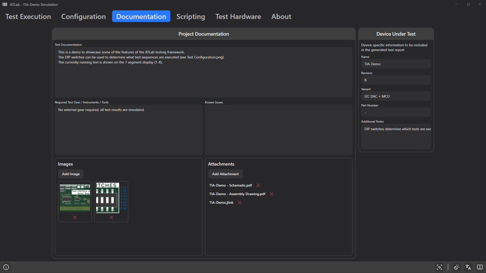

# 13. Documentation Tab

The **Documentation** tab keeps the knowledge needed to run a test together with the test itself: what it does, which equipment is needed, known issues, pictures and reference documents. It also holds the Device Under Test information printed in the test report.

All content is saved in the project file. Images and attachments are stored as **paths** (relative if they are inside the project folder), not embedded — keep the files next to the project.

## Project Documentation

### Text fields

| Field | Suggested content |
|-------|-------------------|
| **Test Documentation** | Purpose of the test, what the sequence does, how the DUT must be prepared and connected. |
| **Required Test Gear / Instruments / Tools** | Power supplies, meters, cables, fixtures, programmers. |
| **Known Issues** | Limitations, workarounds, typical failure causes. |

### Images

- **Add Image** adds a PNG, JPG, JPEG, BMP, GIF or WEBP file. A thumbnail is shown.
- Click a thumbnail to view the image enlarged; close the preview with ×.
- The red × below a thumbnail removes the image from the project (the file itself is not deleted).

Useful for fixture photos, connection diagrams or the location of test points.

### Attachments

- **Add Attachment** adds any file — schematics, assembly drawings, datasheets, programmer project files.
- Click an attachment name to open it with the application associated with its file type.
- The red × removes the attachment from the project (the file is not deleted).

If a referenced image or file no longer exists, an error is logged (*"Image not found: …"* / *"File not found: …"*).

## Device Under Test

*Device-specific information to be included in the generated test report.*

| Field | Report label |
|-------|--------------|
| **Name** | Device Name (also used in the report title) |
| **Revision** | Revision |
| **Variant** | Variant |
| **Part Number** | Part Number |
| **Additional Notes** | Additional Notes (separate section, only printed if not empty) |

Empty fields are printed as `-`. The serial number is not entered here; it comes from the serial-number dialog at the start of each test.

Name, revision, variant and part number are also shown in the [result bar](11-running-tests.md#the-result-bar) on the Test Execution tab, so the operator can check that the right test is loaded.
