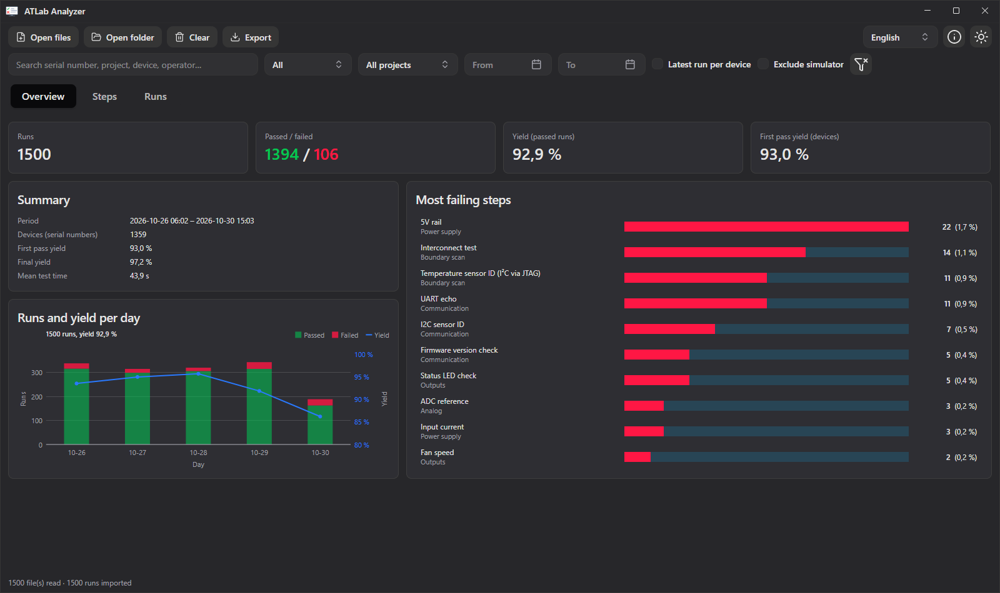
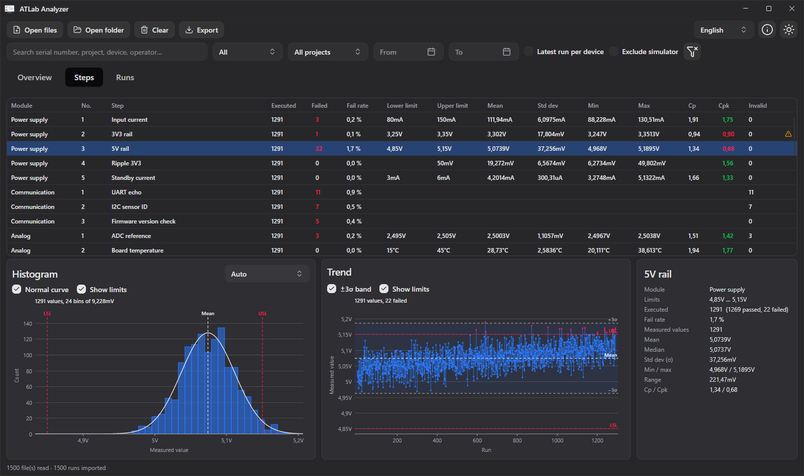
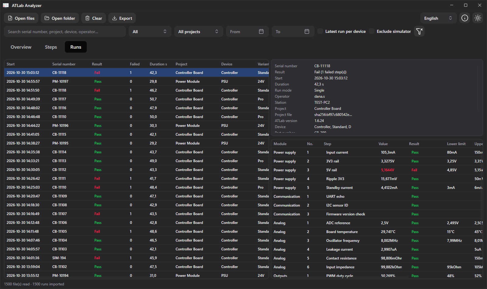

# 16. ATLab Analyzer

ATLab Analyzer evaluates the JSON result files of many runs: yield, the steps that fail most often, the distribution and the trend of every measured value, and the process capability (Cp, Cpk). It is a separate program that is installed together with ATLab; it reads result files and never changes them.

## Requirements

The Analyzer reads the **JSON result files** that ATLab writes when **Export Result File for Evaluation (JSON)** is enabled in the project settings (see [Test Results & Reports](15-results-and-reports.md#json-result-file)). CSV files and PDF reports cannot be evaluated.

Start the Analyzer from the Start menu (**ATLab Analyzer**) or from the `Analyzer` subfolder of the program folder (`ATLab.Analyzer.exe`, on Linux `ATLab.Analyzer`).

## Opening result files

| Action | How |
|--------|-----|
| Open single files | **Open files** or `Ctrl+O` |
| Open a folder | **Open folder** or `Ctrl+Shift+O`. All JSON files in the folder **and its subfolders** are read, so the output path of ATLab with its `Pass` and `Fail` subfolders can be opened at once. |
| Drag & drop | Drop files or folders onto the window. |
| Command line | `ATLab.Analyzer.exe <file or folder> …` opens the given paths at start. |

Opening adds runs to those already imported; a file that is opened again is read again, so a second **Open folder** picks up new runs. **Clear** removes all runs.

Other JSON files (e.g. settings files) and damaged files are skipped. The status bar shows how many files were read and skipped; click **… file(s) skipped** for the list with the reason for every file.

## Filters

The filter bar applies to all tabs and to every export:

| Filter | Effect |
|--------|--------|
| Search | Serial number, file name, project, device, variant, operator or station containing the text |
| **All / Passed / Failed** | Overall result of the run |
| Project | Runs of one project |
| **From / To** | Start date of the run; *To* includes the whole day |
| **Latest run per device** | Only the newest run of every serial number, applied after the other filters (e.g. together with *Passed*: the last passed run of every device). Runs without serial number are kept. |
| **Exclude simulator** | Hides runs executed in simulator mode |

The funnel button resets all filters.

## Overview tab

The cards at the top show the number of runs, passed and failed runs, the **yield** (share of passed runs) and the **first pass yield**.

**Summary**

| Figure | Meaning |
|--------|---------|
| Period | First and last start time of the filtered runs |
| Devices (serial numbers) | Number of different serial numbers |
| First pass yield | Share of devices whose **first** run passed |
| Final yield | Share of devices whose **last** run passed, i.e. after rework and retests |
| Mean test time | Average duration of a run |

Devices are told apart by their serial number (case and surrounding spaces are ignored); runs without serial number count for the yield but not for the device figures.

**Runs and yield per day** shows the passed (green) and failed (red) runs of every day as bars and the yield of the day as a line on the right axis. Days without runs are left out. If there are runs on more than 60 days, they are grouped by week. Point at a bar to see the numbers of that day.

**Most failing steps** lists the ten steps with the most failures. Click a step to open it on the Steps tab.

## Steps tab

The table shows every step across all filtered runs. Steps are matched by their step ID, so renaming or renumbering a step in the project does not split its history. Name, number and limits are taken from the newest run; a ⚠ at the end of the row means the limits changed between runs; the statistics then use the limits of the newest run. Click a column header to sort.

| Column | Meaning |
|--------|---------|
| Executed / Failed / Fail rate | Number of runs that executed the step, failed results and their share |
| Lower limit / Upper limit | Limits of the newest run |
| Mean, Std dev, Min, Max | Statistics of the measured values (sample standard deviation) |
| Cp | (upper limit − lower limit) / 6σ: does the spread fit between the limits? |
| Cpk | Distance of the mean from the nearer limit in units of 3σ: does the spread fit at its actual position? With one limit, the one-sided index. Green from 1.33, orange from 1.00, red below. |
| Invalid | Results without a valid value: Timeout, NACK, Overflow or an unreadable value |

Cp and Cpk stay empty without spread (fewer than two values or all values equal) and for steps whose lower and upper limit are equal (e.g. `0 … 0` mismatching pins of a boundary scan check or `1 … 1` for a confirmation): such steps are pass/fail checks without a tolerance.

Below the table, the selected step is shown as histogram, trend and figures.

### Histogram

The histogram shows how often each range of values was measured, with the limits (**LSL**, **USL**) as red dashed lines and the mean as a dashed line.

| Setting | Effect |
|---------|--------|
| **Auto** | Bins chosen from the spread of the values (Freedman–Diaconis rule, robust against outliers). Stepped values, e.g. whole numbers or the resolution of an instrument, are put in the middle of their bins. |
| **Number of bins** | Set with the slider, 2 to 200 |
| **Bin width** | Typed in the unit of the step; SI prefixes are allowed (`5m`, `5 mV`, `0.005`). The bin edges lie on multiples of the width. An input in another unit (`5mA` for a voltage) is rejected and marked red. |
| **Normal curve** | Normal distribution with the same mean and standard deviation. Not drawn for values that take ten or fewer different values (counts, yes/no confirmations). |
| **Show limits** | Off: the axis covers only the measured values, useful when the limits are far away |

Point at a bar to see its range and count.

### Trend

The trend shows the measured values in the order the runs were executed; failed results are red. The **±3σ band** marks mean ± 3 standard deviations: with normally distributed values 99.7 % of the values lie inside, so points outside or a band that drifts towards a limit deserve attention. **Show limits** works as in the histogram. Point at a value to see the serial number and start time of its run.

### Zooming

Both charts can be zoomed:

| Action | Histogram | Trend |
|--------|-----------|-------|
| Mouse wheel | Zooms the value axis around the pointer | Zooms the run axis around the pointer |
| `Ctrl` + mouse wheel | – | Zooms the value axis |
| Drag with the left mouse button | Zooms to the selected value range | Zooms to the selected rectangle |
| Double-click | Resets the zoom | Resets the zoom |

After zooming, the other axis fits itself to the visible values. Selecting another step resets the zoom.

### Figures

The panel on the right lists module, limits, executed/passed/failed runs, fail rate, mean, median, standard deviation, minimum and maximum, range, Cp and Cpk of the selected step, and for steps with invalid results their number by status (e.g. `10 (NACK 7, Timeout 3)`).

## Runs tab

The left table lists the filtered runs, newest first, with start time, serial number, result, number of failed steps, duration, project, device, variant, operator, station, run mode and file name. On the right, the selected run is shown with its metadata (project file, ATLab version, device under test, test hardware, test equipment, notes, file path) and all its steps with value, limits, deviation, result and details. The details contain the additional messages of a step, e.g. failed pins of a boundary scan check or a failed response check; point at a cell to see the full text.

## Export

**Export** in the toolbar writes tables for Excel or other tools:

| Export | Content |
|--------|---------|
| **Step statistics** | One row per step with the figures of the Steps tab |
| **Run list** | One row per run with the columns of the Runs tab |
| **Selected step (all runs)** | One row per run that executed the selected step: start time, serial number, run result, limits, value, unit, deviation, result, details, operator, station |
| **Selected run (all steps)** | The steps of the selected run with the same columns as ATLab's CSV data file |
| **All values (one row per run)** | One row per run and one column per step with the measured value, for analyses in Excel or statistics tools. A step without value shows its status (e.g. `Timeout`), a step the run did not execute stays empty. |

All exports follow the filters. Like ATLab's CSV data file, they are tab-separated UTF-8 files with numbers in plain notation with `.` as decimal separator and without SI prefix (`0.005` for 5 mV).

## Values and units

Values are shown with an SI prefix like in ATLab (`0.0047` V as `4.7mV`). A unit written in braces in ATLab, e.g. `{°C}` or `{rpm}`, is shown without prefix.

## Language, theme and about

The language (English, German) and the light or dark theme are switched in the toolbar and remembered. On the first start the Analyzer takes over the language and theme of ATLab. The ⓘ button shows version, build and system information. Numbers and dates are always shown in the format of the operating system.

## Example data

The source code contains a test data generator that writes synthetic result files of a production line, e.g. to try out the Analyzer without real test data. See the [README](https://github.com/TobiasNetzer/ATLab#atlab-analyzer) of the repository.
