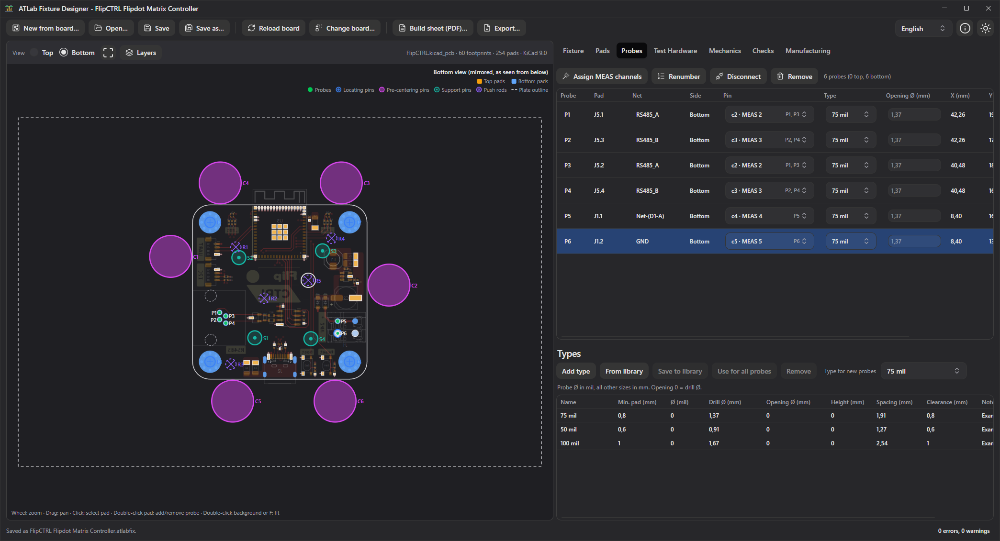

# 17. ATLab Fixture Designer

ATLab Fixture Designer designs a bed-of-nails fixture for the Test Interface Adapter from the KiCad board of the device under test. You choose which pads get a probe, from which side and with which kind of probe, and wire every probe to a pin of the test hardware. You also place the locating pins, pre-centering pins, support pins and push rods. The Fixture Designer checks the design for mistakes such as shorts between nets, probes that are too close together or pins that hit a component. It creates a build sheet for whoever builds the fixture and writes the drawings and 3D models of the plates. It is a separate program that is installed together with ATLab; it reads KiCad boards and never changes them.

## Requirements

- A KiCad board file (`.kicad_pcb`) saved by **KiCad 6 or newer**. Boards of KiCad 5 or older must be opened and saved again in a current KiCad version.
- The fixture is designed for the **compact Test Interface Adapter** (device ID `0xA101`) and its DUT connector J101 (DIN 41612, 3×32).

Start the Fixture Designer from the Start menu (**ATLab Fixture Designer**) or from the `FixtureDesigner` subfolder of the program folder (`ATLab.FixtureDesigner.exe`, on Linux `ATLab.FixtureDesigner`). The installer associates `.atlabfix` files with it, so a double-click on a fixture file opens it.

## Starting a fixture

Without an open fixture, the Fixture Designer shows a welcome screen with **New from board…** and **Open…**.

| Action | How |
|--------|-----|
| New fixture | **New from board…** or `Ctrl+N`, then select the `.kicad_pcb` file |
| Open a fixture | **Open…** or `Ctrl+O`, then select an `.atlabfix` file (a `.kicad_pcb` file starts a new fixture) |
| Drag & drop | Drop a fixture or board file onto the window |
| Command line | `ATLab.FixtureDesigner.exe <file>` opens the fixture or board at start |

A new fixture takes its name, device name and revision from the title block of the board. They can be changed on the **Fixture** tab.

## Working order

The tabs on the right follow the order of the work:

| Tab | What you do there |
|-----|-------------------|
| [Fixture](#fixture-tab) | Name, device, author and notes; the layers of the build sheet drawings |
| [Pads](#pads-tab) | Find the pads to probe |
| [Probes](#probes-tab) | Probe type and test hardware pin of every probe; the probe types |
| [Wiring](#wiring-tab) | Components between board and test hardware, and additional wiring |
| [Test Hardware](#test-hardware-tab) | The pins of J101 with their probes and nets |
| [Mechanics](#mechanics-tab) | Locating pins, pre-centering pins, support pins and push rods |
| [Checks](#checks) | The problems found in the design |
| [Manufacturing](#manufacturing-tab) | Plates, plate outlines and the export of the manufacturing files |

## The board view

The left side shows the board with its outline, pads and holes. The legend above the board lists what is drawn: probes, locating pins, pre-centering pins, support pins, push rods, the openings in the plates and the plate outline (dashed). Pads of the top side are orange, pads of the bottom side blue; the side that is not viewed is drawn faint.

| Option | Meaning |
|--------|---------|
| **Bottom** | The board seen from below, **mirrored**, as the plates under the board see it. This is the usual view for a bed of nails. |
| **Top** | The board seen from the top, as in KiCad. |

**Layers** opens the list of the board's KiCad layers: copper with tracks, vias and zones, silkscreen, solder mask, paste, fabrication, courtyard and the user layers, plus the top pads, bottom pads and holes. Tick the layers to show; **Show all** / **Hide all** switch all of them. Click a layer's color swatch to give it another color; **Default colors** restores KiCad's colors. Choice and colors are remembered for all boards. Pads, holes and both silkscreens are shown by default.

| Action | Effect |
|--------|--------|
| Mouse wheel | Zoom around the pointer |
| Drag | Pan; dragging a pin or push rod moves it |
| Click on a pad | Select the pad; all pads of its net are outlined. If the pad has a probe, the probe is selected too. |
| Double-click on a pad | Add a probe on the pad, or remove it. The probe comes from the viewed side; a pad without copper on that side gets its probe from the other side. |
| Click on the board in place mode | Place a part of the kind chosen on the [Mechanics](#mechanics-tab) tab |
| `Delete` | Remove the selected probe or part |
| `Esc` | End place mode |
| Double-click beside the board, `F` or the frame button | Show the whole board |

Point at a pad to see its reference, net, type and size and the probes on it, or at a hole to see its diameter and the locating pin in it. Probes of the viewed side are filled circles with their number (**P1**, **P2** …); probes from the other side are dashed. Locating pins are numbered **L1**, **L2** …, pre-centering pins **C1** …, support pins **S1** … and push rods **R1** …. A red probe or part has an error, an orange one a warning (see [Checks](#checks)).

## Fixture tab

Name, device, revision, author and notes of the fixture, as printed on the build sheet, plus the test hardware, the fixture file and the board file.

**Board layers…** chooses what the drawings of the [build sheet](#build-sheet) show of the board. There are four columns, one per kind of drawing: **Assembly | top**, **Assembly | bottom**, **Wiring | top** and **Wiring | bottom**. Tick a layer in a column to draw it there. The arrows change the order (the top of the list is drawn on top), the swatch the color, and the slider the opacity. Layers of the far side of the board are drawn dashed, as if seen through the board.

| Button | Effect |
|--------|--------|
| **Show all** / **Hide all** | Switch all layers in all columns |
| **Default style** | Default colors and opacity |
| **Default order** | Default drawing order |
| **Save as default** | Uses these layers for new fixtures and fixtures without a choice of their own |
| **Load default** | Takes over the layers saved as default |

By default, the assembly drawings show the pads, holes, silkscreen and courtyard of their side, and the wiring drawings show the pads, holes and silkscreen of their side.

## Pads tab

The list of all pads of the board, to find the pads to probe.

| Filter | Effect |
|--------|--------|
| Search | Reference, pad (`TP3.1`), net or footprint containing the text. `*` and `?` are wildcards (`TP*`), several terms must all match (`J1 GND`). The pads found are highlighted on the board. |
| **Test points only** | Pads of test point footprints: library name contains *TestPoint*, or the reference is `TP` followed by a number. On by default if the board has test points. |
| **With net only** | Hides pads without a net |

The column **Reachable** shows from which side a probe can touch the pad: copper on that side that is not covered by solder mask. **Add probe from bottom** / **Add probe from top** add a probe on the selected pad; a double-click on a row does the same as a double-click on the board.

## Probes tab

The probes of the fixture with their pad, net, side, test hardware pin, probe type, opening and position. The position is in millimeters from the **origin**: the drill/place file origin of the board if it is set in KiCad, otherwise the bottom left corner of the board outline. X points right and Y up, **as seen from the top**, also for probes from the bottom.

- **Pin**: the pin of J101 the probe is wired to. Every entry shows the pin and the resource behind it, e.g. `c7 · MEAS 7`, and the probes already wired to it.
- **Type**: the [probe type](#probe-types); new probes get the **Type for new probes**.
- **Opening Ø**: the hole the probe comes through in the moving plate (probes on the side facing the moving plate only). Leave it empty to use the opening of the probe type; enter a value for a probe that needs a bigger or smaller opening.
- **Note**: free text for the build sheet, e.g. "long stroke".
- **Additional connections**: what the [wires](#wiring-tab) connect to the probe besides its pin, e.g. `R1.1`.

| Button | Effect |
|--------|--------|
| **Assign MEAS channels** | Wires every probe without a pin to a matrix channel: a probe on a net that is already on a MEAS channel gets the same channel, the others the next free channel. MEAS 1 stays free, as it is usually reserved. |
| **Renumber** | Numbers the probes by side (top first), then row by row from the top left, as they are found on the drawing. |
| **Disconnect** | Removes the pin and the wires of the selected probe. |
| **Remove** | Removes the selected probe. |

Several probes on the same net may share a pin; they are simply wired in parallel.

### Probe types

A probe type describes a kind of spring probe with its receptacle. Its dimensions are used by the checks, the plate files and the bill of materials; take them from the data sheet of your probes. The probe diameter is in mil, as data sheets give it; all other sizes are in millimeters. The **Types** list below the probes shows the types of the fixture; edit the values directly in the table.

| Field | Meaning |
|-------|---------|
| **Name** | E.g. the series or part number |
| **Min. pad** | Smallest pad the tip hits reliably |
| **Ø (mil)** | Diameter of the probe |
| **Drill Ø** | Hole for the receptacle in the probe plate |
| **Opening Ø** | Hole the probe comes through in the moving plate; 0 = the drill diameter |
| **Height** | How far the probe stands out of the plate towards the board |
| **Spacing** | Smallest distance between the centers of two probes of one plate |
| **Clearance** | Smallest distance from the probe to another component of its side (its courtyard) |
| **Note** | Free text, e.g. the part numbers of probe and receptacle |

| Button | Effect |
|--------|--------|
| **Add type** | A new type with the values of the selected one |
| **From library** | Adds a type of your probe library, or updates the fixture's copy of it |
| **Save to library** | Stores the selected type in your probe library, for other fixtures |
| **Use for all probes** | Gives every probe of the fixture the selected type |
| **Remove** | Removes the type; its probes get the default type |

The fixture file contains its own copy of the types, so it is complete on its own and does not change when the library changes. A new fixture starts with the types of the library. Before you save the first type to the library, it contains three examples (100, 75 and 50 mil) whose values are typical, but not those of a particular manufacturer: check them against your data sheet.

## Wiring tab

Sometimes something sits between the board and the test hardware, e.g. a series resistor, a relay or a connector to another device. The **Wiring** tab describes it. The components only belong to the wiring and get no place on a plate.

**Components**: **Add component** adds a line with the designator `?` and the terminals `1, 2`. Enter the designator (R1, K1, U1 …), a description (value or part number, for the bill of materials) and the terminals, separated by commas. Terminals can have any name, e.g. `A1, A2, COM, NC, NO` for a relay or `VIN, VOUT, GND` for a module. **Not wired** shows the terminals without a wire.

**Wires**: every wire besides a probe's own pin. Each end is a probe, a pin of J101 or a component terminal. **Add wire** starts at the selected probe. Examples:

| From | To | Meaning |
|------|----|---------|
| P3 | R1.1 | Probe to a series resistor … |
| R1.2 | c7 | … and the resistor to MEAS 7 |
| P5 | P6 | Jumper between two probes |
| P8 | K1.COM | Probe to a relay contact |

A component does **not** connect its terminals. In the example, c7 is therefore not on the net of P3: the pin gets no net of the board, ATLab shows no net for it, and a short check does not look through R1. Only wires, a probe's pin and probe-to-probe jumpers join nets.

## Test Hardware tab

The pins of J101 lead to these resources of the Test Interface Adapter (see [Test Hardware Tab](04-test-hardware.md)):

| Resource | Pins | Use |
|----------|------|-----|
| **MEAS 1 … 32** | c1 … c32 | Matrix channels. Each can be switched to the H or L side of the measurement bus in a test step, so one channel per net is enough. |
| **STIM 1 … 16 In / Out** | b1 … b32 | The two contacts of a stimulation relay |
| **EXT STIM 1 … 4 H / L** | a3 … a10 | Outputs of the external stimulus relays (inputs on the interface connector) |
| **SENSE H / L** | a1, a2 | Sense lines of the measurement bus |
| **PROG 1 … 10** | a11 … a20 | 1:1 pass-through to the programming connector |
| **RS485**, **I²C**, **UART** | a21 … a32 | Isolated interfaces with signals, VREF and GND |

The tab lists every pin with its resource, signal, net and what is connected to it (probes, component terminals, other pins), and shows how many pins and matrix channels are used.

## Mechanics tab

Besides the probes, a fixture needs pins that position and hold the board:

| Part | Plate | Purpose |
|------|-------|---------|
| **Locating pin** (L) | Moving plate | Stands in a hole of the board, plated or not, and positions the board exactly |
| **Pre-centering pin** (C) | Moving plate | Stands beside the board edge and centers the board roughly while it is put in |
| **Support pin** (S) | Moving plate | The board rests on it, so it does not bend under the probes |
| **Push rod** (R) | Pressure plate | Presses the board down onto the probes |

Click the button of a kind (**Locating pin**, **Pre-centering pin**, **Support pin**, **Push rod**) and click on the board to place it; each click places another one until you press `Esc` or click the button again. Drag a part to move it, or type its **X** and **Y** in the list.

- A **locating pin** goes into a hole: click on or next to a hole of the board, and the pin snaps into it. When dragged, it snaps into the nearest hole, or back into its hole if there is none nearby.
- A **pre-centering pin** snaps beside the board edge, the **Edge gap** of its type away from it, so the board drops in freely.
- **Support pins** and **push rods** stay where they are placed. A push rod can have an **Opening Ø** of its own in the top probe plate, like a probe in the moving plate.

### Part types

The **Types** list below the parts works like the probe types: **Add type**, **From library**, **Save to library** and **Remove**. Every type has a **Kind**; a part can only get a type of its kind. All sizes are in millimeters.

| Field | Meaning |
|-------|---------|
| **Name** | E.g. the part number |
| **Kind** | Locating pin, pre-centering pin, support pin or push rod |
| **Ø** | Diameter where it touches the board |
| **Drill Ø** | Hole for it in its plate |
| **Opening Ø** | Push rods only: hole it comes through in the top probe plate; 0 = the drill diameter |
| **Edge gap** | Pre-centering pins only: gap between pin and board edge |
| **Height** | How far it stands out of the plate towards the board |
| **Clearance** | Smallest distance from its edge to a component of its side |
| **Note** | Free text |

## Checks

The checks run after every change. The **Checks** tab lists the results, the status bar shows the number of errors and warnings; click a result to select its probe or part.

| Severity | Check |
|----------|-------|
| Error | **Short:** the wiring joins probes on different nets, on one pin or through wires. |
| Error | A component has **no designator**, or two components have the **same designator**. |
| Error | A wire goes to a **terminal the component does not have** (e.g. after the terminals were edited). |
| Error | The pad has **no copper** on the side of the probe, or is **covered by solder mask** there. |
| Error | The pad **no longer exists** on the board, e.g. after a board change. |
| Error | Two probes on the **same pad** from the same side. |
| Error | Two probes of one plate are **closer** than the spacing of their probe types. |
| Error | A locating pin is **not in a hole**, or **does not fit** into it. |
| Error | The opening of a probe in the moving plate **overlaps the hole of a locating pin**. |
| Error | A pre-centering pin **overlaps the board**. |
| Error | A support pin or push rod is **not under the board**, or **touches a component**. |
| Error | The type of a part has **no drill diameter**. |
| Warning | A probe is **not wired**: it has no pin and no wire. |
| Warning | A component or some of its **terminals are not wired**, or it has no terminals. |
| Warning | A wire does **not have both ends**, or leads back to where it starts. |
| Warning | A probe or part has **no type**, or a probe type has no drill diameter. |
| Warning | The pad is **smaller** than the minimum pad of the probe type. |
| Warning | A probe lies **on or near another component** of its side: closer to its courtyard than the clearance of the probe type. The footprint of the probed pad itself does not count. |
| Warning | A part is **closer to a component** than the clearance of its type. |
| Warning | A pre-centering pin is not the **edge gap** of its type away from the board edge. |
| Warning | The pad has **no net**. |
| Warning | One net is on **several MEAS channels**. |
| Warning | An **interface** is only partly wired: an isolated interface needs all its lines from the device, including VREF and GND. |
| Warning | An **external stimulus** has only its H or only its L line wired. |
| Warning | The **net** or the **position** of a pad changed since the fixture was saved. |
| Note | A **stimulation channel** has only one of its contacts wired: the other must be wired inside the fixture, e.g. to a supply. |
| Note | The board file changed since the fixture was saved. |

## Manufacturing tab

### Plates

A bed-of-nails fixture consists of several plates. From the bottom up:

| Plate | Contents |
|-------|----------|
| **Bottom probe plate** | The receptacles of the probes from below |
| **Moving plate** | The board lies on it. Holes for the locating, pre-centering and support pins, and openings the probes from below come through. |
| **Top probe plate** | The receptacles of the probes from above, and openings the push rods come through. Only needed with probes from above. |
| **Pressure plate** | The push rods |

The list shows every plate with its size and contents (probe holes, openings, pin and rod holes, frame holes, cut-outs). Enter the **Thickness** of every plate for the STEP files. Openings that overlap or leave less than 0.2 mm of material between them are merged into one opening; the list shows how many.

**Board upside down** is for a board that lies in the fixture with its top side down. Then the probes on the top side go into the bottom probe plate, the pins touch the top side and the push rods the bottom side.

Problems that prevent making a plate are listed below the plates: a hole without drill diameter, holes that overlap, or holes too close to the plate edge or to a cut-out.

### Outline

All plates share one outline, unless a plate has **Own outline** ticked. With own outlines, **Edit outline of** selects which outline the settings below change: the shared one or that of a plate.

| Plate outline | Meaning |
|---------------|---------|
| **Board outline + margin** | The board outline enlarged by the **Plate margin** |
| **Fixed size** | A rectangle of **Width** × **Height** |
| **DXF file** / **SVG file** | The outline from a drawing, e.g. of the fixture housing. **Choose…** selects the file, the refresh button reads it again. |
| **Board layer** | The outline drawn on a layer of the board in KiCad, e.g. `User.1`, `Dwgs.User` or `Margin` |

A fixed size or an outline from a file or layer is centered on the board; **Offset X** / **Offset Y** move it from there. In a drawing, the largest closed contour becomes the outline, closed contours inside it become **cut-outs**, and circles inside it become **frame holes**, e.g. for the screws of the plate. Arcs stay arcs. DXF files may use lines, arcs, circles, polylines, ellipses and splines; the unit comes from the file (millimeters if it has none). SVG files may use paths and all basic shapes. Below the settings, a line shows the size of the plate and the number of frame holes and cut-outs, or what could not be used.

### Export

**Export…** (`Ctrl+E`) writes the manufacturing files into a folder. Tick the files and plates to write; the choice is remembered.

| File | Content |
|------|---------|
| **Drawing (DXF)** | DXF R12 for CAM and CAD, in millimeters. Only what is machined: the plate outline as one closed polyline, the holes as circles on one layer per kind (`PLATE_OUTLINE`, `PROBE_HOLES`, `PROBE_OPENINGS`, `LOCATING_PIN_HOLES`, `PRE_CENTERING_PINS`, `SUPPORT_PINS`, `PUSH_RODS`, `PUSH_ROD_OPENINGS`, `FRAME_HOLES`, `CUTOUTS`), so each can get its tool. |
| **Drawing (SVG)** | The same as SVG, e.g. for laser cutters and Inkscape: one group (Inkscape layer) per kind, hairlines without fill |
| **3D model (STEP)** | The plate as a solid with its thickness, holes and cut-outs, side facing the board at Z = 0 |

The files are named `<fixture> - <plate>`, e.g. `Power board - moving plate.dxf`. Every file shows its plate **as seen from the side facing the board**: the plates below the board from above, the plates above the board from below, i.e. mirrored left to right. The coordinates are in millimeters from the origin of the build sheet. The files are not written while a plate has problems; the message lists them. Existing files are only replaced after asking.

## When the board changes

The fixture refers to pads by footprint reference and pad number (e.g. `TP12.1`), so a changed board keeps the probes on their pads.

- **Reload board** (`F5`) reads the board file again, e.g. after editing it in KiCad.
- **Change board…** uses another board file, e.g. a new revision of the device.

Positions and nets always come from the current board file. The checks then report probes whose pad moved, changed its net or disappeared, compared with the state when the fixture was last saved.

## Build sheet

**Build sheet (PDF)…** (`Ctrl+P`) creates a PDF (A4 landscape) in the order of the work:

- fixture and board information, including the checksum of the board file, the board position (upside down or not) and the meaning of the coordinates,
- the **bill of materials**: every probe type and part type with its quantity, diameter, drill, opening and height, and the components of the wiring by description with their note,
- the **probe list**: probe, pad, net, side, position, pad type and size, probe type, pin, resource and note,
- the list of **pins and push rods** with kind, type, position and plate,
- the **wiring**: every wire to make, with both ends and the note, and the side of its probes if the fixture probes from both sides: first each probe to its pin (sorted by pin), then the wires of the [Wiring tab](#wiring-tab) under their names there (W1, W2 …). Left out if the fixture has no wiring.
- an **assembly drawing** of every side with probes or parts: the plates of that side with their outlines and openings, the probes and parts, seen from the side where they touch the board (the plates above from the top, the plates below from below, mirrored). Different plates are drawn in different colors and line styles, explained in a legend.
- a **wiring drawing** of every probe plate, seen from its outside where the wires go.

Bill of materials, probe list, parts list and wiring have a **Done** box to tick off while building. The board layers of the drawings are chosen on the [Fixture tab](#fixture-tab). If the checks found errors, the Fixture Designer asks before exporting.

## Fixture file

A fixture is saved as an `.atlabfix` file (`Ctrl+S`, **Save as…** `Ctrl+Shift+S`): plain JSON like ATLab's project files, well suited for version control. It contains:

- the fixture information and the test hardware,
- the path of the board file (relative to the fixture file if both are on the same drive) and its checksum,
- the probe types and part types,
- every probe with its number, pad, side, probe type, pin, opening and note, and the net and position the pad had when saved,
- every part with its kind, type, position and opening,
- the components of the wiring and the additional wires,
- the plate outlines (with a copy of imported drawings, so the fixture stays complete when the drawing is moved), the plate thicknesses and the board position,
- the layers of the build sheet drawings.

If the board file is not found when opening a fixture, the Fixture Designer asks for its new location. When closing or opening another fixture with unsaved changes, it asks whether to save them.

## Using the fixture in ATLab

In ATLab, **Import fixture…** in the [Board and Nets](06-configuration.md#board-and-nets) panel takes over the board, the net on every wired test hardware pin and the probe positions of a fixture. A pin wired to the board only through a component of the fixture gets no net. The [board view](14-running-tests.md#board-view) of the Test Execution tab then shows for every step where it connects to the board, including the probes. On request the nets also become the channel labels of the project.

## Language, theme, colors and about

The language (English, German) and the light or dark theme are switched in the toolbar and remembered. On the first start the Fixture Designer takes over the language and theme of ATLab. The palette button sets the colors of the probes, locating, pre-centering and support pins, push rods and the outlines of the probe plates, moving plate and pressure plate. They apply to the board view and the build sheet drawings and are remembered; **Default colors** restores them. The plate files (DXF, SVG) are always black. The ⓘ button shows version, build and system information.
